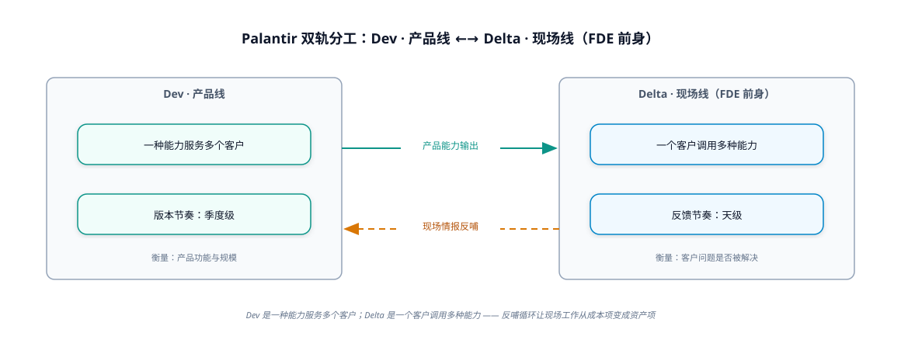
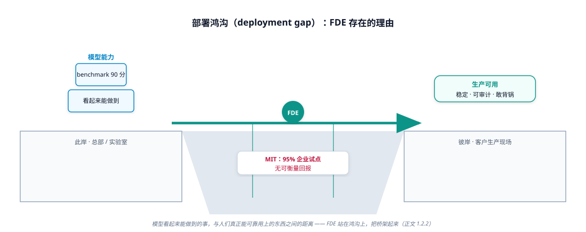
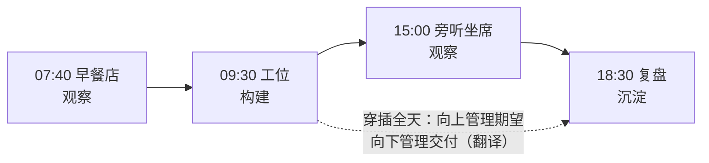
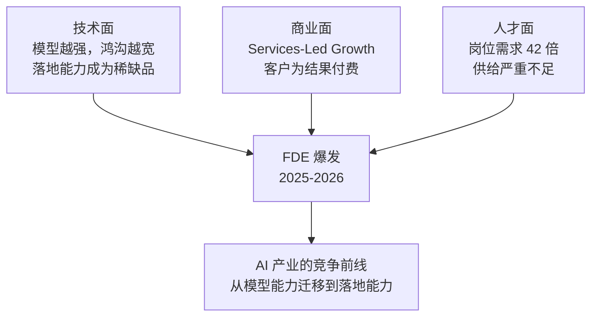
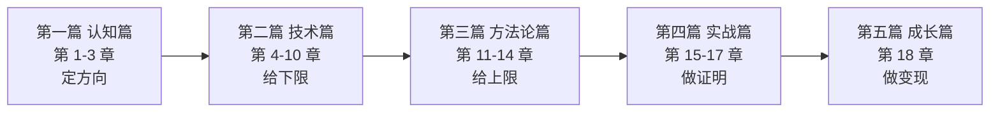

# 第 1 章 FDE 是什么：从 Palantir 阿富汗战场到 OpenAI 部署鸿沟

> **本章导读**：本章解决一个问题——FDE（Forward Deployed Engineer，前沿部署工程师）到底是什么。方法是回到它的起源现场（2008 年前后的阿富汗战场），沿着 Palantir、OpenAI、Anthropic 的一手公开材料，把定义、分工、工作形态和爆发的市场数据讲清楚。读完的产出：你能向任何人解释这个岗位，判断一份 JD 的真伪，并通过一个五信号自测判断自己适不适合干这一行。不需要任何技术基础。


---

## 1.1 一个被战场逼出来的岗位

要理解 FDE，最好的起点不是招聘 JD，是十多年前阿富汗山区的两台电脑。

### 1.1.1 战场上的软件危机

时间回到 2008 年前后。美军在阿富汗的反叛乱作战（counterinsurgency）遇到一个说出来有点荒诞的困境：**情报太多了，但没有一条能用**。

前线无人机在拍，巡逻队在记，线人在报，卫星在扫。数据源源不断涌进指挥室，然后躺在互不相通的数据库里，由不同部门用不同软件各自看管。一个连级指挥官想搞清楚"过去 72 小时，这条路上的简易爆炸装置出现在哪、和哪个部落的活动重合"，他缺的不是数据，是有人把这些数据拼成一张能看的图。

当时的软件公司怎么应对？传统流程：售前谈需求，回总部写代码，半年后交付，前线发现根本不是这个需求，再来一轮。在战场节奏面前，这套流程慢得像用信鸽传令。

一家当时还默默无闻的创业公司接下了这个活，公司名叫 Palantir。他们做了一个当年看来相当叛逆的决定：**不回总部写代码，把工程师直接派到现场去**。

2010 年前后，Palantir 的工程师随美军特种部队进驻阿富汗。白天，他们坐在特种作战指挥室里，看指挥官皱着眉头切换七个系统；晚上，连夜改代码，第二天一早把新版本摆到使用者面前。反馈周期从"一个季度"压缩到"一个晚上"。

这个决定后来被反复证明是 Palantir 成功的根基。如今这家公司市值数千亿美元。

### 1.1.2 Dev 与 Delta：一个分工，两种人生

驻场这件事很快暴露出一个矛盾：现场要的代码是"快而定制"的，产品要的代码是"慢而通用"的。让同一拨人同时干两件事，结果一定是两头都不讨好。

于是 Palantir 把工程师分成了两条战线，内部代号分别是 **Dev** 和 **Delta**：

| | Dev（开发工程师） | Delta（即后来的 FDE） |
|---|---|---|
| 服务对象 | 所有客户共用的产品 | 一个具体客户的具体问题 |
| 工作哲学 | 一种能力服务多个客户 | 一个客户调用多种能力 |
| 节奏 | 按版本发布，季度级 | 按现场反馈，天级 |
| 衡量标准 | 产品功能与规模 | 客户问题是否被解决 |
| 工作地点 | 总部 | 客户现场 |



*图 1-1 Dev/Delta 分工与代谢循环（源文件 `assets/diagrams/dev-delta-light.drawio`，视觉规范见 `docs/writing-style.md` 第 5 节）*

正式职位名叫 **Forward Deployed Software Engineer（FDSE，前沿部署软件工程师）**。"Forward Deployed"这两个词是标准军事术语，指把兵力前置于战场，而不是坐在大后方等信息回传。平移到软件行业：

- 传统软件公司让需求"向后走"到总部，信息在传递中失真；
- FDE 模式让工程师"向前走"到问题发生的地方，信息零损耗。

这套 Dev/Delta 双轨制后来成为整个硅谷 B 端软件的参照系。第 12 章会看到，OpenAI 的方法论本质上是它的工程化展开。

### 1.1.3 "消化痛苦，排出产品"

Palantir CTO Shyam Sankar 给这份工作留下一句流传甚广的描述：

> **"Eat pain, excrete product."**
> **（消化痛苦，排出产品。）**

这句话粗鲁，但值得逐字咀嚼。

Eat pain（消化痛苦）：FDE 吞下的是客户现场最真实的痛苦。对接一个 15 年没更新文档的 ERP，处理一份盖了红章的扫描件，安抚一个被上一任供应商坑过的业务负责人。这些活没法写进周报美化，只能亲自吞下去。

Excrete product（排出产品）：吞下去的痛苦不会白吞。每个现场踩过的坑，都会变成产品的下一个功能、一条新的配置项、一份新的行业模板。痛苦是原料，产品是产出。

这个代谢循环解释了一个反直觉的事实：**2016 年之前的大多数时间里，Palantir 的 Delta 人数一度超过 Dev**。一家以软件产品著称的公司，最大的工程师群体竟然是驻场的。因为 Palantir 想明白了一件事：__**客户付钱买的不是软件，是痛苦的消失**__。谁离痛苦最近，谁就离收入最近。

这段历史还留下三个行业基因，全书会反复出现。**驻场是老手艺**：FDE 这个名字出现之前，ERP 实施顾问、解决方案架构师就在干"把技术焊进客户业务"的活，Palantir 的创新不是发明驻场，是发明了驻场与产品的代谢循环，把现场工作从成本项变成资产项。**分工是生存术**：Palantir 早期差点被现场需求吃死，所有工程师被拉去驻场，产品无人维护，双轨制是把"救火"制度化成"消防系统"的关键一步。**神秘感是双刃剑**："精英岗位"的声望把很多适合的人挡在门外，本书的一个隐性使命就是破除这个迷思，__**FDE 是一门可学的方法论，不是一种天赋**__，十八个章节就是证据。

### 1.1.4 起源故事的三个启示

把这个故事浓缩成三条，后面全书会反复回响：

1. **反馈距离决定交付质量**。信息每多传一手就失真一分，FDE 的核心动作是把工程师搬运到信息源头。
2. **"快而定制"与"慢而通用"必须分工**。混淆两者，是无数 To B 团队效率灾难的根源（第 14 章讲怎么把定制收敛回通用）。
3. **痛苦是产品最好的需求来源**。现场不是产品的负担，是产品的传感器（第 14 章"反哺"）。

---

## 1.2 FDE 的现代定义

故事讲完了，现在给出这本书通用的严格定义。

### 1.2.1 一个定义公式

__**FDE = 工程能力 × 业务理解 × 现场交付 × 结果责任**__

这不是四个技能的堆砌，是一个乘法，任何一项为零，整体归零：

- 只有**工程能力**，你是远程算法工程师：模型调得很好，但不知道客户为什么需要它；
- 只有**业务理解**，你是咨询顾问：方案讲得漂亮，落不了地；
- 加上**现场交付**，你已经很接近了，还差最后一项；
- **结果责任**是 FDE 与一切"类 FDE"岗位的分水岭。你考核的不是"系统上线了"，是"指标变了"：调试时间省没省，转人工率降没降。客户嘴上说得客气，验收报告上见真章。

第 2 章会用一整章把这个定义和驻场工程师、交付顾问、AI 工程师逐一对比。那套判别能力在你求职时很值钱。

### 1.2.2 部署鸿沟：FDE 存在的理由

2026 年 10 月，OpenAI 的 FDE 团队负责人 Colin Jarvis 在官方博客发表长文《What FDE means at OpenAI》，给出了一个注定要写进行业词典的概念，**部署鸿沟（deployment gap）**：

> 模型**看起来能做到**的事，与人们在工作中**真正能可靠用上**的东西之间的距离。

这个概念是理解 AI 落地产业的钥匙，具象化如下：



*图 1-2 部署鸿沟（源文件 `assets/diagrams/deployment-gap.drawio`）*

鸿沟是怎么拉开的？MIT 一项覆盖多家大型企业的报告给出了刺眼的数字：**约 95% 的企业从生成式 AI 试点中没能拿到可衡量的回报**（ProjectNANDA《The GenAI Divide》，2025）。不是模型不行，是模型到了现场就"水土不服"：

- 企业文档是扫描件、多 Sheet Excel、盖红章的合同，模型训练时没见过；
- 关键数据锁在权限森严的内部系统里，模型够不着；
- 业务方的验收标准是"敢让我背 KPI"，demo 里 95% 的准确率远远不够；
- 出了错要能定位、追溯、回滚，纯 prompt 答案做不到。

FDE 的全部工作，一言以蔽之：**站在部署鸿沟上，把桥架起来**。第 3 章会用数据证明，这条鸿沟正是 2025-2026 年 FDE 岗位需求暴涨 42 倍的根本原因。

### 1.2.3 词源考：为什么叫"前沿部署"

"Forward Deployed"借自军事术语 **Forward Deployed Forces（前沿部署兵力）**：平时驻扎在潜在冲突地区附近的部队，冲突一爆发，响应以小时计，而不是把部队从本土海运一个月。

平移到软件行业，每一层都有对应：

| 军事概念 | FDE 对应 |
|---|---|
| 前沿阵地 | 客户生产环境与业务现场 |
| 敌情 | 真实需求与现场约束 |
| 前置兵力 | 常驻工程师 |
| 响应以小时计 | 当天反馈当天改 |
| 前哨传感器 | 反哺给总部的产品情报 |

词源考还有个实用好处：面试时被问"你如何理解 Forward Deployed"，可以从军事隐喻讲到信息保真度。这是候选人拉开差距的回答（第 18 章会完整演练）。

顺带解决一个中文读者的命名困惑。这个词的译法至今没有统一，前沿部署工程师、前线部署工程师、前置部署工程师、驻场 AI 工程师在媒体与 JD 里并存（本书统一用"前沿部署工程师"，取军事术语的标准中译）。对求职者的建议：简历与沟通中中英并用，四个字的译名差异不重要，重要的是你的听众此刻是否明白你在说什么。当对方眼神开始游移，切英文缩写通常能把话题拉回频道。

---

## 1.3 FDE 的典型一天

定义是抽象的。换个方式，跟踪一位 FDE 的完整一天。这是本书虚构的角色林舟，28 岁，某 AI 公司 FDE，驻场一家电信运营商。三个加粗时间点，对应 FDE 的三种核心状态。

### 1.3.1 一天纪实

**07:40，客户楼下早餐店。** 林舟没去公司食堂，在客户办公楼下的早餐店坐下，和客服中心的张班长约好一起吃早餐。昨晚系统把一通投诉电话分流错了，他要搞清楚接线员当时真实的操作路径。张班长边吃边演示：他们看到 AI 摘要有三秒钟，扫一眼没把握就转人工。"不是 AI 答错了，是我们的摘要第一行没说到用户在意的点上。"这个洞察，远程开发者做一百次线上问卷也拿不到。

**09:30，工位，两种角色切换。** 上午写代码。客户侧 IT 提了个新需求：IVR 里要能查副卡话费。林舟评估后判断这是"定制里藏着通用"的需求，副卡查询本质是"多实体归属查询"，写进通用 harness 只需要一次参数化改造（这个判断能力，正是第 12 章要训练的）。上午十一点，客户业务负责人路过，问"隔壁省那个案例你们什么时候能给我们上"。林舟用五分钟讲清排期和验收标准。**对上管理期望，对下管理交付**，FDE 在组织结构上没有一兵一卒，却要让两边的部门都动起来。

**15:00，旁听坐席。** 下午三点是每天的固定动作：旁听半小时真实来电。今天他听到一位老年用户反复说"我的话费怎么多了"，AI 三次回答套餐明细都答非所问，因为老人说的"话费"其实是"流量费"。林舟在本子上记下：**口语歧义，查询改写需要口语化映射表**。晚上他会把这个 case 加进评估集（第 10 章），而不是拍脑袋改 prompt。

**18:30，复盘与明天。** 六点半，林舟整理今天的三条收获进项目知识库：摘要首行策略、多实体归属查询、口语映射表。然后给公司产品团队写了一条反哺提案（第 14 章的模板）：三个客户现场都出现了"口语到术语"的映射需求，建议做成产品级配置项。写完这条，他收拾电脑。明天上午要给客户 IT 团队做交接培训，运维手册还差最后一章。

### 1.3.2 从这一天读出 FDE 的能力结构

拆开这一天，是四个动词，恰好对应定义公式的四项：



| 时间 | 动作 | 对应能力 |
|---|---|---|
| 早餐店 + 旁听坐席 | **观察** | 业务理解：到信息源头去 |
| 工位写代码 | **构建** | 工程能力：现场也能快速写出生产代码 |
| 五分钟讲清排期 | **翻译** | 双向翻译：把技术说给业务听，把业务说给模型听 |
| 反哺提案 + 交接培训 | **沉淀** | 结果责任：让价值在离开你之后继续存在 |

再对比远程开发者的一天：站会、写码、code review，闭环在工单系统里。两种工作没有高下之分。读完 1.3.1 如果感到的是兴奋，说明你和这个岗位的性格是匹配的；感到的是恐惧，也不亏，提前知道比入职后才知道好。

### 1.3.3 适配性自测：你应该做 FDE 吗

在读到第 18 章的职业选择之前，先给自己做一个五信号自测。每个信号答"是/否"，不评判，只对照（源自公开 JD 与从业者访谈的共性归纳）：

1. **模糊耐受**：客户说"我们想要点 AI"，你的第一反应是兴奋（有得挖），还是不适（能不能先给我需求文档）？FDE 的日常 70% 在模糊里度过。第 11 章教把模糊变清晰的手艺，但手艺治不了生理性的模糊厌恶。
2. **对话能耗**：一天开四场会后你还能写代码吗？注意不是"能不能撑"，是"是否还有产出"。FDE 的日程表里对话与编码交错，两边的能耗曲线都要平缓。
3. **他人信用**：过往的同事会怎么描述你，"技术强"，还是"靠谱、能扛事"？FDE 的信任来自后者，技术只是入场券。
4. **旅行体质**：一年 100 天差旅对你意味着什么？Anthropic 的 JD 白纸黑字写着 25% 差旅。身体与家庭两本账都要算。
5. **不完美交付容忍**：你能接受"80 分上线、下周迭代"吗？第 13 章 30 天节奏的哲学是先结果后完善，完美主义者在这套节奏里会痛苦。

五个信号四正一负是良好匹配，那个负项用体系与习惯补。三正两负，值得用实习或小项目试水再定。两正三负，本书其余部分依然对你有用（AI 工程能力与交付方法论是通用资产），但以 FDE 为职业需要慎重。**自测的意义不是劝退，是诚实**：这个岗位的稀缺溢价，恰恰来自它筛掉的那部分性格。

---

## 1.4 为什么是 2025-2026：三股力量的合流

Palantir 的模式存在了近二十年。为什么偏偏是 2025 年之后 FDE 才突然爆发？答案是三股力量在这一刻合流。

### 1.4.1 技术面：模型越强，鸿沟越宽

第一个力量是模型能力的暴涨。GPT-4 之后，前沿模型在基准测试上的表现逼近甚至超越人类专家。

吊诡的是，**模型越强，部署鸿沟反而越宽**。原因不难理解：

- 模型 60 分的时候，客户不指望它能用，鸿沟虽窄但大家根本不想跨；
- 模型 95 分的时候，客户开始真金白银地投入，于是那"差 5 分"暴露出的可靠性、审计、集成问题第一次变得致命。

MIT 那个 95% 失败率的数据，反过来读就是：**企业买 AI 的意愿已被模型能力充分点燃，落地能力完全没有跟上**。需求端在鸿沟此岸疯狂堆人头，彼岸无人架桥。

### 1.4.2 商业面：从卖软件到卖交付

第二个力量在商业侧。2025 年 6 月，风投机构 a16z 发表《Services-Led Growth》，直接把 FDE 称为"**创业公司里最热的岗位（the hottest job in startups）**"。这不是修辞，它描述的是一场定价模型的迁移：

- **传统软件逻辑（Software-Led）**：卖标准产品，交付成本趋近于零，边际利润极高，定制空间小；
- **服务驱动逻辑（Services-Led）**：用交付服务把模型能力"翻译"成客户要的业务结果，客单价可以高一个数量级。因为客户买的不再是工具，是结果的保证。

巨头的动作更直白。OpenAI 联手 19 家私募基金投入超过 40 亿美元成立专门做企业落地的 Deployment Company，收购落地服务商 Tomoro 时带走了 150 名 FDE；Anthropic 宣布投入 1 亿美元、到 2027 年底前培养 1 万名 FDE；AWS 投入 10 亿美元组建 Forward Deployed Engineering 部门。三家头部实验室同时为一个岗位下重注，关于它是不是炒作的争论可以结束了，剩下的争论只有一个：谁做得好。

### 1.4.3 人才面：42 倍

第三个力量可以用一个数字概括。领英 2026 年 1 月的报告显示：2023-2025 年间，FDE 相关新增岗位增长了 **42 倍**。作为对照，同期 AI 工程师岗位"只"增长了 13 倍。

再补几个同口径可查的数字，感受一下这条曲线的斜率：

- Indeed 平台 FDE 岗位招聘需求，2025 年前 9 个月同比激增超 800%；
- Y Combinator 招聘网站上超过 100 家 AI Agent 创业公司在招 FDE，这个数字两三年前是 **0**；
- 在中国，工信部 2026 年 8 月发文首次将 FDE 写入国家部委文件，工信部电标院与联想联合推出业内首个 FDE 权威认证，上海提出 FDE"百千万"工程，政策热度与硅谷同频；
- 薪酬随之水涨船高：猎聘专项报告显示国内 FDE 平均年薪 40.8 万元，成熟 FDE 普遍 60-120 万元；美国前沿实验室资深 FDE 总薪酬中位数约 48.5 万美元。

第 3 章会把这些数字背后的机制讲透，并回答一个冷静的问题：这个热度是可持续的，还是又一个泡沫？（先给本书的判断：岗位名称可能潮起潮落，"工程、业务、交付、结果"的能力组合在 AI 时代只会越来越值钱。）

### 1.4.4 合流图景



这张图里还有一条暗线：**FDE 的爆发不是孤立的岗位现象，是 AI 产业竞争前线迁移的信号**。当各家的模型能力在基准上趋于同质，竞争前线就移到了落地能力，谁交付得了结果，谁拿到订单。FDE 恰好站在这条新前线的最前沿。这不是风口上的运气，是产业结构的必然。也正因为它在结构上而不是风口上，本书才敢把全部篇幅押在"这套能力值得系统学习"上。

---

## 1.5 本书地图：五篇如何构成一个整体

进入第 2 章之前，花一页纸看清全书的路线图。



- **第一篇（认知篇，第 1-3 章）**：建立坐标。FDE 是什么、不是什么、为什么是现在。读完这三章，你能对任何一份 FDE JD 做出专业判断。
- **第二篇（技术篇，第 4-10 章）**：锻造武器。从调第一个 API，到写出 MCP Server，再到把系统部署进客户机房并通过评估。零基础按序读完即可，有经验者可跳到第 7、10 章。
- **第三篇（方法论篇，第 11-14 章）**：交付的艺术。需求考古、OpenAI 四原则、30 天节奏、沉淀与反哺。这是区分"会技术"与"会交付"的四章。
- **第四篇（实战篇，第 15-17 章）**：三个完整项目，把前三篇的知识在仿真场景里全部串起来，每个项目都提供可运行的代码骨架。
- **第五篇（成长篇，第 18 章）**：把能力兑换成职业。简历、作品集、面试与专家之路。

各篇的关系可以这样记：**认知定方向，技术给下限，方法论给上限，实战做证明，成长做变现**。

### 1.5.1 三种读法

本书为三类读者准备了三种打开方式。

**学生读法（线性）**：从本章读到第 18 章，每章工具跑通再前进，约 12-16 周（每周 6-8 小时），目标是 L1-L2 段位与一个可讲述的校园交付。

**工程师读法（跳跃）**：第 1-3 章快速过，直奔第 7、10、11、12 四章（协议、评估、考古、原则，转型 FDE 的最小四件套），再按第 15 章项目补漏，建议总时长 6 周。

**管理者读法（抽样）**：读第 1、2、3、11、13、14 六章（认知、判别、数据、需求、节奏、沉淀，建团队与做决策所需），跳过全部代码。本书对你是"怎么管理 FDE"的书。

三种读法在 18.2.2 的段位自查表里殊途同归。另外，**所有读者都该跑一遍 `examples/ch01` 的部署鸿沟实验**，它是一切的起点，也是唯一一个五分钟就能改变你对 AI 落地认知的实验。

---

## 本章知识点卡

| 概念 | 一句话解释 | 关键词 |
|---|---|---|
| FDE | 常驻客户现场、对交付结果负责的复合型工程师 | Forward Deployed Engineer |
| Delta / Dev | 一个客户调用多种能力 / 一种能力服务多个客户 | Palantir 分工 |
| 部署鸿沟 | 模型看起来能做到的事，与人们真正能可靠用上的东西之间的距离 | deployment gap |
| Eat pain, excrete product | 消化客户现场的痛苦，产出可复用的产品 | Shyam Sankar |
| 前沿部署 | 兵力前置到战场：工程师前置到信息源头 | 军事词源 |
| Services-Led Growth | 用交付服务带动产品增长的商业策略 | a16z |
| 42 倍 | 2023-2025 年 FDE 新增岗位增长倍数（领英口径） | 人才市场 |
| 结果责任 | 考核"指标变了"而不是"系统上线了" | FDE 分水岭 |
| 五信号自测 | 模糊耐受/对话能耗/他人信用/旅行体质/不完美容忍 | 选对战场 |
| 三种读法 | 学生线性/工程师跳跃/管理者抽样，18.2.2 殊途同归 | 阅读契约 |

---

## 代码实战：亲眼看见部署鸿沟

本章示例在 `examples/ch01/`，不依赖任何框架，唯一的目标是让你**亲手量出部署鸿沟的宽度**。

- `01_see_the_gap.py`：让模型回答一个虚构公司的内部制度问题。两次实验，① 不给任何资料，看模型如何"自信地编造"；② 注入内部文档片段，看它如何变成可靠的回答。运行后你会得到一个输出对照表。
- `README.md`：运行说明（Python 3.10+，`OPENAI_API_KEY` 环境变量，可选 `--mock` 模式无 Key 体验录制好的输出）。

```bash
cd examples/ch01
export OPENAI_API_KEY=sk-xxx   # 也可用任意 OpenAI 兼容服务
python 01_see_the_gap.py
# 或无需 API Key：
python 01_see_the_gap.py --mock
```

看完输出请回答一个问题（不需要标准答案）：**鸿沟里到底缺了什么？** 你的答案会随着第 4-10 章的学习逐步修正。这正是本书的学习方法：先看见问题，再学习工具，最后亲手解决问题。

---

## 章末习题

1. **概念内化**：用自己的话向一位非技术朋友解释"Dev 是一种能力服务多个客户，Delta 是一个客户调用多种能力"。限制条件：不许使用"赋能""抓手""闭环"等黑话。对方听懂了并且能复述出来，这道题才算通过。
2. **JD 判别**：在招聘网站找 3 份挂着"FDE"或"前沿部署工程师"头衔的 JD，逐条对照本章的定义公式（工程能力/业务理解/现场交付/结果责任）打分。预告：第 2 章会给出更锋利的"四条标准"和七个反向面试问题，你可以先用自己的直觉打一次分，读完第 2 章再复评。
3. **思考题**：为什么模型越强，部署鸿沟反而可能越宽？提示：从"客户期望的变化"和"容错空间的变化"两个角度分别思考。把你的答案写下来，读完第 3 章后对照 MIT 95% 数据验证。

---

## 参考资料

- 36氪《硅谷最火岗位来了，100+家AI公司疯抢fde，连openai都下场招人》（Palantir 起源故事与 Dev/Delta 分工）：https://36kr.com/p/3477432643132036
- OpenAI《What FDE means at OpenAI》官方博客（2026-10-22）及中文全译（部署鸿沟、四原则原始出处）：https://news.qq.com/rain/a/20261023A00XPA00
- Palantir Careers（FDSE、Forward Deployed Infrastructure Engineer 等岗位至今在招）：https://www.palantir.com/careers/
- 腾讯新闻《爆火的FDE，跟驻场工程师有啥区别？》（"Forward Deployed"军事词源）：https://news.qq.com/rain/a/20261023A0EA0M00
- MIT ProjectNANDA《The GenAI Divide》（95% 无可衡量回报数据）：见第 3 章参考文献全集
- 领英《全球劳动力市场趋势洞察报告》（42 倍数据口径）
- a16z《Services-Led Growth》：https://a16z.com/services-led-growth/
- 百度百科《前沿部署工程师》词条（中文概念综述）：https://baike.baidu.com/item/前沿部署工程师/67210086

> 下一章预告：市场上大量岗位挂着 FDE 的名头，干的却是传统驻场外包的活。第 2 章建立"真 FDE 四条标准"，教你一眼看穿 JD 里的 FDE 包装术。
