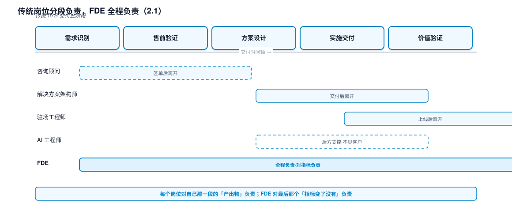

# 第 2 章 FDE 不是什么：与驻场工程师、交付顾问、AI 工程师的本质区别

> **本章导读**：市场上大量岗位挂着 FDE 的名头，干的却是传统驻场外包的活——FDE 火起来之后，"挂头衔"几乎成了一种招聘营销。本章帮你建立"真 FDE 四条标准"，既能识别真岗位，也能识别假岗位；既能让你求职时避开外包陷阱，也能让你作为管理者判断自己的团队要不要设这个岗。读完本章，你将能一眼看穿 JD 里的"FDE 包装术"。


---

## 2.1 一字之差的岗位家族

打开任何一个招聘 App，搜索"前沿部署工程师"，你会发现一个奇怪的现象：同样叫 FDE，有的岗位年薪百万、跟随模型厂商冲锋陷阵；有的岗位月薪八千、常年驻扎客户机房拧网线。头衔完全一样，内容天差地别。

要看清这个现象，得先把 B 端交付链条上的一整族岗位摆到同一张桌子上。这些岗位的名字都很像，但他们在项目生命周期中的**介入时点**、**产出物**和**负责边界**完全不同：

| 岗位 | 核心职责 | 典型产出物 | 与 FDE 的关键差异 |
|---|---|---|---|
| 售前/交付顾问 | 讲方案、做 PPT、协助签单 | 方案文档、投标材料 | 不落地，不写代码，签完就走 |
| 驻场工程师/实施工程师 | 按既定方案安装、配置、培训 | 上线记录、培训签到表 | 不写生产代码，不对业务结果负责 |
| 解决方案架构师 | 设计整体技术架构 | 架构图、选型报告 | 不负责交付闭环与结果 |
| AI 工程师/算法工程师 | 训模型、调优、建基础设施 | 模型、数据管道、推理服务 | 不在客户现场，不管业务闭环 |
| **FDE** | **现场调研→搭系统→上线→出业务结果→反哺产品** | **可运行的生产系统 + 结果报告 + 沉淀资产** | **四者交集 + 结果责任** |

对这张表最好的理解方式，是画一条时间轴。一个项目从"客户有想法"到"价值被验证"，大致经历五个阶段：



*图 2-1 岗位覆盖时间线（源文件 `assets/diagrams/coverage-timeline.drawio`）——传统岗位分段负责，FDE 全程负责——四类近亲岗位的覆盖区间一目了然*

看出规律了吗？**传统岗位都是"分段负责"，FDE 是"全程负责"**。顾问对合同负责，驻场对安装负责，架构师对图纸负责，AI 工程师对模型负责——只有 FDE，对最后那个"指标变了没有"负责。这就是为什么第 1 章的定义公式里，"结果责任"是乘法里的最后一项，也是把 FDE 和所有近似岗位区分开的那一项。

### 2.1.1 三个最容易混淆的"近亲"

**近亲一：驻场工程师。** 这是被混淆得最惨的一个。腾讯新闻的一篇报道里有个精到的说法：传统驻场是"把人派过去"，FDE 是"把能力派过去"。驻场工程师执行的是总部写好的方案——方案错了，他照错执行；客户需求变了，他上报等指令。FDE 相反：他在现场**发现方案应该是什么**，自己动手改，改完还要把经验带回来。一个驻场工程师的周报写"本周完成 3 台设备部署"，一个 FDE 的周报写"发现验收口径与业务方理解有偏差，本周与客户共同修订了评估集，准确率口径从'答对'改为'要点覆盖'"。

**近亲二：交付顾问。** 顾问的产出物是"纸面正确"——方案在逻辑上无懈可击，落地时处处碰壁。而 FDE 的一切判断都要接受现实的毒打：你设计的 RAG 方案面对客户 20 年积攒的扫描件 PDF，分数会给你诚实的反馈。有个流传在交付圈的自嘲可以说明两者的区别："顾问的工作是把大象装进冰箱在 PPT 里画出来，FDE 的工作是真实地找到冰箱、给大象瘦身、必要时跟客户重新谈判大象的定义。"

**近亲三：AI 工程师。** 这个混淆更隐蔽，因为技能集高度重叠——FDE 确实要会 AI 工程师的大部分技能。区别在"完成"的定义：AI 工程师的完成是"模型指标达标、服务稳定"；FDE 的完成是"客户的业务指标变了"。一个 RAG 系统，检索准确率 92%，对 AI 工程师来说接近完成；对 FDE 来说，这才刚到中场——业务方愿不愿意把它接到生产流程里、员工用不用、出错时谁背锅，这些才是下半场。本书第二篇教你 AI 工程师的技术（那是你的下限），第三、四篇教你把技术兑换成业务结果（那是你的上限）。

---

## 2.2 真 FDE 的四条判断标准

### 2.2.0 四条标准的来历

先交代这四条标准的证据基础，免得它们看起来像作者的凭空发明：**标准一（写生产代码）与标准四（对业务结果负责）**直接来自对 Palantir 公开叙事（Delta 的交付物是"部署在客户生产环境的系统"）、OpenAI 官方博客（半导体案例的验收口径是调试时间而非上线）与 Anthropic FDE JD 的归纳；**标准二（参与售前验证）**来自 Anthropic JD 的"embeds directly with strategic customers"与多家厂商"FDE 在签约前介入"的公开描述；**标准三（反哺产品）**则是 Palantir 分工哲学的核心（第 1 章 1.1 的代谢循环）。换句话说：**四条标准就是三家头部公司公开行为的最大公约数**——把公共行为变成检查项，是判别类工具的可靠来源（本书凡是列表，都遵守这个纪律；你看到没有出处的清单，应当本能地怀疑）。

理论对比看完了，现在上手术刀。判断一个岗位（或一个团队）是不是真 FDE，只需要四条标准。这四条标准源自对 Palantir、OpenAI、Anthropic 公开方法论与 JD 的归纳，你在面试和求职中可以直接使用。

### 标准一：写生产代码

真 FDE 的交付物是**能跑在客户生产环境里的系统**，不是 PPT、不是演示视频、更不是"部署手册"。

JD 识别信号：职位描述里出现"构建/开发/实现"等动词，且指向具体技术栈（Python、LangGraph、MCP、RAG……）；工作职责里明确包含系统集成、性能优化、上线部署。

反面信号：职责全是"协助""配合""参与""推动"，技术要求只有"了解 AI 相关技术即可"——这是驻场运维的话术。记住一个粗颗粒但有效的判别法：**这个岗位的人要不要打开 IDE？**

### 标准二：参与售前验证

真 FDE 在**签约之前**就介入——因为技术可行性只有到现场才能验证，而现场验证的结论直接决定方案怎么设计。Anthropic 的 FDE JD 写得非常直白："embeds directly with our most strategic customers"（直接嵌入我们最关键的客户），介入点早于合同。

反面信号：岗位挂在"交付部/实施部"下面，售前环节完全没有技术参与，签约后拿到的需求是一份写死的合同附件。这种模式下 FDE 变成了"合同执行者"，巧妇难为无米之炊。

### 标准三：反哺产品

真 FDE 的组织出口是双向的：把公司的能力带给客户，再把客户现场的洞察带回产品。Palantir 的 Dev/Delta 双轨之所以运转二十年，就是因为 Delta 的现场发现会系统性地回流为 Dev 的产品路线。OpenAI 的做法同样明确：FDE 把项目里的定制代码收敛到通用 harness，每个项目删除约 90% 的定制部分（第 12 章详解）。

反面信号：JD 里通篇没有"沉淀""标准化""产品反馈"字样；组织上 FDE 团队隶属于销售体系，与产品团队零接口。**没有反哺通道的 FDE，做十年也只是经验更贵的驻场工程师。**

### 标准四：对业务结果负责

这是分量最重的一条，也是最难造假的一条。真 FDE 的 OKR/考核里写着业务指标：调试时间节省百分比、转人工率下降幅度、报告制作周期从几天到几小时。OpenAI 半导体客户的验收口径是"调试时间省约 48%"，而不是"系统上线并通过验收"。

反面信号：考核标准是"客户满意度评分""项目按时交付率""工单响应时长"——全是过程指标，没有一个结果指标。这些指标驻场外包也能全部达成。

### 2.2.1 四条标准的用法：一个打分器

四条标准各 25 分，构成一个 100 分的打分器。我们拿两个真实风格的 JD 片段演练一遍（完整的可运行打分工具见本章代码实战）。

**样本 A（真 FDE，风格取自 Anthropic 公开 JD）**："直接嵌入战略客户现场，构建、部署并迭代生产级 AI 系统；交付 MCP 服务器、子智能体与 agent skills；将现场洞察回流产品团队；对客户业务指标达成负责。" —— 四条全中：写生产代码（构建部署生产系统）✅、售前验证（嵌入战略客户）✅、反哺（回流产品）✅、结果负责（业务指标）✅。打分器输出约 94/100——词面信号几乎拉满，剩下的分数要靠面试问出来（2.3 节）。

**样本 B（外包换皮）**："驻场客户现场，负责公司 AI 产品的安装部署、日常巡检与工单处理；配合客户完成系统验收；收集客户反馈并上报。" —— 逐条对照：写生产代码？没有，是安装巡检 ❌。售前验证？没有，验收是"配合完成" ❌。反哺？"收集反馈并上报"是流程动作，不是组织接口 ❌。结果负责？工单处理是过程指标 ❌。0 分——这不是 FDE，是挂着新头衔的传统驻场。

两份样本摆在一起，区别其实一眼可见。**难的不是看穿样本 B，而是样本 B 会用更精致的包装出现**：加上"大模型""Agent"等热词、薪资给到体面、职级写上"专家"。这时候四条标准就是你的手术刀——热词可以堆，四条标准的缺口堆不出来。

### 2.2.2 口袋试金石：钱从哪里来

四条标准之外，还有一个更锋利的"试金石"，适合判断一个公司对 FDE 的真实定位——**看这个岗位的钱从哪个口袋出**：

- 从**交付成本/项目成本**口袋出：公司把 FDE 当作项目的人力成本，逻辑是"客户按人天付钱"——这是外包生意，人天越多收入越高，公司与 FDE 的利益完全一致于"多驻场、少沉淀"。这不是 FDE，是外派。
- 从**产品投入/战略投入**口袋出：公司把 FDE 当作产品的传感器与增长的引擎，逻辑是"每个客户现场都在为下一个客户铺路"。Palantir、OpenAI、Anthropic 的 FDE 预算都在这个口袋里。这才是 FDE 的组织语义。

面试时怎么问？直接问薪酬结构："这个岗位的奖金和什么挂钩？如果我把所有定制代码都沉淀成了通用组件，导致下一个项目不需要再派我驻场，我的绩效是变好了还是变差了？" 后者的答案，能瞬间暴露一家公司 FDE 模式的成色。

---

## 2.3 七个反向面试问题

明白了判别标准，现在换到求职者视角。面试是双向的：公司在面你，你也在面公司。FDE 岗位尤其需要反向面试——因为一个"假 FDE"岗位对你的职业伤害，比一段空窗期更大（头衔不匹配实际经验，下一份工作会被反复拷问）。

以下七个问题，来自一线从业者对真假 FDE 现象的公开讨论（虎嗅、百家号等媒体均有过系统梳理），每个问题都标注了"好答案"与"危险信号"。建议在面试的"你有什么想问的"环节，至少用三个。

**问题 1：「这个岗位做完一个客户项目，会留下什么东西给下一个客户？」**
考察点：标准三（反哺）。好答案：能具体说出沉淀机制——通用组件库、行业模板、MCP Server 资产、更新的产品路线图。危险信号："每个客户都很独特"——这句话翻译过来是"我们不打算沉淀任何东西"。

**问题 2：「团队过去一年里，有几次把客户现场的定制需求推回了产品路线图？能举个例子吗？」**
考察点：还是标准三，但换成可验证的历史事实。好答案：给出具体案例，包括当时的阻力。危险信号：含糊其辞，或反问"为什么要推回产品"——说明 FDE 与产品团队根本没有接口。

**问题 3：「FDE 团队的预算在哪个部门？奖金结构怎么设计的？」**
考察点：口袋试金石。好答案：产品或战略投入口径，考核含业务结果指标。危险信号：项目成本口径、按人天计价——你是"卖时间"的。

**问题 4：「一次典型的交付里，FDE 需要自己动手写代码的部分占多少？剩下的是什么？」**
考察点：标准一。好答案：大部分代码自己写，配置/胶水代码占小头。危险信号："我们有低代码平台，基本不用写代码"——那这个岗位更接近实施工程师。

**问题 5：「在签约之前，这个岗位会参与技术验证吗？验证结论有没有推翻过销售承诺？」**
考察点：标准二。好答案：售前必到现场，并讲一个"推翻销售承诺但救了公司"的故事。危险信号："售前有专门的方案团队"——分段负责制，FDE 只是下游。

**问题 6：「客户验收的标准是谁定的？是'系统上线'，还是某个业务指标？」**
考察点：标准四。好答案：能说出具体业务指标及历史项目的达成情况。危险信号：以"客户满意""顺利上线"为准——过程指标。

**问题 7：「如果我入职，第一个项目大概率是什么？你们怎么选第一个客户给我的？」**
考察点：组织成熟度（附加题）。好答案：有明确的人才梯度设计——新人先跟成熟项目，逐步放手。危险信号："来了就直接独立驻场，我们很缺人"——团队没有方法论，你将独自踩遍所有坑。

**七个问题的总分用法**：好答案 ≥5 个，值得认真考虑；3-4 个，深入追问缺口；≤2 个，无论 JD 写得多漂亮，按外包岗重新估值这份 offer。

### 2.3.1 头衔陷阱补充：三种最容易误导人的岗位包装

七问之外，三种头衔包装值得单独点名（它们在招聘平台的出现频率正在升高）：

- **"AI 产品经理（交付向）"**：JD 看似 FDE，但面试时发现代码考核为零、KPI 全在需求文档与项目推进——这是产品岗穿了交付的衣服。对照第 2.1 表：产品经理的分段职责里没有"全程负责"；
- **"大模型解决方案顾问"**：咨询岗的升级名——方案讲得好、落不了地（面试问"你最近写过的代码是什么"，答案含糊即是实锤）；
- **"AI 售前工程师"**：标准二（售前验证）沾边，但通常没有标准一与四——它的终局是签单，不是结果。

辨别的统一口令还是那一句：**问交付物**（"这个岗位最近的交付物是什么？能描述它上线的系统吗？"）——交付物说不清的岗位，四条标准再怎么对都别去。这不是说上述三个岗位不好（它们各有自己的职业价值）——是别为 FDE 的溢价去了这些岗，拿的却是另一种履历。

---

## 2.4 "95% 的公司不该招 FDE"：雇主视角的反向判断

前两节是求职者视角。现在换成雇主视角——如果你想在自己的团队设 FDE 岗位，或者你被任命去"组建 FDE 团队"，这一节能帮你避开一个昂贵的错误。

一个在业界流传甚广的判断是：**FDE 火了，但 95% 的公司其实不该招，也养不起。**（腾讯云开发者社区同名文章，可延伸阅读）理由要用成本结构来讲：

### 2.4.1 FDE 模式的成本账

FDE 的成本 = 高薪（对标大厂资深工程师甚至更高）× 常驻差旅 × 稀缺溢价。这笔投入只有在以下条件同时满足时才能回本：

1. **客单价足够高**：客户合同金额能覆盖 FDE 成本。行业公开讨论里出现过"单客户 ARR 超过 1000 万美元才派驻一名 FDE"的量级参考——你的客单价够吗？
2. **用例足够复杂**：客户需求用标准产品就能满足时，派 FDE 等于用高射炮打蚊子。
3. **AI 是核心竞争力**：如果 AI 只是产品的附属功能，FDE 沉淀的资产无处安放。
4. **有反哺通道**：产品团队愿意接 FDE 的反馈，并把通用化任务排进路线图。

四条全满足的公司，一眼望去凤毛麟角。这就是"95% 不该招"的由来。虎嗅的批评文章还补了一刀更犀利的：FDE 团队如果随客户数线性增长（客户翻倍、FDE 翻倍），说明沉淀完全失败——**FDE 模式最怕的不是招不到人，是招到人后做成了"高端外包"**。

### 2.4.3 成本账的数字化：一个算给管理层看的例子

"养不起"不能只靠断言——把账算给决策者看。一个以公开行业数据为参照的粗算（各公司按自己实际替换）：

```
单条 FDE 线的年成本 ≈ 人力 60-120 万 + 差旅（驻场 30%×约 250 天×0.3 万） ≈ 75-140 万
回本条件（最保守口径）需要该 FDE 服务客户/用例的年合同额 ≥ 成本 × 2（2 倍杠杆是
服务业的盈亏平衡惯例，低于此线业务实际在贴钱交付）
→ 年合同额低于 150-280 万的客户线，单配 FDE 大概率亏本
```

三个推论由此自动生成：多客户共享的 FDE（轮驻）比一户一驻便宜得多；用例重的客户（需要长期迭代）比轻客户回本快；**你的客户清单里年合同额排序的后 30%，可能根本不该出现在 FDE 排班表上**。这份账的真正价值不在算得准（每个公司参数不同），在把"要不要 FDE"从立场之争变成算术题——算术题可以在会议室里得到共识，立场之争只会得到加班。

### 2.4.2 养不起 FDE 的公司，替代方案是什么

不是所有公司都需要"真 FDE"，但几乎所有 B 端公司都需要 FDE 的**能力**。合理的替代方案分三档：

- **买服务**：客单价不够高时，采购外部 FDE 服务（独立 FDE 或专业服务商）——把固定成本变成可变成本；
- **轻量内建**：不设专职岗，让现有工程师轮流承担"前哨任务"（比如每季度 2 周），保留业务敏感度而不背人力包袱；
- **生态合作**：跟随模型厂商的 FDE 认证体系（工信部电标院、腾讯云 ADP 等，见第 3 章详解），用生态标准降低自建成本。

### 2.4.4 组织形态谱系：FDE 团队该挂在哪

判断"该公司 FDE 真不真"还有个组织学视角——**FDE 团队的汇报线**能提前告诉你反哺通道的命运（第 2.3 问题 3 的旁证）：挂在**销售体系**（汇报给 CRO）——收入导向最强，交付资源优先保障，但反哺通道最窄（产品反馈要跨部门跋涉）；挂在**产品体系**（汇报给 CPO）——反哺通道最短，但容易被当成"产品的延伸人手"，交付纪律反而容易被稀释；**独立交付事业部**——交付与反哺都能平衡，但要求业务规模足够大（否则就是多养一层管理）。三种形态没有对错，只有阶段匹配：初创期挂销售（先活下来）、成长期独立（建代谢）、成熟期靠向产品（沉淀为资产）——**求职时看它的挂载位置与公司阶段的匹配度，比看 JD 词汇准得多**：一家 30 人的初创公司设了三层交付组织，或一家成熟公司的 FDE 全员汇报销售，都是值得多问两句的信号。

判断口诀总结成一句话：**FDE 是"战略武器"而非"标准配置"——先算清成本账，再决定要不要拥有。**

### 2.4.5 一个实战判例：四条件怎么"活"在决策现场

把 2.4.1 的四条件放进一个真实感的决策会议里（虚构但每句话都是行业里真实说过的）——某 SaaS 公司 CTO 在年度规划会上提议组建五人 FDE 团队，三轮问答还原四条件的实际用法：

**第一轮**，CFO 问："这五个人的预算从哪出？"——这是口袋试金石的会议版。CTO 答"从各项目的交付预算抽"，CFO 当场翻出"95% 不该招"的文章；讨论转向：**结论不是取消 FDE，是把五人缩减为两人试点**（四条件里先满足"客单价"：只服务年合同额排序前五的客户）。

**第二轮**，产品 VP 问："他们挖出来的需求谁接？"——反哺通道在预算落地前就要先落地：会议确定双周例会 + 两人中一人的绩效一半挂在"进产品路线图的需求条数"上——**反哺从价值观变成 KPI**，是 2.4.1 第四条件的可执行形态。

**第三轮**，CEO 问了本章最重要的问题："两年后这两人应该变成什么样？"——健康曲线的预设：客户翻倍而团队不翻倍、通用组件清单变长。答案写进了团队的 OKR：**两年后 FDE 团队"接单能力"的 50% 必须由 harness 承担**（第 14 章的完整展开）。

三轮问答的产出是一份两页纸的试点方案——四条件不是墙上的检查表，是会议里的问题清单；**判别工具的最高形态，是能变成正确的问题**。

---

## 2.5 本章知识点卡

| 概念 | 一句话解释 | 关键词 |
|---|---|---|
| 真 FDE 四标准 | 写生产代码 / 参与售前验证 / 反哺产品 / 对业务结果负责 | 判别框架 |
| 全程负责 vs 分段负责 | FDE 覆盖项目全周期并对接结果，传统岗位各管一段 | 时间轴模型 |
| 口袋试金石 | 看预算出自交付成本还是产品投入 | 钱的流向 |
| 反向面试 | 求职者用七个问题甄别真假 FDE 岗位 | 双向甄别 |
| 95% 判据 | 客单价/复杂度/核心竞争力/反哺通道四条件缺一不可 | 雇主视角 |
| 健康曲线 | FDE 工作量应随客户增多而下降 | 沉淀成功指标 |

---

## 代码实战：jd-scorecard.py——给你的 JD 打个分

本章工具在 `examples/ch02/`，它把你刚学的四条标准变成一个可运行的命令行打分器：

- **内置两份样本 JD**：样本 A（真 FDE 风格）与样本 B（外包换皮），一键对照输出；
- **打分模式**：对你自己的 JD 文本文件跑 `python jd_scorecard.py your_jd.txt`，基于信号词典（岗位关键词 × 四标准映射）自动打分并指出每条标准的缺口；
- **互动模式**：不加参数运行，13 个是非题（四标准 + 口袋试金石的展开），答完得到 100 分制评分与"好答案/危险信号"诊断报告。

```bash
cd examples/ch02
python jd_scorecard.py --sample A   # 看真 FDE 样本的满分解析
python jd_scorecard.py --sample B   # 看外包换皮如何被拆穿
python jd_scorecard.py your_jd.txt # 给你手上的 JD 打分
python jd_scorecard.py              # 互动问答模式
```

信号词典的设计本身就是一个教学过程——读 `jd_scorecard.py` 源码里的 `SIGNALS` 字典，你会看到"协助/配合"为什么是负面信号、"构建/部署/沉淀"为什么是正面信号。**建议先跑样本 B**：看一个精心包装的外包 JD 是怎么在四条标准前现出原形的。

---

## 章末习题

1. **JD 判别实战**：在招聘网站收集 3 份国内"FDE/前沿部署工程师"JD，分别用打分器（或手工）按四条标准逐条打分。写一段 200 字的判词：哪份是真 FDE？哪份是换皮？哪份在中间地带？把你的评分结果保存下来——第 18 章做模拟面试时你会用到它。
2. **雇主推演**：假设你是某 SaaS 公司 CEO（标准产品 + 客单价 20 万/年 + 200 家客户），用 2.4 的四条件判断要不要组建 FDE 团队；如果答案是否，从三档替代方案里选一个并说明理由。
3. **反向面试彩排**：找一位同学/同事扮演招聘方，你把 2.3 的七个问题问一遍。要求：对方随机抽"真 FDE"或"外包换皮"剧本作答，你根据回答判断对方剧本，答错算不过关。这个练习在真实面试前做三遍，问题会变成长在你嘴上的本能。

---

## 参考资料

- 腾讯新闻《爆火的FDE，跟驻场工程师有啥区别？》（"把人派过去"vs"把能力派过去"、驻场与 FDE 区别的系统梳理）：https://news.qq.com/rain/a/20261023A0EA0M00
- 腾讯云开发者社区《FDE 火了，但 95% 的公司其实不该招，也养不起》（四条件判断与成本结构）：https://cloud.tencent.com/developer/article/2696614
- 百度百家号《都叫FDE，有人在装，有人在玩真的》（口袋试金石与七个面试必问问题的原始梳理）：https://baijiahao.baidu.com/s?id=1880742316719415276
- 虎嗅《被吹爆的FDE角色，正在掩盖AI产品的核心问题》（FDE 团队线性增长 = 无杠杆的批评视角）：https://www.huxiu.com/article/4902748.html
- Anthropic Forward Deployed Engineer, Applied AI JD（"embeds directly with strategic customers"的原始表述）：https://www.anthropic.com/jobs
- OpenAI《What FDE means at OpenAI》（结果导向验收口径与 90% 代码收敛）：https://news.qq.com/rain/a/20261023A00XPA00
- 36氪《硅谷最火岗位来了》（Dev/Delta 与 Palantir 反哺机制）：https://36kr.com/p/3477432643132036

> 下一章预告：看清了"FDE 是什么、不是什么"，下一个问题自然是"这波热度是真是假"。第 3 章用 MIT 95% 数据、a16z 判断、巨头资本动作和中国政策文件，回答一个冷静的问题：FDE 是可持续的职业，还是又一个泡沫？
