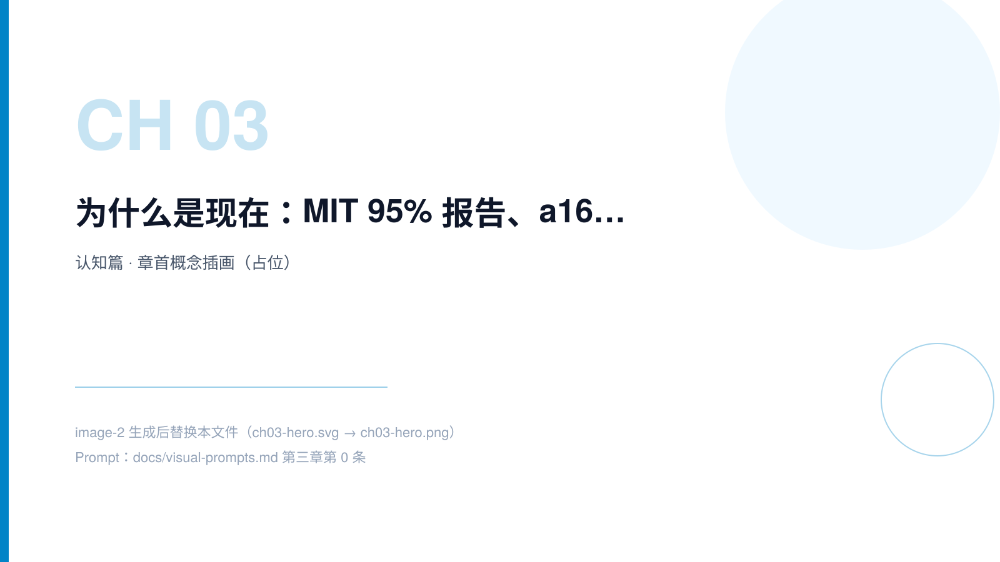

# 第 3 章 为什么是现在：MIT 95% 报告、a16z 判断与产业趋势

> **本章导读**：第 1 章讲了 FDE 是什么，第 2 章讲了它不是什么。本章回答第三个问题：为什么偏偏是 2025-2026 年，FDE 突然从一家公司的内部做法，变成全球现象？我们用一手数据讲清三股力量的合流——技术侧的"95% 困局"、商业侧的"Services-Led Growth"、人才侧的"42 倍"——并把中美路径放在一起对照。最后，我们冷静地回答一个你心里可能已经在嘀咕的问题：**这会不会是又一个泡沫？**



*（image-2 插画生成后替换：按 `docs/visual-prompts.md` §3 第 3 条 Prompt 生成 `assets/ch03-hero.png`，并把本引用扩展名改为 .png）*

---

## 3.1 95% 困局：AI 落地的残酷现状

一切讨论的起点，是一个让整个行业尴尬的数字。

### 3.1.1 MIT 的那记耳光

2025 年，MIT 的 ProjectNANDA 团队发布了一份名为《The GenAI Divide》的研究报告。研究团队跟进了多家大型企业的生成式 AI 试点项目，结论用一句话就能说完：

> **约 95% 的企业，从生成式 AI 试点中没有拿到可衡量的回报。**

注意这句话的三个限定词，每个都值得咀嚼：

- **"试点"**——不是没人尝试，恰恰相反，几乎人人都在尝试。 budgets 没少花，demo 没少做，发布会没少开。
- **"可衡量"**——不是"感觉有用"。报告的口径是财务指标、效率指标、质量指标这类能写进经营分析会的东西。"员工反馈良好"不算。
- **"回报"**——投入产出比。很多项目不是零效果，而是效果抵不上投入：省下的时间，抵不上搭系统的成本。

这个数字出来之后，行业里出现了两种解读。一种说"AI 是皇帝的新衣"；另一种说"模型还没到临界点"。**这两种解读都错了**——因为同一时期，另一群公司正在用同一代模型赚到真金白银（下一节会讲到）。真正的分歧点不在模型，也不在 AI 本身，而在**落地能力**。

### 3.1.2 四大堵点：鸿沟的结构性成因

那 95% 卡在哪儿？把 MIT 报告的失败案例和企业级软件领域的实践总结（润和软件《FDE：AI 时代的落地工程师》白皮书）放在一起看，失败原因高度收敛为四个，我们称为**四大堵点**：

1. **业务语义堵点**：模型不理解企业自己的语言。客户说的"话费"其实是"流量费"，财务说的"挂账"包含七种不同业务含义——通用模型的知识里没有这些约定。
2. **数据治理堵点**：企业数据躺在扫描件、盖章 PDF、多 Sheet Excel、三个不同年代的 ERP 里。把数据"喂"给模型之前，光清洗和打通常常就要耗掉项目一半预算。
3. **系统集成堵点**：AI 能力必须嵌进客户 20 年历史的信息系统才产生价值——但它进不去。接口没文档、测试环境缺失、核心库不许直连。
4. **可审计堵点**：金融、政企、医疗场景要求每个 AI 输出可追溯、可回滚、可追责。纯 prompt 生成的答案，没有审计链条，业务方不敢用。

把四大堵点和第 1 章的"部署鸿沟"对照一下，你会发现它们就是同一条鸿沟的四个断面。而四大堵点有一个共同特征——**它们全部发生在客户现场**，没有一个能靠在实验室里继续提升模型分数来解决。

这就引出了本章的核心判断：

> **AI 产业的稀缺资源已经切换：模型能力过剩，落地能力短缺。谁在客户现场，谁就在稀缺的位置上。**

### 3.1.3 反面证明：跨过鸿沟的公司在干什么

95% 的另一面，是那些拿到回报的少数派。看看他们把 AI 用在了什么地方（均为公开案例）：

- **OpenAI 的半导体客户**：10+ 个内部用例，3-6 个月全部上线，验证调试时间节省约 48%；
- **OpenAI 的电信客户**：语音客服的 eval 从 60% 提升到 90%+，用了六个月；
- **约翰迪尔（John Deere）**：精准农业场景，模型辅助识别杂草减少农药用量——这个场景"以前根本不可能"；
- **阿里云 × 昆仑数智（中石油）**：FDE 联合团队驻场炼厂，典型异常从发现到定位由 30 分钟降至 2 分钟内。

这些成功案例的共性不是"用了更强的模型"——他们用的就是市面上人人可买的同一代模型。共性是：**有人扎进了现场，逐个堵点地打通了业务语义、数据、集成与审计**。这就是 MIT 报告读到最后剩下的那 5%，也是 FDE 的定义域。

---

## 3.2 岗位爆发的三组数据

诊断讲完了，现在上数据。FDE 的爆发不是媒体喊出来的，是招聘市场真金白银投出来的票。三组数据，三个口径，互相印证。

### 3.2.1 数据一：招聘量的斜率

- **领英《全球劳动力市场趋势洞察报告》（2026-01）**：2023-2025 年间，FDE 新增岗位数量增长 **42 倍**。作为参照系，同期 AI 工程师岗位增长 13 倍——注意，13 倍本身已是现象级，而 FDE 是它的三倍多。
- **Indeed / Live Data Technologies**：FDE 岗位 2025 年 1-9 月招聘需求同比激增超 800%（另一统计口径约 729%，从 643 个职位涨至 5330+ 个）。16 个月内岗位发布量暴涨 5230%。
- **Y Combinator 招聘平台**：超过 100 家 AI Agent 公司在招 FDE——而这个数字两三年前是 **0**。

对"42 倍"要有正确的打开方式：基数小是事实（2023 年这个岗位几乎不存在），所以 42 倍不等于"海量岗位"。它的真正含义是**一条从零起步的、陡峭的 J 型曲线**——一个岗位品类在被市场从无到有地定价。

### 3.2.2 数据二：薪酬的定价

市场用什么价格给这个新品类定价？两份口径可查的报告：

- **国内（猎聘 2026-09 FDE 人才专项报告）**：FDE 平均年薪 40.8 万元；成熟 FDE 普遍 60-120 万元；供需比仅 **0.28**——四个岗位抢一个人。
- **美国（Perspective AI 2026 年对 1500 名 FDE 的调查）**：前沿实验室资深 FDE 年总薪酬中位数 **48.5 万美元**，资深员工级别 72.5 万美元；顶级实验室总包区间 35-55 万美元。

公开 JD 的量级可以对表：字节跳动"豆包 AI 大模型 FDE"3.5-7 万 × 15 薪；蚂蚁数科 4-6 万 × 15 薪；智谱 FDE 负责人 6-8 万；腾讯 WorkBuddy FDE 5-8 万；Anthropic FDE 20-30 万美元外加 25% 差旅预算。

一个岗位的薪酬超过同司资深纯技术岗，只可能有一个解释：**市场认定它直接创造收入**。这就把话题引向第三组数据。

### 3.2.3 数据三：资本与巨头的下注

如果说招聘和薪酬还是"散户行为"，这一组是"机构行为"：

- **a16z（2025-06）《Services-Led Growth》**：把 FDE 称为"创业公司里最热的岗位（the hottest job in startups）"。这份研报的分量在于它宣布了一场**定价模型的迁移**：从 Software-Led（卖标准软件，交付成本趋零）到 Services-Led（用交付服务把模型能力翻译成业务结果，客单价高一个数量级）。客户不再为"工具"付费，开始为"结果的保证"付费——而 FDE 是这种定价模型的执行单元。
- **OpenAI Deployment Company（2026-05）**：联手 19 家私募基金，合计投入超过 **40 亿美元**成立专门做企业落地的"部署公司"；收购落地服务商 Tomoro 时带走了 **150 名 FDE**。多方报道口径显示其派驻门槛：单客户 ARR 超过 1000 万美元才派一名 FDE——注意这个门槛的含义：FDE 被当作**收入单位**而非成本单位。
- **Anthropic（2026-10）**：承诺投入 **1 亿美元**，到 2027 年底前培养 1 万名 FDE；更早时候与 IT 服务商 DXC 合作培训数万名 Claude 认证 FDE。其 FDE JD 里明确写着交付物是 MCP 服务器、子智能体和 agent skills。
- **AWS（2026-06-30）**：投入 **10 亿美元**成立 Forward Deployed Engineering 部门，初期配置数千名工程师。

三家头部实验室加一家云巨头，同时为一个岗位真金白银下重注。在商业史上，当资本用这种密度对一个"岗位"表态时，关于它是不是炒作的争论其实已经结束了——**剩下的争论只有一个：谁做得好。**

### 3.2.4 三组数据的合流

```
技术侧：  MIT 95% 困局 ──────→ 模型能力过剩，落地能力短缺
商业侧：  Services-Led Growth → 客户为"结果"付费，FDE 成为收入引擎
人才侧：  42 倍 / 供需比 0.28 → 市场从零开始为品类定价，供给严重不足
                              ↓
                  「现在是学习 FDE 的最好时机窗口」
```

---

## 3.3 中国路径：从政策到认证

硅谷的热度讲完了。中国市场的特殊之处在于：市场力量之外，**政策力量在同一时间窗口进场**——这让中国的 FDE 发展呈现出与美国不同的结构。

### 3.3.1 政策时间线

把公开可查的政策动作排成一条时间线：

- **2026-08**：工信部印发《关于开展人工智能应用服务商培育专项行动的通知》——**FDE 首次写入国家部委文件**。同时配套发布 FDE 制造业培训课程大纲（初/中/高三级，收录 68 个制造业实战案例）。
- **2025-11（上海）**：《支持先进制造业转型升级三年行动方案（2026-2028）》提出 FDE **"百千万"工程**——建立超千人规模的 FDE 人才储备库。首期 FDE 专题培训班已于 2025 年 11 月开班。
- **2026（武汉）**：提出三年培育 **一千名** FDE；宁波慈溪、上海徐汇、武汉东湖等地相继开设 FDE 专题培训。

一个部委级文件为一个具体"岗位"发文培育，这个信号强度怎么评估都不为过。它的含义是：中国政府把 FDE 定位为**AI 产业化的基础设施性角色**——AI 要进制造业、进政企，就必须有大批能把 AI 焊在产业上的人。

### 3.3.2 认证体系竞赛

政策之后是认证。2026 年下半年，中国 FDE 认证市场进入密集发布期，媒体称之为"巨头竞相发证"：

- **工信部电标院 × 联想（2026-10-27）**：业内首个"企业与行业人才标准化专业机构联合认证"。课程分三大系列：企业 AI 设计方法 / 智能体工坊与 AI 基础能力 / 项目交付实施与运维，总投入约 120 小时，实操考试要求在预置环境完成任务并提交过程证据。背景：联想内部已有 60% 业务流程由智能体接管，对外沉淀 200+ 可交付智能体方案（制造行业 128 个）。
- **人社部能建中心（2026-11）**：FDE 实训技术进阶班。官方定义了双轨角色——**Echo（业务型专家）**：挖掘需求、提供 AI 解决方案与场景架构；**Delta（技术型专家）**：从技术到产品原型交付。华为提供教学支持，48 课时，12000 元/人。
- **腾讯云 ADP 前沿部署工程师认证（2026-08-18）**：由原有认证体系更名升级而来，与 WorkBuddy FDE 精英班共同构成腾讯的 FDE 人才培养计划。
- **阿里云公共云生态伙伴 FDE 体系**：把驻场交付中验证过的能力拆解为可考核维度（架构与任务拆解、工具调用、生产可靠性）。

认证扎堆是好事也是坏事：好的一面说明岗位能力模型正在收敛为公共标准；坏的一面是——媒体的冷静提醒值得抄录：**有招聘从业者判断"只有约 20% 挂着 FDE 头衔的人实际能力与岗位定位匹配"**，而澎湃新闻等媒体已提醒"FDE 速成班"可能是驻场外包换皮（第 2 章的四条标准在这里再次适用——对认证如此，对培训如此，对你自己更如此）。

### 3.3.3 中美路径的结构性差异

| | 美国路径 | 中国路径 |
|---|---|---|
| 驱动力 | 自下而上：市场（a16z、巨头资本）先定价 | 自上而下：政策先定方向，市场跟进 |
| 岗位语义 | 高客单价的战略武器（ARR 1000 万美元门槛） | 产业升级的基础设施（制造业 68 案例） |
| 代表玩家 | OpenAI/Anthropic/AWS/Palantir | 工信部/电标院/人社部/腾讯云/阿里云/联想/华为 |
| 风险形态 | 泡沫风险（估值先行） | 认证通胀与换皮风险（供给先行） |
| 对个人的含义 | 高风险高回报的窄门 | 更宽的入口，更考验甄别 |

对读者的实操含义：**在中国，"入场"更容易（政策与认证把门开大了），但"甄别"更重要（第 2 章的四条标准是你的防身武器）。** 在美国，入场是窄门，但进了门的人含金量更集中。

---

## 3.4 泡沫之辩：三问三答

热度讲到这个程度，必须回答你心里的问题：**这不会是 2020 年的"区块链工程师"重演吧？** 我们把怀疑者最强的三个论点摆出来，逐个检验。

### 3.4.1 第一问：模型进化会不会让 FDE 消失？

怀疑论：模型会越来越强，agent 会越来越自主，最终"部署"本身自动化了，FDE 失去存在必要。

检验：这个论点把第 1 章的"部署鸿沟"记反了。事实是——**模型越强，鸿沟越宽**。模型 60 分时客户不指望它能用，没人需要桥；模型 95 分时客户开始把关键流程压上去，此时可靠性、审计、集成、业务语义的缺口第一次变得致命。MIT 95% 发生在模型能力历史最强的时刻，这本身就是证伪：**困局不在模型侧，在落地侧。** 而落地侧的四大堵点（数据、集成、语义、审计）没有一个是"下一代模型"能顺带解决的——它们是每个企业自己的历史、自己的约定、自己的制度，它们只能被**现场的人**逐个打通。

更进一步的证据是模型厂商自己的行为：如果模型进化能消灭 FDE，为什么 OpenAI、Anthropic、AWS 在 2026 年——模型最强的一年——集体**扩编** FDE？（3.2.3 的三组注资全部发生在模型能力突飞猛进的同期。）厂商比任何人都清楚模型的天花板在哪，他们用钱包投票的方向，和怀疑论的推演正好相反。

### 3.4.2 第二问：FDE 会不会退化为"高端外包"？

怀疑论：FDE 团队随客户数线性增长，没有规模效应，本质是咨询外包生意的 AI 版。（虎嗅批评文章的核心论点：FDE 越能干，越可能掩盖产品缺陷、锁定客户。）

检验：这个论点**对一半**——它准确地描述了做坏的 FDE。FDE 团队线性增长、定制代码永不收敛、现场经验不回流——这正是第 2 章"95% 公司不该招"里描述的失败形态，也正是第 14 章要花整章教你怎么避免的陷阱（把定制收敛为通用、六个必须留下、反哺提案机制）。

但"存在做坏的方式"不等于"模式必然做坏"：Palantir 把 Delta 的现场痛苦代谢成了 Gotham 和 Foundry 两条产品线；OpenAI 的 FDE 把项目代码收敛到通用 harness，每项目删除约 90% 定制部分。**判断标准是现成的：看健康曲线——FDE 工作量应随客户增多而下降。** 下降的，是产品资产的复利；不降的，才是外包换皮。

### 3.4.3 第三问：这个岗位窗口会不会太短？

怀疑论：FDE 是过渡形态——等企业都学会用 AI 了、等"AI 落地"变成 IT 部门常规技能，这个岗位就退役了。

检验：把"FDE"三个字母和它的能力内核拆开看。**字母层面**——岗位名称确实可能潮起潮落，就像"Flash 工程师"一样。**能力层面**——"工程 × 业务 × 现场 × 结果"这个组合在任何技术周期里都稀缺：上世纪是实施顾问里最会写代码的那批人，SaaS 时代是 solutions architect 里最懂客户的那批人，AI 时代叫 FDE。技术每次换代，最先被淘汰的是只懂技术侧的人，而**站在客户痛苦现场的人，永远在需求的源头**。

本书的立场因此可以一句话说清：**不要为三个字母 (F-D-E) 学这本书，要为它包裹的能力组合学这本书。** 字母会变，能力组合不会——第 18 章会展开讲这个组合在 L4 之后的四条出路。

### 3.4.4 判决：泡沫的形状

三个怀疑论点检验完，泡沫的形状就清楚了：**FDE 有泡沫的成分（头衔通胀、速成班、换皮 JD、认证扎堆），但没有泡沫的本质（需求是 MIT 95% 摆在那儿的真实痛，收入是 40 亿美元级别的真实注资）。** 你要防范的不是"这个行业会消失"，而是"你拿到的是不是这个行业里的真东西"——而这，恰好就是第 2 章四条标准存在的意义。

---

## 3.5 独立 FDE 的冷思考：接不到单的一群人

本章数据全是光鲜面，公平起见，最后看一个阴暗面——它同样来自公开报道，且对所有读者都构成实用的风险提示。

新浪财经《风向》栏目 2026 年的报道标题很直白：**《月薪 8 万招人，一群 FDE 却接不到单》**。报道观察到一个有趣的剪刀差：岗位市场火热的同时，一批脱离组织、独立执业的 FDE 却挣扎在接不到单的状态。

为什么组织内的 FDE 一将难求，独立的 FDE 却难以为继？拆开看是三个结构性原因：

1. **信任背书**：企业把核心系统交给一个人，赌的是组织信誉而非个人简历。大厂 FDE 背后是 SLA、是法务、是跑路时的兜底——独立者拿什么对冲？
2. **交付纵深**：第 9 章你会看到，一次像样的私有化交付涉及部署、安全、审计、运维一整套纵深，独立者单枪匹马覆盖不了全链条。
3. **销售通道**：FDE 的核心能力是交付，不是获客。独立 FDE 常常死在"单在哪"而不是"活干不了"。

这对读者的启示很清晰：**想走独立路线（或创业路线），先把组织内的交付战绩攒够——独立 FDE 的正确姿势是"先在牌桌上赢够筹码，再下牌桌单干"**（第 18 章的 L4 路线图会给出完整的过渡设计）。同时，报道也记录了另一面的机会：Anthropic 的 1 亿美元培养计划、AWS 的部门化建制，都在把"认证 + 生态"做成独立 FDE 的获客通道——观察这些生态位的演化，本身就是判断入场时机的雷达。

---

## 3.6 全球岗位族谱：这波浪潮里已经存在的位置

结束本章之前，送你一张"地形图"——截至 2026 年，全球公开招聘市场上真实存在、可以直接投递的 FDE 家族岗位。它来自对各公司公开招聘页面的持续盘点（腾讯云开发者社区《FDE 不再只是一个岗位》等做过系统梳理），每一个都附 JD 特征，方便你按图索骥：

**模型厂商（本轮浪潮的源头）**

- **OpenAI**：FDE / Forward Deployed Software Engineer / Forward Deployed Security Engineer / Technical Deployment Lead——四岗家族，覆盖交付、安全与建制的三层（openai.com/careers 可按关键词检索）；
- **Anthropic**：Forward Deployed Engineer, Applied AI——JD 明确"直接嵌入战略客户"，交付物是 MCP 服务器、子智能体与 agent skills，20-30 万美元 + 25% 差旅；
- **AWS 生成式 AI 创新中心**：Senior Forward Deployed Deep Learning Architect——偏架构深度的大客户落地岗。

**老牌 B 端软件（模式的原创者）**

- **Palantir**：FDSE / Forward Deployed Infrastructure Engineer——二十年原教旨 FDE，产品线里最接近"现代骑士"的岗位；
- **Atlassian**：Principal Forward Deployed Architect（首席前向部署架构师）——传统 SaaS 巨头向 AI 交付进化的信号岗。

**咨询与行业侧（模式的延伸地带）**

- **BCG X**：多职级的 Forward Deployed AI Engineer——咨询公司把 FDE 当作新交付产品线的组织信号；
- **诺华（Novartis）**：Forward Deployed Engineer - AI Prototyping & Product Engineering——生命科学企业自建 FDE，常驻布拉格，覆盖从原型到产品的全栈 AI 交付，证明这个岗位已从软件业外溢到制药业。

**国内（政策与市场双轮驱动）**

- 字节跳动（豆包大模型 FDE）、蚂蚁数科（B 端 FDE）、智谱（FDE 负责人）、腾讯（WorkBuddy/CodeBuddy FDE，5-8 万/月）——模型与应用厂商的交付先锋队；
- 阿里云生态伙伴 FDE、商汤"产业 FDE 模式"——把交付做成行业方法的体系化建制；
- 各地方与部委认证体系（3.3.2）——体制内的"泛 FDE"通道。

这张地图的读法有三个层次：**看地名**（哪些组织类型在进场——从模型厂到药厂，外溢在加速）；**看职级**（从 Engineer 到 Principal 到 Lead，建制在成熟）；**看动词**（JD 里"embed/嵌入"还是"支持/配合"——第 2 章的判别标准在这张地图上同样适用）。第 18 章会教你怎么从这张地图里选出你的第一站。

---

## 本章知识点卡

| 概念 | 一句话解释 | 关键词 |
|---|---|---|
| MIT 95% | 企业生成式 AI 试点无可衡量回报的比例（2025 报告口径） | GenAI Divide |
| 四大堵点 | 业务语义 / 数据治理 / 系统集成 / 可审计性 | 部署鸿沟的断面 |
| 42 倍 | 2023-2025 FDE 新增岗位增长（领英口径，对照 AI 工程师 13 倍） | J 型曲线 |
| 供需比 0.28 | 四个岗位抢一个人（猎聘 2026-09 口径） | 定价权 |
| Services-Led Growth | 客户为"结果的保证"付费的定价模型迁移 | a16z |
| 百千万工程 | 上海 FDE 人才储备政策（千人规模储备库） | 中国政策 |
| Echo / Delta | 人社部官方定义的业务型/技术型双轨 FDE | 双轨角色 |
| 健康曲线 | FDE 工作量随客户增多而下降 = 沉淀成功的指标 | 反泡沫判据 |
| 字母与内核 | 岗位名会变，"工程×业务×现场×结果"不会 | 职业策略 |

---

## 代码实战：fde-dashboard.py——把本章的数据画出来

本章工具在 `examples/ch03/`。数据是本章的灵魂，而数据只有画出来才真正可感——这个工具把 3.2 的三组数据渲染成三张 ASCII 图表，帮你建立"数字的体感"：

- **图 1 岗位增长曲线**：2023-2025 年 FDE vs AI 工程师的岗位增长倍数对照（42 倍 vs 13 倍）——J 型曲线的斜率差一目了然；
- **图 2 薪酬定价表**：中美代表性岗位的薪酬区间横向对照（含 Anthropic、字节、蚂蚁、智谱等公开 JD 口径）；
- **图 3 泡沫检验器**：输入你对"FDE 是泡沫吗"的三个判断（y/n/?），工具按 3.4 的三问三答框架输出对应检验逻辑，生成你的个人"泡沫判断报告"。

```bash
cd examples/ch03
python fde_dashboard.py            # 输出全部三张图
python fde_dashboard.py --chart 1  # 只看增长曲线
python fde_dashboard.py --bubble   # 泡沫检验器（互动）
```

所有数据点都在源码的 `DATASETS` 字典里注明口径与出处（领英/猎聘/Perspective AI/a16z 等）——**把出处和数字放在一起，是本书数据纪律的样板**。运行完请做一件事：把图 1 的斜率拍下来，在你下次犹豫"要不要投入时间学 FDE"时看一眼。

---

## 章末习题

1. **堵点归因**：选一个你亲身经历或深度了解的失败 AI 项目（所在公司、朋友的创业、公开报道的案例均可），用四大堵点框架做归因：主要卡在哪个堵点？次要是哪个？如果当时有一个 FDE 在场，他会先做什么？（提示：回顾 1.3 节"林舟的一天"里的动作。）
2. **中美对照分析**：3.3.3 的对照表列出了两种路径的风险形态——美国是"估值先行"、中国是"供给先行"。写一段 300 字分析：假设你分别处在两种市场里求职，你的求职策略应有什么不同？（第 18 章会给你参考答案，先自己写。）
3. **辩论题（写作练习）**：以"FDE 是过渡形态，还是长期职业？"为题写 500 字，要求：必须引用本章至少三个数据点，必须包含一个反方观点并回应它（建议引用 3.4.2 的线性增长批评）。写完后对照 3.4 的三问三答复盘你的论证质量。

---

## 参考资料

- MIT ProjectNANDA《The GenAI Divide》（2025，95% 口径原始出处）
- a16z《Services-Led Growth》（2025-06）：https://a16z.com/services-led-growth/
- 领英《全球劳动力市场趋势洞察报告》（2026-01，42 倍口径）
- 猎聘 2026-09 FDE 人才专项报告（平均年薪 40.8 万、供需比 0.28，媒体报道口径）
- Perspective AI 2026 FDE 薪酬调查（1500 名 FDE，48.5 万美元中位数口径）
- 36氪《硅谷最火岗位来了，100+家AI公司疯抢fde，连openai都下场招人》（YC 100 家、Palantir 帝国）：https://36kr.com/p/3477432643132036
- 新浪财经《月薪8万招人，一群FDE却接不到单|风向》（独立 FDE 冷思考）：http://baijiahao.baidu.com/s?id=1880532831405262281
- 新浪财经《联想、阿里、腾讯等巨头竞相"发证"》（工信部电标院 × 联想首个认证）：http://finance.sina.com.cn/roll/2026-11-06/doc-inixuqia5459790.shtml
- 人社部能建中心 FDE 实训技术进阶班（Echo/Delta 双轨定义，华为教学支持，微信发布口径）
- 腾讯新闻《AI巨头争抢的FDE，到底值钱在哪里？》（招聘量三年涨 30 倍等数据链）：https://news.qq.com/rain/a/20261028A08GKR00
- 虎嗅《被吹爆的FDE角色，正在掩盖AI产品的核心问题》（3.4.2 批评论点原始出处）：https://www.huxiu.com/article/4902748.html
- 润和软件《FDE：AI时代的落地工程师》白皮书（四大堵点框架，第五届全球数字贸易博览会发布口径）
- 工信部《关于开展人工智能应用服务商培育专项行动的通知》（2026-08，FDE 首次写入部委文件）
- 百度百科《前沿部署工程师》词条：https://baike.baidu.com/item/前沿部署工程师/67210086

> 下一章预告：认知篇到此收官——你知道了 FDE 是什么、不是什么、为什么是现在。第二篇开始锻造武器：第 4 章从调用你的第一个模型 API 开始，把"FDE 的武器库"一件一件交到你手上。
