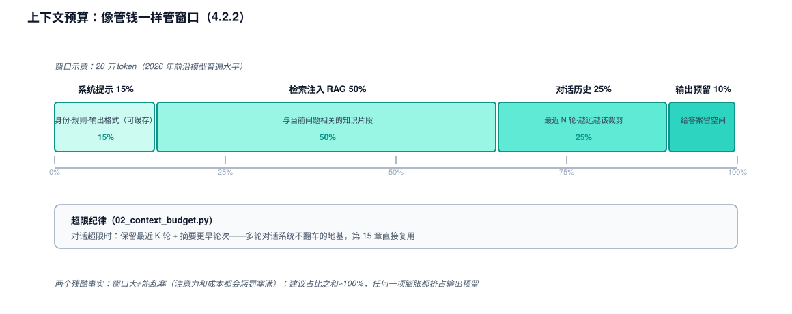
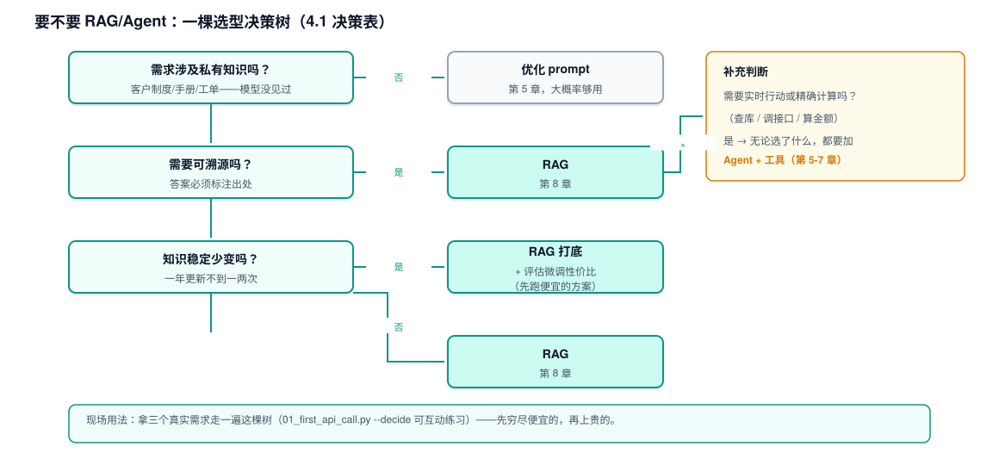

# 第 4 章 大模型基础：API、上下文、微调与推理

> **本章导读**：FDE 不需要训模型，但必须懂模型的“脾气”——在现场，模型是你每天都要打交道的核心生产资料，它的计费方式、上下文限制、能力边界和部署形态，直接决定你的方案设计和成本核算。本章为零基础读者准备“最小够用”的 LLM 知识：从调第一个 API，到管好上下文预算，再到把模型私有化跑起来。本章起，代码成为正文的一部分——**每个知识点都配可运行的程序**。


---

## 4.1 调用你的第一个模型

### 4.1.1 三行代码的工业革命

先做一件事：让你的电脑真正“说一次话”。以下代码就是全书的起点（完整版见 `examples/ch04/01_first_api_call.py`）：

```python
from openai import OpenAI

client = OpenAI()  # 自动读取环境变量 OPENAI_API_KEY
resp = client.chat.completions.create(
    model="gpt-4o-mini",
    messages=[
        {"role": "system", "content": "你是云帆科技的财务制度助手。"},
        {"role": "user", "content": "招待费报销需要什么条件？"},
    ],
    temperature=0.0,
)
print(resp.choices[0].message.content)
```

如果这是你第一次运行大模型 API，值得停下来感受一下：这三行代码背后是一个千亿参数的神经网络，通过一条 HTTPS 请求为你服务。更重要的是——**它对你和对此刻地球上任何一家公司都是完全一样的**。FDE 的价值不在“能调用模型”（人人都能），而在调用之后那 90% 的工作。

### 4.1.2 消息结构：与模型对话的语法

`messages` 列表是与模型沟通的全部语法，只有三种角色：

| 角色 | 作用 | 类比 |
|---|---|---|
| `system` | 设定身份、规则与输出格式 | 岗位说明书 |
| `user` | 使用者的输入 | 工单 |
| `assistant` | 模型的回复（多轮时回填历史） | 处理记录 |

关键认知：**模型没有“记忆”，只有“上下文”**。每次调用都是一次全新的会话，所谓“多轮对话”，是你的程序把历史 `assistant` 消息重新塞进 `messages` 而已。这个认知价值千金——它意味着对话的一切状态由**你**管理，丢了的上下文模型永远想不起来。第 5 章的 Agent 记忆、第 8 章的 RAG，本质上都是在管理这个列表。

### 4.1.3 两个最重要的参数

- **`temperature`（0.0-2.0）**：随机性旋钮。0.0 = 尽量确定（制度问答、数据抽取必用）；0.7-1.0 = 有发散（写文案、头脑风暴）。FDE 场景 90% 用 0.0——**客户要的是可复现的答案，不是灵感**。
- **`max_tokens`**：输出上限。不设不等于无限，而是受模型默认值约束；设小的值可以省钱，但会把长答案拦腰截断——现场翻车常见原因之一。

### 4.1.4 费用工程：把模型当“水电煤”来管理

FDE 必须会算钱。token 是模型的计量单位，粗略换算：**1 个汉字 ≈ 1-2 token，1 个英文单词 ≈ 1-1.3 token**。计费分输入（input）与输出（output）两口井，输出通常贵数倍。

三个立刻能用的省钱杠杆：

1. **Prompt Caching**：重复的 system 前缀（公司制度、规则说明）可被缓存，缓存命中部分价格降至约十分之一——FDE 场景的 system 提示几乎每次都一样，这个杠杆天然适配；
2. **Batch API**：不赶时间的批量任务（如夜间跑历史工单分类）走批处理接口，五折；
3. **模型分级**：简单任务用小模型、复杂任务用大模型的路由策略（第 10 章的评估体系会告诉你哪些任务“降级”是安全的）。

`examples/ch04/01_first_api_call.py` 里内置了一个“合同条款提取器”完整示例，会打印每次调用的 token 用量与费用估算——**把成本打印出来，是成本工程的第一步**。

### 4.1.5 参数速查表：现场能脱口而出的全部参数

除了 `temperature` 和 `max_tokens`，生产代码里还有这些参数需要认识。不需要背，但面试和 code review 时要能认出来：

| 参数 | 作用 | FDE 常用值 | 踩坑警告 |
|---|---|---|---|
| `top_p` | 与 temperature 同为采样控制（核采样） | 与 temperature 二选一，不要同时调 | 两个一起调等于乱调 |
| `seed` | 固定随机种子，提升可复现性 | 评估实验时设固定值 | 不同厂商行为不一，别指望跨厂商完全一致 |
| `stop` | 命中即停止生成的结束符 | 需要截断列表式输出时 | 会把结束符本身从输出中删掉 |
| `stream` | 流式返回 token | 客户演示必开（体验感知延迟大幅下降） | 需要拼流处理，别忘最后一帧 |
| `n` | 一次生成多个候选 | 评估时采样对比 | 费用 ×n，现场慎用 |
| `response_format` / `json_schema` | 强制 JSON 结构化输出 | 任何要进数据库的输出必用 | 详见下一段 |

关于结构化输出多说一句：4.1.4 的合同提取器依赖模型“自觉”输出合法 JSON，这在 temperature=0 时大概率成立但**不保证**——生产代码应该用 `response_format={"type": "json_object"}` 或 JSON schema 模式（各厂商叫法不一，OpenAI 叫 Structured Outputs，Anthropic 叫 tool use 强约束）从协议层保证。这是“能用 demo”与“敢上线系统”的分界线之一。

---

## 4.2 上下文窗口：模型的世界就那么大

### 4.2.1 能装下 ≠ 能用好

上下文窗口是模型一次调用能“看见”的全部信息容量。2026 年的前沿模型普遍支持 20 万 token 以上的窗口——听起来很大，但 FDE 必须知道两个残酷事实：

- **lost in the middle**：研究发现模型对上下文中部信息的利用率显著低于首尾。把关键条款埋在 50 页文档中间，模型可能视而不见——**信息的位置就是信息的一部分**；
- **成本与窗口同涨**：窗口塞得越满，每次调用的输入费用越高、延迟越长。全量注入是一种奢侈行为。

### 4.2.2 上下文预算表：像管钱一样管上下文

把上下文当作预算来分配，是 FDE 的基本功。一份典型的生产级预算表：

| 预算科目 | 建议占比 | 内容 |
|---|---|---|
| 系统提示 | 10-20% | 身份、规则、输出格式（可被缓存） |
| 检索注入（RAG） | 40-60% | 与当前问题相关的知识片段 |
| 对话历史 | 15-30% | 最近 N 轮，越远越该裁剪 |
| 输出预留 | 10-20% | 给答案留空间，别让长答案被截断 |



*图 4-1 上下文预算（源文件 `assets/diagrams/context-budget.drawio`）——窗口示意 20 万 token：四科目占比与超限裁剪纪律*

`examples/ch04/02_context_budget.py` 实现了一个**生产可用的上下文预算管理器**：给定窗口大小，自动为各科目分配额度；对话超限时按“保留最近 K 轮 + 摘要更早轮次”策略裁剪——这是多轮对话系统不翻车的地基，第 15 章智能客服项目会直接复用这个模块。

### 4.2.3 token 计数：别猜，要量

所有预算管理的前提是准确的 token 计数。不要用“字数 ÷ 2”来猜——用工具量：

```python
# 粗略计数（不依赖模型）：用 tiktoken 估算
import tiktoken
enc = tiktoken.get_encoding("o200k_base")
n = len(enc.encode("招待费超过1500元需要事前审批"))
```

注意：不同模型的 tokenizer 不同，tiktoken 是近似值；精确值以 API 响应里的 `usage` 字段为准（所以示例代码都会打印 usage——用它校准你的估算器）。

### 4.2.4 流式输出：体验工程的第一课

技术上属于 API 参数，但值得单独讲一节，因为它关乎 FDE 的“现场体感”。

非流式调用下，模型把整个答案生成完才返回——一个 800 字的回答可能要等 15 秒，客户在白屏前怀疑系统挂了。流式（`stream=True`）把生成过程切成 token 逐个推送，首字延迟可以从十几秒降到一秒以内：**总时长没变，但“感知延迟”天差地别**。

现场经验三条：

1. **演示必开流式**——客户对“打字机效果”的耐受度远高于“加载圈”；
2. 流式下错误处理更麻烦：流到一半断开，你手里是半截答案——要设计“断流重试还是丢弃”的策略；
3. 流式与结构化输出有张力：JSON 没生成完无法解析。解法是“先流式给用户看，后端再校验”——前后端各管各的。

`examples/ch04/01_first_api_call.py` 的进阶练习（见 README）可以自行把 `stream=True` 加上，亲测首字延迟差异。

---

## 4.3 模型能力边界：幻觉、时效、私域知识

### 4.3.1 幻觉的白话解释

模型是概率生成器：它逐 token 地预测“下一个最合理的词”。当问题落在它的知识盲区时，它不会说“我不知道”（没人教过它这么干），而是**生成一段概率上最像答案的话**——这就是幻觉。第 1 章 `01_see_the_gap.py` 的实验一你已经亲眼见过：虚构的制度问题，模型答得理直气壮。

FDE 对幻觉的正确姿势不是恐惧，而是**工程化管控**：

- 知道答案在哪（RAG 提供出处，第 8 章）；
- 让它承认不知道（低置信度拒答，第 8 章）；
- 出口设卡（评估兜底，第 10 章）。

### 4.3.2 私域知识的三条注入路线

客户的知识（制度、工单、产品手册）不在模型训练数据里。注入它们有三条主流路线，选型表如下（**这张表值得贴在工位上**）：

| 路线 | 适用场景 | 成本 | 时效性 | 深入章节 |
|---|---|---|---|---|
| **RAG**（检索增强） | 知识频繁更新、需要溯源 | 低 | 即插即用 | 第 8 章 |
| **微调**（fine-tuning） | 稳定的风格/格式/领域语感 | 中 | 更新周期长 | 本章 4.4 |
| **Agent + 工具** | 需要行动：查库、调接口、算数 | 低 | 实时 | 第 5-7 章 |

三条路线不互斥。成熟的企业系统常常是“微调定语感 + RAG 供知识 + 工具管行动”的组合拳——第 15-17 章的三个项目会分别演示组合方式。

### 4.3.3 多模态入门：眼睛也是输入通道

2026 年的主流模型都支持图片输入（视觉能力），这对 FDE 意味着一批“以前需要 OCR + 后处理”的场景被大幅简化：发票识别、合同盖章页校验、工单截图分类、报表图片取数。

代码上几乎零成本——把图片以 base64 或 URL 塞进 `messages` 即可：

```python
client.chat.completions.create(
    model="gpt-4o-mini",
    messages=[{
        "role": "user",
        "content": [
            {"type": "text", "text": "提取这张发票的金额、抬头与开票日期，输出 JSON。"},
            {"type": "image_url", "image_url": {"url": f"data:image/jpeg;base64,{b64}"}},
        ],
    }],
)
```

但三个现场纪律必须刻在脑子里：

1. **图片按 tile 计费**，一张高清大图的 token 成本可能是文本的几十倍——先压缩再上传是美德；
2. **视觉模型也会幻觉**，对“金额、账号”这类关键字段，第 16 章的实战会演示“视觉抽取 + 规则校验”的双保险；
3. 手写体、盖章遮挡、倾斜扫描件仍是重灾区——多模态降低了门槛，但没有消灭文档解析这门手艺（第 8 章）。

---

## 4.4 微调：什么时候值得做

### 4.4.1 微调的真相

关于微调，最重要的一句话：**微调教模型“怎么说话”，不教它“知道什么”**。

想让客服回复都用公司规定的语气和格式？微调很擅长。想让模型记住公司 500 条制度？微调既贵又不可靠（还会加剧幻觉——它会把“编造”也学得很像）。用第 1 章的话说：**微调改变的是鸿沟此岸的模型脾气，而 RAG 和工具才是往鸿沟上架桥的建材**。

### 4.4.2 技术概念的白话版

你不需要亲手推导反向传播，但要在客户面前听得懂这些词：

- **全参微调**：改模型所有参数，效果最强、成本最高（要 GPU 集群）；
- **LoRA**：冻结原模型、只训练一小块“外挂适配器”（几百 MB），消费级显卡即可，是私有化场景的主流；
- **SFT（监督微调）**：用“输入-理想输出”样本对教格式与语感——企业微调服务的 90% 是这个；
- **蒸馏**：用大模型的输出训练小模型，做“降级省钱”。

### 4.4.3 选型决策树：一个需求到手怎么走

把上面所有判断压缩成一棵可以直接执行的树：



*图 4-2 选型决策树（源文件 `assets/diagrams/selection-tree.drawio`）——补充判断：需要实时行动或精确计算吗？是则无论选了什么，都要加 Agent + 工具（第 5-7 章）*

用三个真实感十足的需求走一遍这棵树（`01_first_api_call.py --decide` 可以互动练习）：

**需求一：「客服回复必须严格符合公司话术规范」。** 私有知识？规范话术算"怎么说话"的私有风格，不算事实性知识——否。走左枝：**优化 prompt，把话术规范写进 system 并用 few-shot 示例**（第 5 章）。做了一阵子如果语感仍不稳，此时才升级考虑 SFT 微调——注意顺序：prompt 是免费的，微调是要花钱的。

**需求二：「问答要引用最新版员工手册」。** 私有知识？是。可溯源？是（必须标注出自哪一页）。**RAG，没有悬念**。这个需求里微调是典型的错误答案：手册半年一改版，每次改版都要重训一遍——用 RAG，改版只要替换文档库。

**需求三：「自动核对报销单与发票金额是否一致」。** 这题的陷阱在最后一步：金额比对是**精确计算**，把它交给概率生成器等于把账本交给掷骰子——模型可能"看对"99 次，错的那一次就是审计事故。正确走法：**多模态抽取字段（本节 4.3.3）+ 代码做比对**，即 Agent + 工具路线（第 5-7 章）。

实战经验浓缩成一句话：**90% 的"我们要微调"需求，最后都被 RAG + 好的 prompt 解决了**。先跑通便宜的方案，让评估数据（第 10 章）告诉你什么时候真的需要花微调的钱。

---

## 4.5 推理与部署入门：vLLM 与 Ollama

### 4.5.0 主流模型地形图：FDE 的选型坐标系

进入部署话题前，先解决一个更前面的问题：**选哪个模型？** FDE 的选型不是看排行榜刷分，而是带着四个现场坐标去看：

1. **中文能力**：国内客户场景的第一硬指标——术语理解、公文语感、方言口语（第 15 章的"话费/流量费"案例）；
2. **工具调用能力**：function calling 的稳定性直接决定 Agent 质量（第 5-7 章），比"会写诗"重要得多；
3. **私有化可得性**：开源权重与否，决定了能不能进客户机房（本节后半）；
4. **价格梯度**：从轻量级到旗舰通常差 1-2 个数量级，混合路由是常态（第 10 章评估体系支撑分级）。

按 2026 年市场格局画一张粗粒度地形图（**型号与价格随时在变，坐标比型号重要**）：

| 阵营 | 代表 | 特点 | FDE 典型用法 |
|---|---|---|---|
| 闭源旗舰 | GPT/Claude/Gemini 系 | 能力天花板、按 API 计费 | 复杂推理、评估裁判（LLM-as-judge） |
| 国内闭源 | 豆包/通义/文心/混元/DeepSeek 等 | 中文强、合规友好、价格阶梯完整 | 国内交付主力 |
| 开源开放权重 | Qwen/Llama/DeepSeek/GLM 等 | 可私有化、可量化、可微调 | 客户机房、专有云 |

两条 FDE 选型铁律：**其一，选型以评估结果为准而非宣传**——同一个"报销问答"任务，让候选模型跑你 50 条黄金集（第 10 章），分数说话；**其二，代码层面永远留 `base_url` 切换的口子**（`03_ollama_local.py` 的模式）——模型是最容易换的组件，别让它焊死在系统里。

### 4.5.1 为什么要自部署

三种典型情况逼你私有化：**合规**（政企金融，数据不许出院墙）、**成本**（调用量大，API 计费打不平自建 GPU）、**延迟**（工厂产线级响应）。第 9 章会系统讲部署，本节先把两个名字变成你的肌肉记忆：

- **vLLM**：高吞吐推理引擎。三行起步：`pip install vllm` 后 `vllm serve <model>`，它以 PagedAttention 技术把并发吞吐拉高数倍，是客户 GPU 机房里的标配服务；
- **Ollama**：本地开发的最好朋友。`ollama run qwen2.5` 一条命令把开源模型跑在你笔记本上，零配置。开发调试用它，不烧 API 费用，还能离线工作——FDE 在飞机上写代码的救星。

### 4.5.2 量化：为什么小显存也能跑大模型

量化 = 用更少的比特存储模型参数。FP16（原始）→ INT8（减半）→ INT4（四分之一）。代价是精度略降，收益是 7B 参数模型从 14GB 显存压到 4GB——一张消费级显卡就能跑。现场判断口诀：**生产建议质量优先，开发实验用量化**。

`examples/ch04/03_ollama_local.py` 演示完整的本地链路：检测 Ollama 服务 → 拉取模型 → 以与云 API **完全相同的 OpenAI 兼容格式**调用。这个“同一套代码、切换云与本地”的设计会贯穿全书——它让 FDE 的方案在合规客户与普通客户之间自由迁移。

---

### 4.5.3 现场急救箱：模型服务的常见故障与处置

FDE 到客户机房的第一周，大概率会遇到下面这张表里的至少三行。把它存进手机：

| 症状 | 最可能的原因 | 第一处置动作 |
|---|---|---|
| 调用突然全部超时 | 代理/防火墙规则、DNS 污染 | `curl -v <base_url>/models` 看握手在哪一步断 |
| 偶发 429 限流 | 并发超配额 | 客户端加指数退避重试（勿硬重试） |
| 输出质量突然下降 | 模型被厂商静默升级/路由切换 | 固定模型版本号；跑 10 条冒烟测试集对比 |
| 代理后报 SSL 错误 | 企业中间人证书 | 把客户 CA 证书加入信任链（合规确认后） |
| 本地 GPU 服务慢 | 量化档位过高/并发打满 | `nvidia-smi` 看显存与利用率，降并发或升量化 |
| 答案和昨天不一样 | temperature 非 0 / 模型版本漂移 | 复查参数；评估集回归（第 10 章） |

处置的总原则只有一条：**先定位（网络 or 配置 or 模型），再动手**——而定位最快的工具就是你本章写的三个示例脚本（服务探测、最小调用、计数校准）。这也是本书坚持每个示例都要“真的能跑”的原因：它们不只是教程，是你在现场的听诊器。

---

## 4.6 本章知识点卡

| 概念 | 一句话解释 | 关键词 |
|---|---|---|
| token | 模型计费与计量的最小单位（1 汉字 ≈ 1-2 token） | 成本工程 |
| messages 三角色 | system/user/assistant——模型对话的全部语法 | 无记忆有上下文 |
| temperature | 随机性旋钮；FDE 场景 90% 用 0.0 | 可复现 |
| 上下文预算表 | system/RAG/历史/输出四科目的分配策略 | 像管钱一样管上下文 |
| lost in the middle | 中部信息利用率低于首尾——位置即信息 | 长文档风险 |
| 幻觉 | 概率生成器在盲区“自信编造”的工程化管控 | RAG/拒答/评估 |
| prompt/RAG/微调/工具 | 四条能力注入路线，各有明确边界 | 选型决策树 |
| LoRA | 冻结原模型只训外挂适配器的低成本微调 | 私有化主流 |
| vLLM / Ollama | 高吞吐推理服务 / 本地开发伙伴 | 生产/开发双轨 |
| 量化 | 压缩参数精度换显存（INT4=四分之一） | 开发实验用 |

---

## 代码实战：examples/ch04 三件套

本章三个示例都在 `examples/ch04/`，互相独立、均可单独运行：

- **`01_first_api_call.py`** —— 第一个 API 调用 + 费用工程：合同条款提取器（结构化输出 + token 用量与费用打印 + 选型决策树练习模式）；
- **`02_context_budget.py`** —— 上下文预算管理器：预算表分配、超限裁剪（保留最近 K 轮 + 更早轮次摘要）、tiktoken 计数校准——第 15 章直接复用的生产级模块；
- **`03_ollama_local.py`** —— Ollama 本地链路：服务检测、模型拉取、OpenAI 兼容格式调用（与云 API 同一套代码切换）。

```bash
cd examples/ch04
pip install -r requirements.txt
export OPENAI_API_KEY=sk-xxx        # 01/02 需要；03 只需本机 Ollama
python 01_first_api_call.py          # 首次调用 + 费用感知
python 02_context_budget.py          # 预算管理器演示
python 03_ollama_local.py            # 本地模型（需先安装 ollama）
```

每个示例支持 `--mock` 离线模式（无 Key、无 Ollama 也能完整走一遍逻辑）——这是全书代码的统一约定：**网络条件永远不该成为学习的障碍，正如客户机房的限制永远不该成为交付的借口**。

---

## 章末习题

1. **成本实测**：用 `01_first_api_call.py` 处理 10 份真实合同（可自造样本），统计平均 token 消耗与单份成本；再打开 Prompt Caching（把固定的制度文本放进 system 并复用），对比第二次调用的费用变化。把这个数字记进你的“现场成本手册”。
2. **预算压力测试**：用 `02_context_budget.py` 模拟一场 30 轮的长对话（窗口设为 8k token），观察裁剪策略何时触发、摘要轮次保住了多少信息；然后故意把“关键约定”放在第 3 轮，验证它被摘要后模型是否还能正确引用——体会 lost in the middle 与裁剪的双重风险。
3. **选型演练**：为以下三个需求各选一条技术路线并说明理由——①客服回复必须符合公司话术规范；②问答需要引用最新版员工手册；③自动核对报销单与发票金额是否一致。（答案方向：①微调或强格式 prompt ②RAG ③Agent+工具——算术必须交给代码，不能交给概率。）

---

## 参考资料

- OpenAI API 文档：https://platform.openai.com/docs
- Anthropic Prompt Engineering 指南（system/消息结构与参数最佳实践）：https://docs.anthropic.com/en/docs/build-with-claude/prompt-engineering/overview
- OpenAI Cookbook（Batch API、结构化输出等官方示例库）：https://github.com/openai/openai-cookbook
- tiktoken（token 计数）：https://github.com/openai/tiktoken
- vLLM（高吞吐推理引擎）：https://github.com/vllm-project/vllm
- Ollama（本地模型运行）：https://github.com/ollama/ollama
- 论文《Lost in the Middle: How Language Models Use Long Contexts》（上下文位置效应原始研究）：https://arxiv.org/abs/2307.03172
- 论文《LoRA: Low-Rank Adaptation of Large Language Models》：https://arxiv.org/abs/2106.09685
- CSDN《FDE工程师：年薪百万的AI落地高手》（FDE 硬技能清单中 LLM 基础的 JD 对照）

> 下一章预告：模型调通了、成本算清了，现在把杠杆交到你手上——第 5 章 Prompt Engineering：FDE 在客户现场最快的价值杠杆，以及从“写好一段提示词”到“定义一个 Agent”的范式跃迁。
