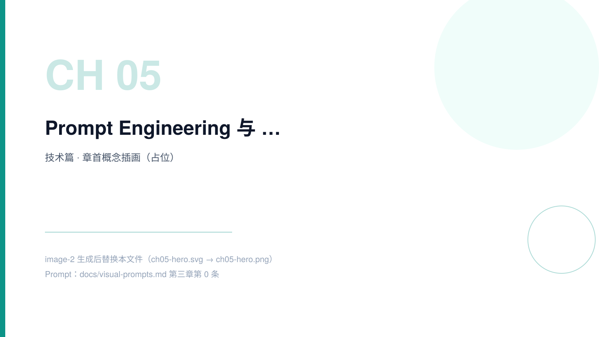
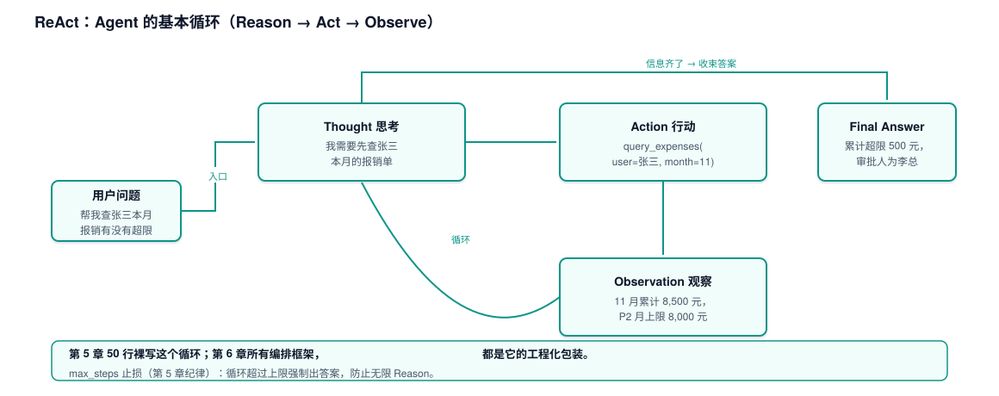

# 第 5 章 Prompt Engineering 与 Agent 范式

> **本章导读**：Prompt 是 FDE 在客户现场最快速的价值杠杆——改一段话就能改变系统行为，成本为零、立竿见影。但"快速杠杆"的另一面是"快速翻车"：一段没纪律的提示词能把模型的行为带偏到不可复现。本章分两步走：前半章建立 prompt 工程的纪律（结构化模板、可维护性、反模式），后半章完成从"写好一段提示词"到"定义一个 Agent"的范式跃迁——并用 50 行代码手写一个不依赖任何框架的 ReAct Agent，它是全书最重要的代码之一，第 6 章的所有框架不过是它的工程化包装。



*（image-2 插画生成后替换：按 `docs/visual-prompts.md` §3 第 5 条 Prompt 生成 `assets/ch05-hero.png`，并把本引用扩展名改为 .png）*

---

## 5.1 Prompt 写作的核心技术

### 5.1.1 先看一次"改坏"：一个真实感十足的客服提示词

先看一段在真实交付里出现频率极高的"坏 prompt"（来自 `examples/ch05/01_prompt_before_after.py` 的起点版本）：

```
你是云帆科技最专业最优秀的金牌客服主管，请务必认真、热情、专业地
回答用户的问题，回答要准确、详细、全面，让客户满意，同时也不能
太啰嗦，注意语气一定要好，谢谢配合！
```

它坏在哪？逐条拆解：

1. **全是祈使句，零信息量**："认真""热情""专业"是态度，不是规格。模型无法从这些词里推出任何行为差异；
2. **自相矛盾**："详细全面"和"不能啰嗦"同时出现——模型只能随机选边，今天答长明天答短，**不可复现**；
3. **没有边界**：客户问公司制度，模型不知道该依据什么、不知道哪些问题该拒答；
4. **没有格式**：下游系统要解析答案，格式靠猜。

把它改好，需要的是**结构**，不是形容词。下面是改造后的版本（完整对照实验可运行代码查看）：

```
你是云帆科技的财务制度助手。
【规则】
1. 仅依据<制度片段>回答；制度未涉及的内容回答"制度中未涉及"。
2. 涉及金额、时限的答案，必须引用条款编号。
3. 回答控制在 3 句话以内。
【输出格式】
结论：<一句话>
依据：<条款编号与原文摘录>
下一步：<可执行建议，没有则写"无">
<制度片段>{{RAG_CONTEXT}}</制度片段>
```

改造前后各跑 20 条测试问题，效果差距是断崖式的：改造前的回答平均 120 字、无从引用条款、3 条越权承诺；改造后 40 字以内、全部带条款引用、零越权。**注意改造的核心动作**：删掉了所有形容词，补上了**规则、边界、格式、锚点**——这就是 prompt 工程的全部秘密。

### 5.1.2 结构化提示词模板：五件套

把上面的改造过程提炼成可复用的模板，几乎所有生产级 system 提示都是它的变体：

| 组件 | 作用 | 例 |
|---|---|---|
| **角色**（Role） | 设定视角与知识范围 | "你是云帆科技的财务制度助手" |
| **任务**（Task） | 一句话说清要产出什么 | "仅依据制度片段回答员工问题" |
| **约束**（Constraints） | 硬性边界与红线 | "制度未涉及的回答'制度中未涉及'" |
| **格式**（Format） | 输出的结构规格 | "结论/依据/下一步三段式" |
| **示例**（Examples） | few-shot 样本，钉死行为 | 1-3 组输入-输出对照 |

一个经验法则：**当你的提示词超过 300 字，说明该用示例而不是用更多形容词来约束行为**——一个 few-shot 示例的效果通常胜过十条祈使句。

### 5.1.3 高频模式速查

以下是生产里最高频的五种模式，各有明确的适用边界：

| 模式 | 一句话原理 | 适用 | 陷阱 |
|---|---|---|---|
| **零样本** | 直接下指令 | 简单分类、格式转换 | 对复杂任务约束不足 |
| **少样本**（few-shot） | 用例子钉行为 | 格式敏感、风格敏感任务 | 示例间不一致会污染行为 |
| **思维链**（CoT） | 让模型先写推理再给结论 | 多步判断、需要理由 | token 消耗增加；敏感场景要隐藏推理过程只留结论 |
| **自我检查**（self-critique） | 让模型复查自己的答案再输出 | 高价值单条输出 | 相当于调用两次，成本 ×2 |
| **结构化输出** | 协议层强制 JSON/schema | 任何要进数据库的输出 | schema 要留有余地，别把每个字段都 required |

CoT 值得展开一句：对模型来说，"想"发生在生成的过程里——让它"一步步思考"，等于把推理摊在纸面上，中间步骤错了你能看见（第 10 章的轨迹评估依赖这一点）。但对 FDE 有个重要提醒：**生产环境的客户界面不该展示思维链**——内部推理与用户可见答案分离，既保护体验也避免泄露中间噪声。

### 5.1.4 Prompt 也有"温度纪律"

第 4 章说过 temperature 的 90% 用 0.0。这里补上 prompt 层面的对应纪律：**同一段提示词，temperature 必须固定**。评估分数（第 10 章）是对"提示词 + 参数"这个组合打的分——改了 prompt 又没固定参数，你永远不知道分数变化来自哪里。**prompt、参数、评估集，是可复现性的三位一体。**

---

## 5.2 Prompt 也是工程品

### 5.2.1 版本管理：prompt 进 Git

一个扎心的事实：在多数团队里，prompt 是"祖传代码"——躺在某人的聊天记录里、某个后台配置页里，改了没人知道、坏了查不出原因。FDE 的做法是把 prompt 当代码：

- **进版本库**：`prompts/ch05/finance_assistant.txt` 与代码同仓，PR 审查；
- **变更可追溯**：每次修改附带"为什么改、评估分数怎么变"的说明；
- **A/B 可对比**：新旧版本在同一段评估集上对打（第 10 章的工作流）。

### 5.2.2 变量化与模板化

长 prompt 直接硬编码会失控——中文改动一个字就是一次代码提交。工程做法是**骨架与数据分离**：骨架（角色/规则/格式）进模板文件，数据（制度片段、用户信息）运行时注入。Jinja2 是最顺手的工具：

```python
from jinja2 import Template
tpl = Template(open("prompts/finance_assistant.txt").read())
prompt = tpl.render(rag_context=retrieved_docs, question=user_q)
```

第 8 章的 RAG、第 15 章的客服系统，注入点全部长这个样子。

### 5.2.3 反模式清单：十条最常见的坏味道

按出现频率排序，逐条自查：

1. 形容词堆砌（"专业、热情、认真"）——零信息量；
2. 互相矛盾的约束（"详细但不啰嗦"）——不可复现；
3. "请务必""一定要""千万"——祈使句强度不影响模型，信息量才影响；
4. 关键指令埋在长文中间——lost in the middle 同样适用于 prompt 内部；
5. 没有"不知道"出口——逼模型在盲区里编造（第 1 章幻觉问题的 prompt 侧根源）；
6. 负面清单过长——"不要 A 不要 B 不要 C……"模型只记得住 A、B、C；
7. 示例与任务不一致——few-shot 是最强的信号，比规则更硬；
8. 格式靠口头约定——"输出整洁一点"，什么是整洁？
9. 一段 prompt 干三件事——分类+抽取+改写混在一起，坏一处全崩；
10. 没有版本号——三个月后没人知道线上跑的是哪一版。

### 5.2.4 提示词的测试纪律：上生产前的三道门

反模式清单帮你写出好 prompt，但“好”要被证明。FDE 的习惯是给每段生产 prompt 过三道门：

1. **冒烟门**：5 条典型问题（含 1 条库外问题）人工目检——拒答出口、格式、条款引用三样各确认一次；
2. **对比门**：新版本必须在黄金集上不输旧版本（第 10 章的完整工作流），“感觉变好了”不算理由，分数才算；
3. **极限门**：空输入、超长输入、恶意注入（“忽略之前的指令”）各过一轮——生产环境的第一批 bug 永远来自边界之外。

一个真实教训：某项目把制度问答 prompt 从 v3 升到 v4，只做了“表达优化”，上线后拒答率从 8% 涨到 23%——优化后模型把“谨慎”理解成了“保守”。没有对比门，这种回退要在两周后才被客户投诉暴露。**从此以后，这个团队改任何一个字都要跑评估集。**

> **一线故事：林舟的“一个字事故”**。本书虚构的 FDE 林舟在第一次独立驻场时，把 system 提示里“依据制度回答员工问题”改成了“依据制度回答员工和客户的问题”——意图是兼容外部咨询。三天后客服主管找上门：AI 开始把供应商协议条款当成员工制度解释给内部员工听。根因：一类读者、两套制度源，混进了一个 prompt。修复方案不是删字，而是拆成两个 prompt 入口（内部/外部），各自绑定各自的制度库。教训后来写进了林舟的交付手册：**当一段 prompt 的受众多于一种人，就该拆，而不是加形容词。**

---

## 5.3 从 Prompt 到 Agent：范式转变

### 5.3.1 Agent 的白话定义

前两节的一切，模型都是"一次性应答机"：你问，它答，结束。Agent 引入一个根本变化——**循环**：

> **Agent = LLM + 工具 + 记忆 + 循环**
>
> 模型不再只生成文本，而是生成**行动**；行动的结果回到模型，驱动下一轮思考；如此往复，直到任务完成或触达止损。

用一句话体会差别：问答系统是"搜索引擎"，Agent 是"新员工"——搜索引擎给你资料让你自己干，新员工会自己去查、去调系统、直到把事办完。客户买 AI 落地，买的其实是后者（这正是第 1 章部署鸿沟的"彼岸"：业务结果，不是资料）。

### 5.3.2 ReAct：Agent 的基本循环

2022 年的论文《ReAct: Synergizing Reasoning and Acting in Language Models》给出了最经典、至今仍是主流的 Agent 循环：**Reason → Act → Observe**。



*图 5-1 ReAct 循环（源文件 `assets/diagrams/react-loop.drawio`）——Reason → Act → Observe 循环；第 6 章所有框架都是它的工程化包装*

```
用户：帮我查一下张三这个月的报销单有没有超限，超标的话告诉我审批人。
Thought:  我需要先查询张三本月的报销单 —— 思考（Reason）
Action: query_expenses(user="张三", month="2026-11")  —— 行动（Act）
Observation: 11 月累计报销 8,500 元，职级 P2，月上限 8,000 元 —— 观察（Observe）
Thought:  累计超限 500 元。用户要知道审批人，我需要查 P2 超限的审批规则
Action: query_policy(role="P2", type="超限审批")
Observation: P2 月累计超限需提交 VP 附加审批，审批人为李总
Thought:  我已经掌握了回答所需的全部信息
Final Answer: 张三本月累计报销 8,500 元，超过 P2 月上限 8,000 元，
              超限需 VP 附加审批，审批人为李总。
```

ReAct 的美在于**可观测**：每一步的 Thought 都写出来，出错时你看得见是哪一步想歪了。这既是调试神器（第 6 章所有框架的 debug 视图都是它的变体），也是评估基础（第 10 章的轨迹评估）。

### 5.3.3 工具调用的协议真相：没有魔法

Agent 调用工具不是玄学，就是一次普通的 chat 调用 + 一层**协议约定**。把协议报文摊开看（这是理解 Agent 框架的关键一步）：

```json
// 你发给模型的消息（附上工具说明书）
{
  "messages": [...],
  "tools": [{
    "type": "function",
    "function": {
      "name": "query_expenses",
      "description": "查询员工月度报销累计金额",
      "parameters": { "type": "object",
        "properties": {"user": {"type": "string"}, "month": {"type": "string"}} }
    }
  }]
}
// 模型的返回（不是文本，是一次"工具调用指令"）
{
  "role": "assistant",
  "tool_calls": [{"function": {"name": "query_expenses",
    "arguments": "{\"user\": \"张三\", \"month\": \"2026-11\"}"}}]
}
```

模型做的事只有一件：**读了工具说明书后，输出了一段符合说明书的 JSON**。真正执行工具的是你的代码，然后把执行结果作为新消息喂回去，模型才知道 `Observation`。所谓 Agent 框架（LangGraph、CrewAI……），核心就是把"发说明书→收指令→执行→回填→再问"这个循环工程化。理解了这一点，第 6 章学框架时你就不会被节点、边、状态这些词汇吓住——它们都是这个循环的语法糖。

由此也能推出一个重要的质量判断：**Agent 的能力上限 = 模型的工具选择能力 × 你的工具说明书质量**。说明书（description、参数命名、错误信息）写得好，弱模型也能稳定调对；写得含糊，旗舰模型也会调错——这引出 5.4 的第一条纪律。

### 5.3.4 记忆的三层：Agent 状态的完整地图

循环解决了“行动”，但一个只会“这一次任务内打转”的 Agent 还只是工具人。完整的 Agent 记忆分三层，FDE 在客户现场要在方案里明确回答“每一层用什么实现”：

| 层 | 生命周期 | 实现方式 | 对应章节 |
|---|---|---|---|
| **短期记忆** | 当前任务 | 就是 messages 列表（第 4 章的预算表管它） | 第 4 章 |
| **中期记忆** | 跨轮次会话 | 摘要压缩 + 外部存储（会话 KV/Redis） | 本章 02 示例的裁剪策略 |
| **长期记忆** | 跨会话/永久 | 外部系统：RAG 文档库、客户业务库 | 第 7-8 章 |

关键认知：**模型本身没有记忆，Agent 的记忆全部是你的工程**。第 4 章的裁剪策略是中期记忆的雏形；第 7 章你会发现 MCP 的 resources 机制就是为长期记忆准备的标准化接口。现场常被问“你们的 AI 有记忆吗？”，专业答案从来不是有或没有，而是“三层分别怎么实现、各自保存多久”。

---

## 5.4 Agent 设计的第一批纪律

### 5.4.1 最小化工具集

每多给模型一个工具，就多一分选错的可能。实测经验：工具超过 10 个，模型开始混淆用途相近的工具；超过 20 个，选择错误率显著爬升。FDE 纪律：

- **宁可让 Agent 多走一步**，不要堆一个"也许用得上"的工具；
- 用途相近的工具先合并（`query_orders` 优于 `query_paid_orders` + `query_pending_orders`，用参数区分状态）；
- 每个工具的 description 写清"什么时候该用我、什么时候不该"。

### 5.4.2 失败即出：止损是设计出来的

Agent 循环的风险是"无限打转"——模型拿不到想要的结果，换个姿势再试，烧 token 不说，还可能越错越远。三条止损设计：

1. **最大迭代数**（max_steps）：触达即中断并报告"未能在 N 步内完成"；
2. **超时**（timeout）：单工具与整任务两级超时；
3. **人工兜底**（human-in-the-loop）：无法收敛时降级为"转人工/存待办"，而不是硬答。

第 15-17 章的三个项目里，这三条会反复以代码形式出现——它们是"demo 能跑"和"敢上线"之间的护栏。

### 5.4.3 可观测：从第一条日志开始

Agent 上线后你会被问"它刚才到底干了什么"，所以日志从第一版就要有。最小集合：每步的 Thought/Action/参数/Observation/耗时/token 数。`examples/ch05/03_raw_react_agent.py` 的 `trace` 函数就是按这个清单实现的——20 行代码换你夜里睡得着觉，是全书性价比最高的投资。

### 5.4.4 工具说明书写作四要点

5.3.3 说过：Agent 能力上限 = 模型选择能力 × 说明书质量。说明书不是文档附产品，是核心交付物。四条写作纪律（每条都能在 `03_raw_react_agent.py` 里找到对照）：

1. **description 说“何时该用、何时不该”**：对比两个真实例子——“查询报销数据”（❌ 没说什么时候用）vs “查询员工当月报销累计金额与上限。当用户提到具体人名和报销/金额时使用；问制度规则时不要用本工具，应使用 query_policy”（✅）。后者的错误率实测显著更低；
2. **参数命名用业务语言**：`user` 优于 `emp_full_name_v2`；每个参数配 `description`——模型是照着参数名猜语义的；
3. **错误信息写给模型读**：工具报错时返回“未找到员工张三的记录（可用值：李四、王五）”而不是“ERROR 404”——错误信息是模型下一步行动的输入，这是“友好报错”的全新含义（第 7 章 MCP 会重点展开）；
4. **返回要小而结构化**：宁可多调一次，不要一次返回 10 万行——工具返回会进入上下文预算（第 4 章），大数据集必须分页。

---

## 5.5 本章知识点卡

| 概念 | 一句话解释 | 关键词 |
|---|---|---|
| 提示词五件套 | 角色/任务/约束/格式/示例 | 结构化模板 |
| few-shot | 用输入-输出示例钉死行为，胜过十条祈使句 | 示例 > 形容词 |
| CoT | 让推理摊在纸面：可调试、可评估、生产中要隐藏 | 思维链 |
| prompt 进 Git | 版本化、可对比、可回滚——代码同等待遇 | 工程品 |
| 三位一体 | prompt + 参数 + 评估集固定，才有可复现 | 评估前提 |
| Agent | LLM + 工具 + 记忆 + 循环 | 范式跃迁 |
| ReAct | Reason → Act → Observe 循环，Agent 的基本步法 | 可观测 |
| 工具调用协议 | 模型只输出符合说明书的 JSON，执行靠你的代码 | 无魔法 |
| 最小工具集 | 宁多走一步，不多堆一具 | 混淆率 |
| 失败即出 | max_steps / timeout / 人工兜底三件护栏 | 止损 |

---

## 代码实战：examples/ch05 三件套

- **`01_prompt_before_after.py`** —— "改坏一个客服提示词"的完整实验：内置坏 prompt 与好 prompt，各跑同一组 5 条测试问题（支持 `--mock` 离线回放），输出"翻车对照表"——形容词堆砌、自相矛盾、无边界、无格式的四宗罪在答案里现形；另含 `--build` 模式引导你亲手用五件套模板拼出好 prompt。
- **`02_structured_output.py`** —— 结构化输出双保险：同一抽取任务分别用"口头约定格式"与"response_format 协议强制"实现，故意喂脏数据观察两者的失败差异——理解"协议层保证"为什么是上线标准。
- **`03_raw_react_agent.py`** —— **全书最重要的代码**：约 50 行实现一个不依赖任何框架的 ReAct Agent，带两个玩具工具（报销查询/制度查询）、max_steps 止损、全链路 trace 日志。支持 `--mock` 脚本化回放（无 Key 完整走循环）、真实模式跑任意 OpenAI 兼容模型。第 6 章你将看到：LangGraph/Dify/CrewAI 的核心，就是这 50 行的工程化包装——**先懂裸机，再上框架**。

```bash
cd examples/ch05
python 01_prompt_before_after.py          # before/after 对照实验
python 02_structured_output.py            # 结构化输出双保险
python 03_raw_react_agent.py              # 裸写 ReAct Agent（--mock 可离线）
python 03_raw_react_agent.py --mock       # 无 Key 回放完整循环
```

---

## 章末习题

1. **改坏改好**：把 5.1.1 的好 prompt 故意改坏三个地方（删掉格式、加矛盾约束、埋掉关键指令），用 `01_prompt_before_after.py` 的测试集跑分，记录分数掉了多少——**亲手制造一次退步，比读十遍最佳实践更能建立手感**。
2. **裸写挑战**：不看 `03_raw_react_agent.py`，凭 ReAct 协议（5.3.3 的报文）自己写一个最小循环，然后对照官方实现找差距。完成后给 Agent 添加第三个工具（如 `send_notification`），并回答：加工具后你改了几处？（答案应为：工具注册表 + 说明书，各一处——这叫好的抽象。）
3. **止损演练**：在 `03_raw_react_agent.py` 里把一个工具的返回值改成永远为空，把 max_steps 设为 8，观察打转行为与止损日志；写一份 200 字的"事故报告"：它一共烧了多少 token？如果这是生产环境，每单成本多少？

---

## 参考资料

- Anthropic Prompt Engineering 官方指南（五件套与示例写法的权威参照）：https://docs.anthropic.com/en/docs/build-with-claude/prompt-engineering/overview
- OpenAI Function Calling / Structured Outputs 文档（工具调用协议原始规范）：https://platform.openai.com/docs/guides/function-calling
- 论文《ReAct: Synergizing Reasoning and Acting in Language Models》（2022，Agent 基本循环原始出处）：https://arxiv.org/abs/2210.03629
- 论文《Chain-of-Thought Prompting Elicits Reasoning in Large Language Models》：https://arxiv.org/abs/2201.11903
- 《Prompt Engineering Guide》（开源教程，模式速查的延伸阅读）：https://www.promptingguide.ai/
- 第 1 章实验 `examples/ch01/01_see_the_gap.py`（本拒答与引用约束的雏形，对照 5.1.1 的改造）

> 下一章预告：裸写的 ReAct 循环能跑，但状态管理、断点恢复、人机接管会让你抓狂——这正是框架存在的理由。第 6 章 LangGraph / Dify / n8n / CrewAI 四框架横评，同一个"报销审批助手"做四遍，用实测告诉你原型期和生产期各该用什么。
