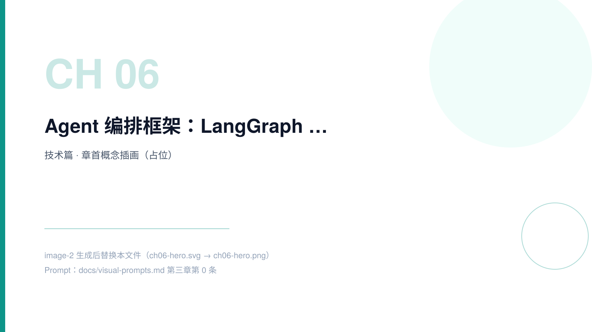
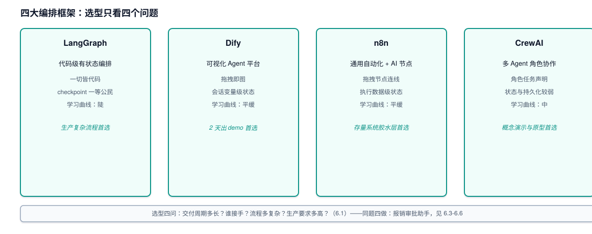

# 第 6 章 Agent 编排框架：LangGraph / Dify / n8n / CrewAI

> **本章导读**：上一章你用 50 行跑通了裸写 ReAct Agent——那为什么还要学框架？因为裸写版只经得起 20 分钟的 demo：客户要断点恢复、要人审开关、要并行分支，你会瞬间陷入状态管理的泥潭。本章横向对比四大主流框架，并用同一个"报销审批助手"在四个框架里各做一遍，给出可实测的选型结论。含可运行的 LangGraph 实现——**checkpoint 断点恢复**的完整演示，这是"demo 能跑"与"敢上生产"的分水岭技术。



*（image-2 插画生成后替换：按 `docs/visual-prompts.md` §3 第 6 条 Prompt 生成 `assets/ch06-hero.png`，并把本引用扩展名改为 .png）*

---

## 6.1 为什么需要编排框架

### 6.1.1 裸写版会在第 21 分钟翻车

回顾 `03_raw_react_agent.py` 的三个结构性缺陷——它们不是 bug，是**裸写模式的天花板**：

1. **状态无处安放**：messages 列表就是全部状态。要加"多用户并发""中途修改参数"，你得自己发明会话管理、锁与恢复——重复造一千个轮子；
2. **循环只有一个形状**：ReAct 是"模型驱动的循环"。但生产流程常常是**人定的流程**——"先查预算、超标必须走人审、批准后写回 OA"——这是确定性的分支图，硬塞进自由循环里，模型会在每一步重新"发明"流程，然后偶尔发明错；
3. **崩溃即失忆**：进程重启，进行到一半的审批全部丢失。"客户填了一半的表单，重启后 Agent 从头来"——这在生产里是事故，不是 bug。

框架的全部价值就在修补这三点：**把"不确定的循环"和"确定的流程"统一成可控的图（graph），把状态从内存里解救出来（checkpoint），把关键决策交给人（interrupt）**。

### 6.1.2 两种"图"：先分清你要的是哪种

这是选型的第一问，多数人选错框架都错在这——**你的流程主导权在谁手上？**

| | 模型主导（autonomous） | 流程主导（workflow） |
|---|---|---|
| 形态 | 自由循环，模型决定下一步 | 你画好的分支图，模型只在节点内干活 |
| 例子 | "帮我调研这个客户并写报告" | "报销单必须先查预算、超标必须人审" |
| 适合 | 开放任务 | 业务流程（**FDE 交付的绝大多数**） |
| 代表 | ReAct 循环 | LangGraph 图、Dify 工作流、n8n |

FDE 的现场经验：企业交付里 **80% 以上是流程主导**——客户的流程本来就是被制度规定好的。所以本章的主角是 workflow 图，ReAct 循环只在个别节点内出现（比如"自由核查发票内容"这种开放子任务）。

### 6.1.3 选型四问

带着这四个问题读 6.2 的横评表：

1. **交付周期多长？**——2 天出 demo 和 2 个月建平台，选型完全不同；
2. **谁接手？**——客户 IT 是工程团队还是业务团队，决定可视化优先还是代码优先；
3. **流程多复杂？**——有没有并行、人审、回退、长周期等待；
4. **生产要求多高？**——要不要断点恢复、灰度、审计（第 9 章）。

### 6.1.4 什么时候不需要框架

选型纪律的反面同样重要——以下三种情况，裸写（第 5 章）就是正确答案：

1. **单轮或两轮调用**：抽取、分类、改写类任务，一次调用出结果，没有任何状态可言——上框架纯属负重跑步；
2. **纯模型驱动的探索 demo**：20 分钟给客户看个效果，用不到人审与恢复——框架的搭建成本反而吃掉响应速度；
3. **嵌入现有系统的轻量 Agent**：宿主系统已有状态管理（如工作流引擎），你只是其中一个小函数——别在别人家屋子里再造一套图。

一个可操作的判据：**当你的 while 循环里出现了手工维护的 status 字典，就该上 LangGraph 了**。框架的入场时机不是“项目开始”，而是“复杂度信号出现”。

---

## 6.2 四大框架横评

| 维度 | LangGraph | Dify | n8n | CrewAI |
|---|---|---|---|---|
| **定位** | 代码级有状态编排 | 可视化 Agent 应用平台 | 通用自动化 + AI 节点 | 多 Agent 角色协作 |
| **范式** | 代码即图 | 拖拽即图 | 拖拽节点连线 | 角色任务声明 |
| **学习曲线** | 陡（Python + 图思维） | 平缓 | 平缓 | 中 |
| **灵活性** | 最高（一切皆代码） | 中 | 中 | 中高 |
| **状态/持久化** | 一等公民（checkpoint 内置） | 会话变量 | 执行数据 | 较弱 |
| **人审（HITL）** | interrupt 原生支持 | 有节点可用 | 等待/审批节点 | 需自建 |
| **适合场景** | 复杂状态机、生产系统 | 业务侧快速落地、非工程团队接管 | 企业存量流程自动化 | 分工明确的多角色流程 |
| **FDE 典型用法** | 生产主力 | 客户共研原型、低代码交接 | 客户已有 n8n 资产时 | 试点演示多角色协作 |



*图 6-1 四大框架定位（源文件 `assets/diagrams/framework-comparison.drawio`）——每张卡只回答一件事：什么时候选它*

### 6.2.1 四个框架的"世界观"差异

横评表是骨相，世界观是气质——同一件事，四个框架的问法完全不同：

- **LangGraph 问你：**"流程长什么样？状态里有什么？"——它把 Agent 看作**状态机**：节点是纯函数（state 进、state 出），边是转移条件。一切复杂性都摊在代码里，因此**一切复杂性都可测试**。这是它成为生产主力的根本原因：测试无法覆盖看不见的魔法（第 10 章评估的工程化前提）；
- **Dify 问你：**"应用要长什么样？"——以**应用**为中心：编排页、知识库、模型管理、发布入口一站式。代价是灵活性的天花板，收益是非工程同学也能改流程——**"谁接手"这题的答案常常直接决定选它**；
- **n8n 问你：**"这个流程怎么自动化？"——它的本命是**存量系统集成**：四百多个连接器（数据库、OA、ERP、IM）开箱即用，AI 节点是近年加的能力。当客户已经有 n8n 在跑流程时，别推新框架，把 AI 节点嵌进现有工作流是阻力最小的路线；
- **CrewAI 问你：**"任务该分给谁？"——以**角色**为中心：声明一组 Crew（船员）、各自 Role 与 Backstory、Task 列表，框架负责调度协作。它最擅长的不是可控流程，而是"多视角协作"的开放任务（如"三个角色分别从合规/成本/体验角度评审方案"）。

### 6.2.2 架构对照：一张图看懂四个抽象层

四个框架其实站在不同的抽象层上，不存在谁取代谁：

```
抽象层高    Dify（应用层：编排+知识库+发布）
           n8n（集成层：连接器+流程自动化）
           CrewAI（协作层：角色+任务委派）
抽象层低    LangGraph（状态层：图+状态+持久化）
           ↓ 底座都是第 5 章的裸循环：LLM + 工具 + 循环
```

一个真实感十足的组合用法：**LangGraph 做生产内核（状态与流程），n8n 打通存量系统（集成层连接器），Dify 给业务方留一个可调参的壳**——三层各司其职。第 16 章的"宏达制造"项目会用到这个组合思路。

---

### 6.2.3 版本演进与选型稳定性：横评的时效性提醒

本书不列版本号，理由本身就是一条纪律：**这个赛道的版本以月为单位失效**（LangGraph 自 2024 年发布以来 API 多次调整；Dify 版本迭代以周计）。但选型决策需要稳定性，三条对策：

1. **横评看"世界观"，不看功能清单**——功能一个版本就能补齐，世界观（6.2.1 的四问四答）多年不变。本文 2026 年的横评结论若在 2028 年依然成立，靠的是问对了问题；
2. **锁定语义、抽象封装**——第 6.3.6 的"节点字典"法：语义资产（流程逻辑、接口定义）与框架实现解耦，换框架时只翻译不重构；
3. **小成本验证**——用本章"同题法"：任何新框架/新版本入场时，花两小时把报销审批助手做一遍，你的手感比任何横评文章都新鲜。

顺带一个 FDE 视角的提醒：**客户现场没有"最新版"**——政企环境里你大概率遇到落后一年以上的版本。选型时永远多问一句："这个特性，在客户机房的离线安装包里存在吗？"（第 9 章私有化的伏笔。）

---

## 6.3 同题实战：报销审批助手四做

### 6.3.0 需求定义

四个框架做同一个需求（这是本章实验设计的核心——同题才能横比）：

> **报销审批助手**：读入发票信息（金额、事由）→ 查询预算系统核对额度 → **未超标：自动通过**；**超标：必须转人工审批，批准后**继续 → 写回 OA 系统并通知员工。

三个刻意设计的考点：

1. **确定性分支**（超标判断）——流程主导型的典型；
2. **人审中断**（超标转人工）——HITL 能力，裸写最难处理的部分；
3. **外部系统回写**（OA 写回）——集成能力的代表。

验收口径统一：支持人工重放测试——给定输入与人工决策，产出可核对的审批轨迹。

### 6.3.1 LangGraph 版（本章代码实战主角）

核心设计（完整可运行代码见 `examples/ch06/langgraph-approval/app.py`）：

```
START → parse_invoice → check_budget
   ├─ 未超标 → write_back_oa → END
   └─ 超标 → human_review（interrupt，暂停等待人工）
                 ├─ 批准 → write_back_oa → END
                 └─ 驳回 → END（记录驳回）
```

四个要点直接对应 6.1.1 的三个裸写缺陷：

- **State 用 TypedDict 声明**：`amount / budget / needs_human / human_decision / trail`——状态不是藏在 messages 里的，是显式字段，可测试、可迁移；
- **节点是纯函数**：`parse_invoice(state) -> dict`——输入输出都是状态，天然可单测（第 10 章评估能对每个节点单独打分）；
- **conditional edges 表达业务规则**："超标必人审"是一条 `add_conditional_edges`——规则在图上，肉眼可审计（客户合规部门友好）；
- **checkpoint + interrupt 实现断点与暂停**：`MemorySaver`（生产换持久化后端）保存每步快照；`interrupt_before=["human_review"]` 让流程**物理性停下**，等人工决策输入后 `update_state` 恢复继续——**进程重启后凭 thread_id 照样能接着跑**，这是断点恢复的演示核心。

### 6.3.2 Dify 版

Dify 里这条流程是一个标准工作流（编排页拖拽）：

`开始 → 图像提取（发票OCR节点）→ HTTP请求（预算接口）→ 条件分支（IF 超标）→ 人审核对节点 / 直接 → HTTP请求（OA回写）→ 结束`

实现要点：预算与 OA 走 HTTP 请求节点（Dify 不自带你的客户系统连接器）；人审用"表单收集"类节点。**耗时实测：熟悉 Dify 的人约 40 分钟出可用版本**，是四者中最快出 demo 的。局限也明确：人审的审批流转（超时提醒、多级审批）超出其表达能力时，就是迁往 LangGraph 的信号。

### 6.3.3 n8n 版

n8n 的形态与 Dify 相似（拖拽节点），但气质完全不同——**强在连接器**：如果客户用飞书/钉钉/OA 厂商，n8n 大概率有现成节点，OA 回写是"拖个节点配个 token"的事；人审用它的"等待回调（Wait/Approval）"节点。`examples/ch06/n8n-workflow/approval-workflow.json` 给出可导入的工作流骨架（node 列表与连线），导入 n8n 后补齐凭证即可。**选它的判据只有一条：客户已有 n8n 资产。**

### 6.3.4 CrewAI 版

CrewAI 版的思路是角色化：`发票核对员`（从发票提取要素并校验合规）、`预算审查员`（核对额度、给建议）、`OA 归档员`（生成回写内容）。三个 Role 各配工具（查预算、写 OA），Task 间用 `context` 传递。**实测观感**：多角色评审的"会签"体验很出彩——两个角色能从不同角度发现单角色漏掉的问题（金额校验 vs 流程合规）；但"超标必须停下等人"这种硬性流程约束表达起来反而别扭，需要把人审逻辑包在工具实现里。这印证了它的定位：**协作层，不是流程层**。

### 6.3.5 同题横比：一张实测对照表

| | LangGraph | Dify | n8n | CrewAI |
|---|---|---|---|---|
| 出可用 demo | ~2 小时 | **~40 分钟** | ~1.5 小时 | ~1 小时 |
| 人审中断 | 原生 interrupt | 表单节点 | 等待节点 | 工具内自建 |
| 断点恢复 | **checkpoint 原生** | 无 | 执行历史可查 | 无 |
| 流程可审计 | 图代码可 diff | 可视化截图 | 可视化 | 角色对话日志 |
| 客户非工程团队接管 | 难 | **容易** | 容易 | 难 |
| 生产演进空间 | **最高** | 中 | 中 | 低 |

选型结论（可操作版）：**原型期用 Dify/n8n 抢时间，生产期迁 LangGraph 求确定性，多角色开放任务用 CrewAI 做尖兵**。而迁移的触发信号（人审流转复杂化/断点恢复需求/流程版本管理）在 6.3.2-6.3.4 各节已逐一指出——**选型不是站队，是跟随需求的阶段**。

---

### 6.3.6 迁移三步法：从 Dify 原型到 LangGraph 生产

阶段化选型必然带来迁移。把 Dify 原型迁往 LangGraph 生产版的可操作三步（第 16 章实战将完整演练）：

1. **先固化语义**：把 Dify 画布上的每个节点翻译成一页纸——输入变量、输出变量、调用的接口与参数。这一步产出的“节点字典”就是新图的需求文档，**任何流程迁移前，先把语义从工具里释放出来**；
2. **重建图骨架**：LangGraph 版先不接 LLM——节点用确定性桩函数（本章 app.py 的做法），把图结构与条件分支跑通，用同一批测试用例（发票号/预算/超标组合）对比两边输出；
3. **最后接智能**：把 OCR、制度问答等模型节点逐个接入，每接一个跑一次评估集（第 10 章）——智能化是逐步注入的，而不是一次性切换。

三步的共同原则：**图先于智能，语义先于工具**。反过来迁移（LangGraph 验证过的流程交给业务方在 Dify 维护）同理——节点字典同样成立。

---

## 6.4 从 Demo 到生产：框架之上的必修课

### 6.4.0 checkpoint 解剖：一张快照里到底有什么

本章代码实战让 checkpoint 跑起来了，现在拆开看它是什么——这是从“会用”到“敢运维”的关键一步。一个 checkpointer 的契约由三样东西组成：

- **thread（线程）**：一条流程实例的身份。一个 thread_id 对应一次报销审批的全部历史——多用户并发就是多个 thread，互不干扰；
- **checkpoint（快照）**：每个节点执行完后的完整状态（State 字典 + 图当前进度 next）。MemorySaver 存内存，生产换 PostgresSaver/RedisSaver——**接口完全一致，代码零改动**；
- **恢复语义（as_node）**：`update_state(config, values, as_node="human_review")` 的意思是“假装 human_review 刚产出了这些值”——图从该节点的下游继续，而不是从头跑。这是断点恢复的灵魂参数，也是 resume_demo 实际使用的机制。

三个运维必答问题（现场会被问到）：快照多大？（与 State 字段数成正比——State 保持精简，大对象存外部系统、状态里只放引用）多久过期？（thread 清理策略与业务流程寿命对齐——等人审的单子可能活三天）谁有权限读改？（快照含敏感业务数据，权限设计见第 9 章。）三个问题想清楚，框架才算真正“生产可用”。

框架解决了图与状态，但“敢上线”还差两章必修课，这里先立框架（第 9、10 章展开）：

- **持久化后端**：MemorySaver 是内存版——生产要换成可持久化的 checkpointer（Postgres/Redis 版），并设计 thread 的清理策略。原则：**状态存储的寿命必须覆盖流程的最长等待**（一张等人审的报销单可能要等三天）；
- **human-in-the-loop 的工程闭环**：interrupt 只是"停下"，生产还需要配套——谁审批（路由到谁）、超时怎么办（升级/自动驳回）、审批记录留痕（审计，第 9 章）；
- **与评估的接口**：图状态让"轨迹评估"变成可能——每个节点输入输出都可采样打分（第 10 章 10.5 节）。这是 LangGraph 路线在生产演进上的决定性优势。

一个值得提前记住的判断：**框架图 + checkpoint + HITL 闭环 + 审计日志 = 生产级 Agent 的最小完整形态**。第 15-17 章的三个项目将反复组装这个形态。

---

## 6.5 本章知识点卡

| 概念 | 一句话解释 | 关键词 |
|---|---|---|
| 两种图 | 模型主导（自由循环）vs 流程主导（分支图）——FDE 80% 是后者 | 选型第一问 |
| 节点即纯函数 | state 进 state 出，天然可单测 | 可测试性 |
| conditional edge | 业务规则画在图上，肉眼可审计 | 合规友好 |
| checkpoint | 每步状态快照，重启后凭 thread_id 续跑 | 断点恢复 |
| interrupt | 流程物理性停下等人，update_state 恢复 | HITL 原生 |
| MemorySaver | 内存版 checkpointer，生产换持久化后端 | 演练用 |
| 四层抽象 | Dify 应用层 / n8n 集成层 / CrewAI 协作层 / LangGraph 状态层 | 不互斥 |
| 阶段化选型 | 原型 Dify/n8n → 生产 LangGraph → 尖兵 CrewAI | 跟随阶段 |

---

## 代码实战：同题四做

本章示例在 `examples/ch06/`，四个子目录对应四个框架：

- **`langgraph-approval/app.py`** —— 完整可运行版（本章主角）：State 声明、五个节点、条件分支、MemorySaver checkpoint、`interrupt_before` 人审暂停、update_state 恢复、trail 审计日志。**零 API Key 即可运行**（流程节点全部确定性，刻意不接 LLM——编排本身才是本章主角；接口已留好，第 8 章起接入真实模型）；
- **`langgraph-approval/resume_demo.py`** —— 断点恢复的戏剧化演示：跑到人审节点**退出进程**，第二次运行凭同一个 thread_id 找回全部状态并继续到 OA 回写——亲眼看到"重启不失忆"；
- **`dify-workflow/README.md`** —— Dify 编排的分步搭建指南（节点清单 + 配置要点 + 迁移信号）；
- **`n8n-workflow/approval-workflow.json`** —— 可导入的 n8n 工作流骨架（节点与连线，导入后补凭证）；
- **`crewai-approval/app.py`** —— 三角色会签实现（发票核对员/预算审查员/OA 归档员），需 `pip install crewai`，代码结构可先读。

```bash
cd examples/ch06/langgraph-approval
pip install langgraph
python app.py --auto           # 自动演示：未超标直通路径
python app.py --human          # 人审演示：超标暂停 → 输入决策 → 继续
python resume_demo.py          # 断点恢复演示：跨"进程重启"续跑
```

---

## 章末习题

1. **改图练习**：在 LangGraph 版里加一条新规则——"金额超过 1 万元时，即使未超标也要二级人审"。要求：只加节点和边，不动现有节点内部逻辑。做完后回答：改动了图之后，旧测试用例还有效吗？（体会"图即规则"的可审计性。）
2. **断点恢复压力测试**：把 `resume_demo.py` 的等待时间调长，在暂停期间手动往 checkpoint 里改状态（比如把 amount 从 8000 改成 300），恢复后观察决策分支变化——然后回答：**生产里谁应该有权限改 checkpoint？**（这题答案通向第 9 章的权限设计。）
3. **选型答辩**：为一个真实（或虚构）客户场景写 300 字选型报告：客户是 200 人规模的制造业，IT 团队 3 人（1 工程师 + 2 业务系统管理员），已有 n8n 在跑考勤流程，要上"设备报修分派 Agent"。给出主框架、过渡方案与两年演进路线，并准备接受挑战提问。

---

## 参考资料

- LangGraph 官方文档（State/节点/checkpoint/interrupt 的权威定义）：https://langchain-ai.github.io/langgraph/
- Dify 官方仓库与文档：https://github.com/langgenius/dify
- n8n 官方文档（Workflow JSON 结构与节点库）：https://docs.n8n.io/
- CrewAI 官方文档：https://docs.crewai.com/
- CSDN《AI Agent开发装备清单》《2026年五大开源Agent框架选型指南》系列（框架选型的社区视角对照）
- 第 5 章 `examples/ch05/03_raw_react_agent.py`（四个框架的底座——裸循环）
- Anthropic《Building effective agents》（workflow vs agent 范式区分的权威参照）：https://www.anthropic.com/research/building-effective-agents

> 下一章预告：图能跑了、状态能存了，但工具还是硬编码在 `execute_tool` 里的玩具。第 7 章升级为标准协议：MCP——从零写一个生产级 MCP Server，把"工具"变成可复用、可移交、可反哺产品的企业资产。
