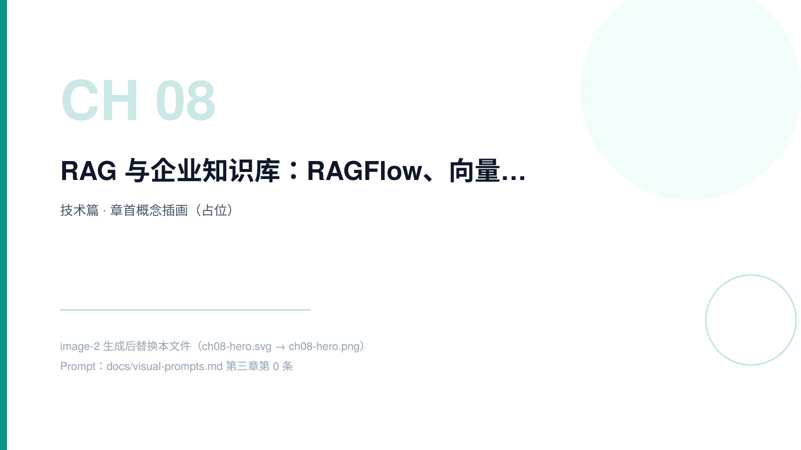
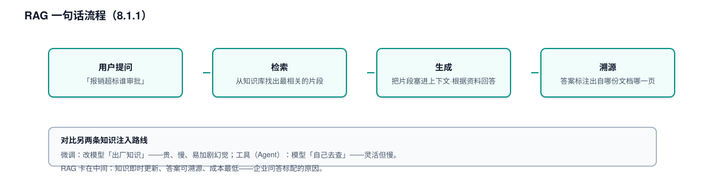
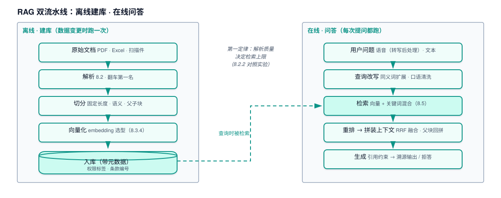
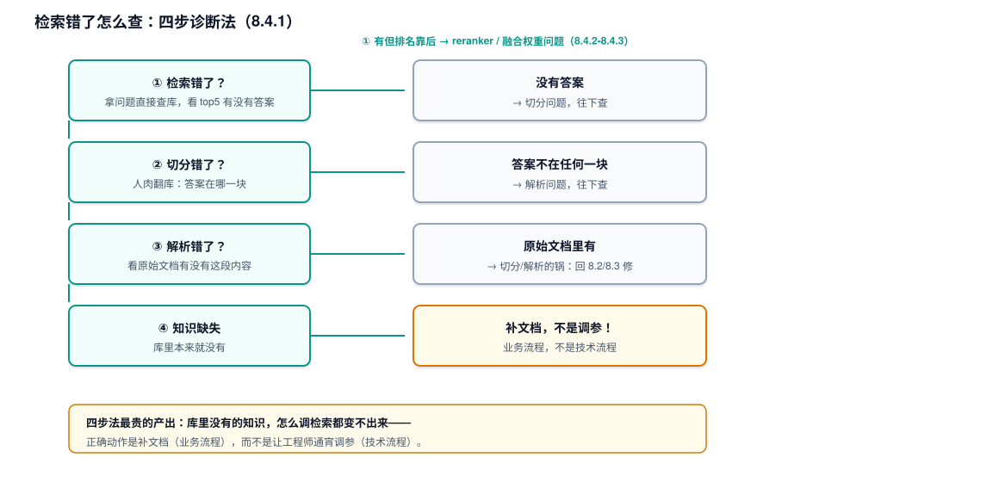

# 第 8 章 RAG 与企业知识库：RAGFlow、向量库、文档解析

> **本章导读**：企业知识问答是 FDE 接到最多的需求，也是翻车最多的需求——"AI 一本正经地答错制度"几乎是每个企业 AI 项目的第一个事故。本章覆盖从文档解析、切分、向量化、检索到生成的完整流水线，重点始终是"企业级"三个字：脏数据、多格式、权限与溯源。全部示例**零第三方依赖、纯标准库可运行**——因为我们用教学版检索算法（字符袋 + BM25 思想）讲透原理，生产级的向量库与 RAGFlow 在原理落点一一对应。



*（image-2 插画生成后替换：按 `docs/visual-prompts.md` §3 第 8 条 Prompt 生成 `assets/ch08-hero.png`，并把本引用扩展名改为 .png）*

---

## 8.1 RAG 五分钟原理

### 8.1.1 白话版：让模型开卷考试

第 4 章说过：模型没见过客户的私有知识；第 1 章的实验你亲眼见过闭卷的下场（幻觉）。RAG（Retrieval-Augmented Generation，检索增强生成）的思路朴素到只剩四个字：**开卷考试**。



*图 8-2 RAG 四步链（源文件 `assets/diagrams/rag-chain.drawio`）——一句话流程与两条对比路线（微调/工具）的位置关系*

对比另外两条注入路线（第 4 章选型表）：微调想改变模型的"出厂知识"（贵、慢、还容易加剧幻觉）；工具想让模型"自己去查"（Agent 模式，灵活但慢）。RAG 卡在中间：**知识即时更新、答案可溯源、成本最低**——这就是它成为企业问答标配的原因。

### 8.1.2 流水线全景图



*图 8-1 RAG 双流水线全景（源文件 `assets/diagrams/rag-pipeline.drawio`）——第一定律"解析质量决定检索上限"贯穿两列*

本章按"离线四步 + 在线六步"推进，每一步都有翻车点，也有对应的纪律。

### 8.1.3 50 行跑通第一个 RAG

`examples/ch08/01_toy_rag.py` 用不到 50 行实现完整闭环（纯标准库）：文档切分 → 字符袋相似度检索 → 带引用的生成 prompt 拼装。检索算法刻意用"字符袋余弦"替代真实 embedding——**教学版的意义不是精度，是让每个环节都肉眼可见**。跑通它，然后问它一个库外问题（"公司食堂几点开门"），观察它检索到了什么、模型该拒答——这个"看到了差距"的瞬间，是本章所有优化的起点。

---

## 8.2 文档解析：企业 RAG 翻车第一名

### 8.2.1 企业文档的真实形态

Demo 世界的文档是干净的 Markdown；客户机房的文档长这样：盖红章的扫描件 PDF、五个 Sheet 互相引用的 Excel、合并单元格嵌套三层的报表、Word 里用空格排版的"表格"、双栏排版导致阅读顺序错乱的论文。**RAG 项目的第一周，一半时间花在"让文档可读"上**——这是 FDE 排期时刻意要留出的余量。

### 8.2.2 解析对照实验：同一段制度，两种命运

`examples/ch08/02_parse_benchmark/` 做一个可运行的对照实验：同一段"报销制度"，模拟两种解析结果——

- **坏解析**：表格被拍平成一行乱序文字（"P1-P3 单笔不超过 2000 元"变成"2000 超过 不 单笔 P1-P3……"），条目编号丢失；
- **好解析**：结构保留，条款编号、层级、表格行列完整。

然后跑同一组检索测试，对照两种解析下"单笔上限是多少"能否命中。实测会看到坏解析下检索分数系统性偏低——**解析质量决定检索上限**，这是 RAG 的第一定律。生产工具选型（RAGFlow 的深度文档理解、通用 PDF 库、OCR 服务）的判断依据不是跑分，而是**拿客户真实文档做这个对照实验**——这也是售前验证（第 2 章标准二）的技术动作。

### 8.2.3 解析纪律三条

1. **先抽样再全量**：拿 20 份客户真实文档跑解析，人眼看 5 份——别用印刷体 demo 文档自欺；
2. **保留结构元数据**：条款编号、标题层级、表格标签进入 chunk 的元数据（8.3.3）；
3. **解析失败要有出口**：扫描件识别不了的，标记"需 OCR 补处理"，而不是硬塞进库里变成噪声。

---

## 8.3 切分与向量化：细节决定成败

### 8.3.1 三种切分策略

| 策略 | 做法 | 优点 | 陷阱 |
|---|---|---|---|
| **固定长度** | 每 500 字切一段 | 实现简单 | 语义被腰斩，答案往往跨两块 |
| **语义切分** | 按标题/条款/段落边界切 | 保住语义完整 | 长块检索稀释、短块上下文不足 |
| **父子块**（parent-child） | 检索用小块（精确命中），生成用父块（上下文完整） | 精度与上下文兼得 | 实现复杂度高一档 |

企业制度文档的最优解通常是"**按条款切 + 父子块**"：第 2 条招待费规定切成 child chunk（检索时精准命中"1500 元"），返回时带上整个第 2 条（生成时上下文完整）。`03_hybrid_search.py` 的示例数据就按条款切分——你会看到条款边界让检索分数显著更干净。

### 8.3.2 向量化：教学版与生产版

向量化（embedding）的白话解释：**把文字变成坐标，意思相近的文字坐标相近**。生产中用预训练 embedding 模型（中文场景注意选型），教学版用字符袋（char-bag）余弦——两者在"检索管道"的角色完全一致，所以本章代码里换一行模型调用就能升级到真实 embedding（代码注释标了升级点）。**学的是管道，不是某个模型**——模型年年换（第 6 章 6.2.3），管道十年不变。

### 8.3.3 元数据设计：权限与溯源的地基

每个 chunk 入库时带一份"户口"（本章代码的 `meta` 字段）：

```python
{"doc": "报销制度v3.2", "section": "第2条", "page": 3,
 "dept": "财务部", "level": "公开"}   # ← 8.5 的权限过滤靠它
```

元数据不是锦上添花——**它是 8.5 溯源引用、权限过滤、增量更新、失效重筛的共同地基**。现场排期时"设计元数据 schema"要放在写代码之前，改 schema 的成本随库体积指数增长。

### 8.3.4 增量更新与失效管理：知识库是活的

上线只是知识库生命的开始。制度半年一改版，产品手册月月更新——**增量更新是运维阶段的头等大事**，设计不当会出现最恶劣的故障形态：新旧两个版本同时被检索到，AI 给出互相矛盾的答案。三条纪律：

1. **以文档为单位入桶**：每个 chunk 的元数据里带文档 ID 与版本号（`doc_id + version`），改版时同文档旧版 chunk 全部标记 `superseded`，检索层过滤掉——**先淘汰旧版，再灌入新版**，顺序不能反；
2. **断点可重跑**：解析→切分→向量化流水线要能从任意一单失败处重跑（幂等设计）；
3. **变更留痕**：谁在何时更新了哪份文档——第 9 章审计日志在知识库侧的镜像。

现场排期时，把"增量更新机制"写在交付清单里——客户 IT 接手后第一件砸手上的事往往就是它。

> **一线故事：两个版本打架的那一周。** 本书虚构的 FDE 林舟在智能客服项目上遇到过一个诡异故障：同一个问题，上午和下午的答案不一样，而且**两个答案都像是对的**。排查了两天，最后在 8.4.5 的四步法第 ③ 步才发现根因：客户一周前下发了新版报销制度，增量脚本把新版灌了进去，但旧版没有被淘汰——知识库里同时活着 v3.1 和 v3.2，而新版恰好把招待费审批门槛从 2000 元改到了 1500 元。两版条款分数咬得极近，谁排第一取决于问题措辞的细枝末节。修复只用了半小时（按文档 ID 淘汰旧版），但林舟在复盘会上的那句话后来被写进了团队章程：**"知识库的'新'不是靠灌入保证的，是靠淘汰保证的。"** 这个故事也解释了 8.5 溯源机制的第二个价值——答案带版本号引用，混答事故当天就会被发现，而不是两天后。

---

## 8.4 检索质量优化

### 8.4.1 为什么单一检索永远不够

向量检索的强项是**语义**（"话费怎么多了"能命中"资费标准"），弱项是**精确词**（问"P1-P3"这种术语，向量可能输给关键词）；关键词检索（BM25 一族）恰好相反。企业文档里专有名词、编号、人名、金额密集——**单用向量，术语查询系统性翻车**。所以生产标配是两者融合。

### 8.4.2 混合检索与 RRF 融合

`03_hybrid_search.py` 实现完整的混合检索管道（纯标准库）：

1. **关键词路**：BM25 思想的打分（词频 × 逆文档频率）；
2. **向量路**：字符袋余弦（教学版，注释标了真实 embedding 升级点）；
3. **融合**：RRF（Reciprocal Rank Fusion，倒数排名融合）——每个候选集里的第 k 名得 `1/(60+k)` 分，两路相加。RRF 的妙处是**不比较两路分数的绝对值**（量纲不同没法比），只比排名——简单、免调参、效果稳定，是工业界事实标准。

实测对照（脚本自动输出，并附一个教学版的诚实注脚）：术语型问题（"P4-P6 单笔 5000"）关键词路大幅领先；口语型问题（"请客户吃饭没提前申请能报销吗"）教学版的字符袋向量路会排偏（它没有真实 embedding 的语义泛化能力），关键词路反而靠词汇重叠兜底——**这个"意外"本身就是教学素材：换上生产 embedding，"吃饭没提前申请"与"招待费事前审批"的语义相似才会显现，而管道结构一行不用改**。RRF 的价值在实测里同样清晰：两路排名差异是真实的，融合让单路失效时另一路兜底——这就是混合检索的工程意义。

### 8.4.3 重排序（reranker）

粗检索追求"召回"（宁可多捞，别漏了），精排追求"精度"（前几名要对）。生产做法：粗排取 top 50 → reranker 模型精排取 top 5。教学版用"查询词与文档的重叠率"模拟 reranker（`03` 的 `rerank()`），它演示的是**两阶段的结构**——生产中把这一个函数换成真实 reranker 模型，管道其他部分零改动。成本账也值得记住：**reranker 是 RAG 里性价比最高的增益**，一个轻量精排模型往往比换更大的 embedding 提升更明显。

### 8.4.4 查询改写：口语进，术语出

客服场景的真实问题是"我话费怎么多了"——检索库里写的是"资费标准与扣费说明"。两个动作：**口语→术语映射表**（第 15 章的实战资产，从真实会话日志里挖）和**查询扩展**（模型把口语问题改写成 2-3 个检索友好的变体，再各查一路）。查询改写的落点在 8.1.2 流水线图的第一站——它优化的是"进"，后面所有环节都受益。

### 8.4.5 多轮追问：检索看不到的那半句话

用户从不把话说完整：第一问“招待费上限是多少”，第二问“那超额了怎么办呢”——第二问里**没有主语**。若拿原句去检索，“超额”两个字会把知识库犁一遍而徒劳无功。正确动作是在检索之前加一步**对话状态改写**：把“那超额了怎么办呢”改写为“招待费超过 1500 元上限如何处理”——用第 4 章的对话历史做指代补全，再进检索。

实现要点：改写器本身是一次轻量 LLM 调用（或规则模板）；改写后的完整句作为检索 query，原始口语句保留给生成层（用户的措辞里可能有情绪信息）。多轮客服场景里，这一步带来的检索命中率提升常常比换 embedding 模型更明显——第 15 章的项目里它会作为独立模块出现。

---

### 8.4.6 失败诊断四步法

检索没命中时的排查顺序（现场救命的流程图）：



*图 8-3 检索诊断四步（源文件 `assets/diagrams/rag-debug.drawio`）——有但排名靠后 → reranker/融合权重问题（8.4.2-8.4.3）*

四步法最重要的产出是第 ④ 步的纪律：**库里没有的知识，怎么调检索都变不出来**——此时正确动作是补文档（业务流程），而不是让工程师通宵调参（技术流程）。把四步法贴在工位上，能省下项目里最贵的加班费。

### 8.4.7 生产性能预算：延迟与成本的账

检索质量之外，生产 RAG 还有两张预算表要管：

- **延迟账**：总延迟 = 检索（百毫秒级）+ reranker（百毫秒级）+ 生成（秒级）。生成永远是最大头，所以优化优先级：**先动检索参数（top_k、过滤条件），再动模型规模**。多路检索并行发、reranker 只对 top50 精排，是标准姿势；
- **成本账**：每次问答 = 改写调用（小）+ 检索（免费/本地）+ reranker（小）+ 生成（大头）。用第 4 章的 token 预算法把注入片段控制在预算表 40-60% 内——**top_k 不是越大越好**，多注入一段无关节，分数不升、成本升、还稀释注意力（lost in the middle）。

把两张账画进交付方案的一页纸里——客户问“为什么不用更大的模型”时，这两张表就是你的回答。

---

## 8.5 溯源与引用：让客户敢用

### 8.5.1 强制引用：答案必须带"户口"

生产级生成的 prompt 约束（第 5 章五件套在 RAG 里的应用）：

```
【规则】仅依据<制度片段>回答；每个结论必须标注来源，
格式为"（依据：《报销制度v3.2》第2条）"；未涉及的回答"制度中未涉及"。
```

`04_citation_answer.py` 演示完整行为：命中时输出带条款引用的答案；低置信时**拒答并给出最接近的已知条款**。两种输出客户都"敢用"——前者可核查，后者不误导。

### 8.5.2 拒答机制：置信度阈值

检索分数低于阈值时拒绝回答（"制度中未涉及该问题，最相关的条款是第 2 条，可联系财务确认"）。三个设计要点：阈值不是拍脑袋——用评估集（第 10 章）在"误答率/拒答率"曲线上选业务方能接受的点；**拒答要给出口**（最接近条款 + 人工渠道），纯冷冰冰的"不知道"是体验灾难；阈值要分场景——财务制度从严（宁拒勿错），闲聊知识从宽。

### 8.5.3 权限过滤：检索前置一道闸

`dept/level` 元数据此刻兑现：检索结果在进入生成之前，先按当前用户身份过滤——**权限过滤发生在检索层，而不是生成层**（生成层的"请不要回答越权内容"是可以被绕过的，第 7 章注入攻防的近亲）。生产实现：查询带上用户身份 → 向量库做 filtered search（Milvus/Qdrant 原生支持）→ 拿到"该用户可见"的候选集。**Agent 可见性不得超过其代表人**（第 9 章 9.3）在 RAG 里的落点就是这一行 filter。

### 8.5.4 溯源的验收标准：三条可核对的线

交付验收时，"答案能溯源"要翻译成客户能核对的验收项，建议写进测试报告的三条线：

1. **抽查核对线**：随机抽 20 条真实问答，人工核对每条引用的条款是否真的支持该结论——引用错误（张冠李戴的条款号）是最隐蔽的翻车形态，比拒答危害更大；
2. **版本一致线**：所有引用必须带文档版本号，且与知识库当前生效版本一致（8.3.4 的镜检机制）；
3. **拒答可解释线**：抽 5 个库外问题，验证拒答文案里"最接近条款"确实是最相关的——给错出口的拒答，比不拒答更误导。

这三条线的原始出处是第 2 章"目标公式"的验收思想：**能力要用可核对的方式写进合同，而不是用形容词写进方案**。第 15 章的智能客服项目将把这三条线做成验收报告模板。

---

## 8.6 本章知识点卡

| 概念 | 一句话解释 | 关键词 |
|---|---|---|
| RAG | 先检索后生成：让模型开卷考试 | 开卷 |
| 解析第一定律 | 解析质量决定检索上限 | 翻车第一名 |
| 父子块 | 小块检索、父块生成，精度与上下文兼得 | parent-child |
| 元数据户口 | doc/section/page/dept/level——溯源权限地基 | chunk 户口 |
| 混合检索 | 向量管语义、关键词管术语，缺一必翻 | BM25+向量 |
| RRF | 只比排名不比分数的免调参融合 | 倒数排名 |
| reranker | 粗排求召回、精排求精度，性价比最高增益 | 两阶段 |
| 失败诊断四步 | 检索→切分→解析→知识缺失 | 别调参，补文档 |
| 强制引用 | 每个结论标注出处 | 敢用 |
| 拒答阈值 | 低置信拒答并给出口，场景化取值 | 宁拒勿错 |
| 权限前置 | 过滤发生在检索层，不是生成层 | filtered search |

---

## 代码实战：examples/ch08 四件套（全零依赖）

- **`01_toy_rag.py`** —— 50 行闭环：切分→字符袋检索→带引用的 prompt 拼装；内置"库外问题"实验看到差距；
- **`02_parse_benchmark/`** —— 解析对照实验：同一份制度的好/坏解析各建一库，同题检索分数对照（"解析第一定律"的实测版）；
- **`03_hybrid_search.py`** —— 混合检索管道：BM25 思想打分 + 字符袋余弦 + RRF 融合 + overlap 重排，三类问题自动对照（术语题/口语题/融合收益）；
- **`04_citation_answer.py`** —— 溯源与拒答：带条款引用的答案模板、置信度阈值、越权过滤演示（mock 生成，零 API 离线可跑）。

```bash
cd examples/ch08
python 01_toy_rag.py            # 50 行闭环 + 库外问题实验
python 02_parse_benchmark/run.py # 解析质量对照
python 03_hybrid_search.py       # 混合检索 + RRF + 重排
python 04_citation_answer.py     # 溯源/拒答/权限（离线可跑）
```

---

## 章末习题

1. **四步法实战**：用 `01_toy_rag.py` 的库，找三个"它答不好"的问题，按 8.4.5 四步法逐个归因到（检索/切分/解析/知识缺失），并为每个归因写出修复动作。这个练习建议做满 3 个完整案例——失败诊断的手感只能从失败里长。
2. **融合器改造**：`03_hybrid_search.py` 的 RRF 权重目前两路均等。给关键词路加权 0.7（术语密集的制度场景），重跑三类问题对照，观察口语题是否受损——记录你的权衡结论，并回答：权重应该怎么定才不是拍脑袋？（提示：第 10 章评估集。）
3. **权限演练**：给 `04_citation_answer.py` 增加"高管专属条款"（level=vp），验证普通员工查询时它不出现、副总裁查询时出现——然后写出：如果这个 filter 写在了 prompt 里而不是检索层，构造一个绕过它的攻击问题。（这道题的答案会让你终身记住"权限前置"。）

---

## 参考资料

- RAGFlow（深度文档理解的开源 RAG 引擎，8.2 解析对照的生产参照）：https://github.com/infiniflow/ragflow
- Milvus：https://github.com/milvus-io/milvus；Qdrant（filtered search 原生支持）：https://github.com/qdrant/qdrant
- LlamaIndex（chunking 策略与父子块的工程实现参照）：https://docs.llamaindex.ai
- 论文《BM25: Okapi at TREC》背景与《Reciprocal Rank Fusion outperforms Condorcet and individual Rank Learning Methods》（RRF 出处）：https://dl.acm.org/doi/10.1145/1571941.1572114
- 论文《Dense Passage Retrieval for Open-Domain Question Answering》（稠密检索的代表作）：https://arxiv.org/abs/2004.04906
- Anthropic Retrieval 官方指南（引用与拒答约束的参照）：https://docs.anthropic.com/en/docs/build-with-claude/prompt-engineering/long-context-tips
- 第 1 章 `01_see_the_gap.py`（手工 RAG 雏形——本章是它的工程化完全体）
- OpenAI 税务 AI 案例（深度文档处理的生产级样本，中文转述见 CSDN 系列文章）

> 下一章预告：系统在云上跑通了，但客户说"数据不能出院墙"。第 9 章私有化部署与安全：Docker 离线交付、分层权限、全链路审计与回滚演练——把 demo 变成客户机房里"敢用"的生产系统。
