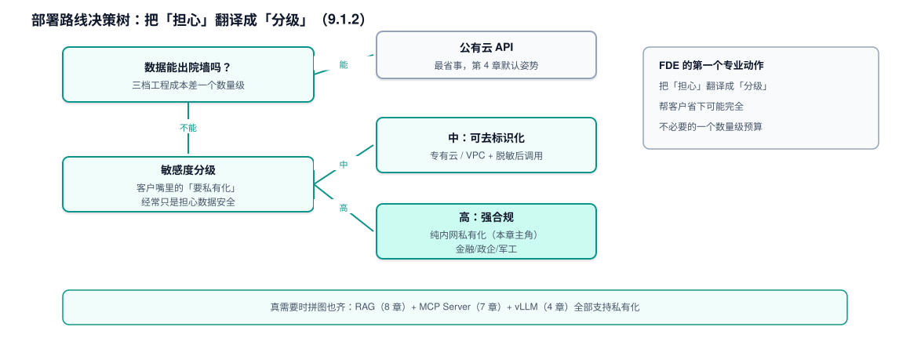
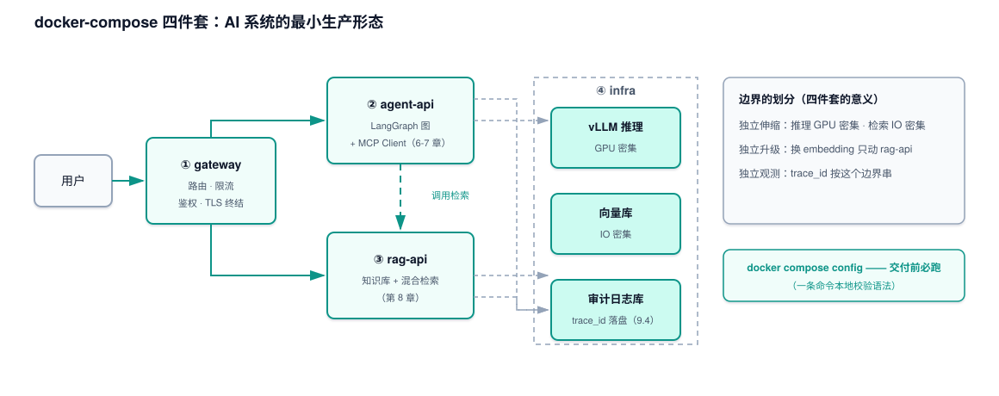
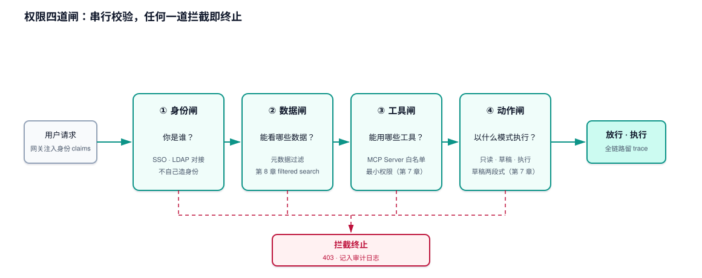

# 第 9 章 私有化部署与安全：Docker/K8s、权限、审计与回滚

> **本章导读**：Demo 在你的笔记本上，生产在客户的机房里——这两地之间隔着整个交付工程学。FDE 交付的最后一个技术台阶，是让系统在客户的私有环境里"安全地活着"：数据不出院墙、权限严格分层、每个动作可追溯、出了问题能退回。本章四件武器——容器化交付、分层权限、全链路审计、回滚演练——也是评估与岗位 JD 中出现频率最高的一章。学完后你会得到一套可直接复印的"交付前检查单"。


---

## 9.1 客户私有环境的真实约束

### 9.1.1 现场调研清单：进机房前先问清的十件事

FDE 进场第一周不是写代码，是把客户的"地质图"摸清。部署相关的十个必问题（打勾表可直接用）：

| # | 问题 | 影响的决策 |
|---|---|---|
| 1 | GPU 有无？型号/显存/数量 | 模型选型与量化档位（第 4 章） |
| 2 | 网络隔离程度？能出网吗？走代理吗？ | 依赖下载方式、API 可用性 |
| 3 | 操作系统与容器平台？已有 K8s？ | 交付形态（9.2） |
| 4 | 安装方式限制？能进 systemd？能 docker save 导入？ | 离线交付方案 |
| 5 | 身份源是什么？LDAP/AD/SSO/企业微信？ | 权限对接（9.3） |
| 6 | 有没有安全基线？端口开放审批？ | 部署架构 |
| 7 | 数据等级划分？哪些字段是敏感级？ | 脱敏方案（9.3.4） |
| 8 | 日志留存要求？几个月？能外发吗？ | 审计设计（9.4） |
| 9 | 变更管理流程？上线要谁审批？平时多久？ | 发布策略（9.5） |
| 10 | 之前的 AI 项目怎么死的？ | 所有以上（避免重蹈覆辙） |

第十个问题最值钱——它给你的不是约束清单，是**客户组织的疤痕组织**：上一次 AI 试点是怎么翻车的、谁背的锅，决定了这次你会遇到哪些"看起来不合理"的阻力。第 11 章需求考古学会再回到这里。

### 9.1.2 部署形态决策树



*图 9-3 部署路线决策树（源文件 `assets/diagrams/deploy-decision.drawio`）——把「担心」翻译成「分级」——三档工程成本差一个数量级*

三条路线的工程成本差一个数量级，而客户嘴里的"要私有化"经常只是"担心数据安全"——**FDE 的第一个专业动作是把"担心"翻译成"分级"**，帮客户省下可能完全不必要的一个数量级预算。这不是偷工减料：如果真需要，第 8 章的 RAG + 第 7 章的 MCP Server 全部支持私有化，模型走 vLLM（第 4 章），私有化的技术拼图本章凑齐。

### 9.1.3 模型选型的连带约束

私有化意味着模型必须在客户的硬件上跑，第 4 章的选型坐标此刻全部收紧：开源权重（Qwen/Llama/DeepSeek/GLM 系）、量化档位（显存预算倒推）、并发吞吐（vLLM 的 PagedAttention）。一个现场铁律：**选型演示用客户真实硬件做**——PPT 上的"7B 模型 4GB 显存"和机房里那台被三个部门共用的 A10，是两个世界。

### 9.1.4 私有化的经济学：什么时候该劝退

把决策树再往前推一步：FDE 有时应该劝客户**不要**私有化。私有化的真实成本清单远不止“买几张 GPU 卡”：

- **硬件与许可**：GPU 服务器 + 开源模型推理优化（量化/并发的实际折扣远大于宣传）；
- **运维人力**：客户侧至少 1-2 名工程师接手升级、扩容、故障处理——这常是成本里最大却最被忽略的一项；
- **能力代差**：私有化模型永远落后云端旗舰一到两代，某些能力（复杂推理、多模态）可能始终做不了；
- **机会成本**：同样的预算投在数据治理与流程改造上，可能回报高得多（MIT 95% 报告的四大堵点里，私有化只解决合规一项）。

判断口诀：**合规是“必须”还是“感觉”？**如果是监管明确要求（金融、政务、医疗的某些数据域），没有讨论空间，把私有化做精；如果只是“怕”，用脱敏 + 分级 + 审计（9.3.4）先满足安全诉求，云 API 的性价比值得为之多谈一轮。**敢于说服客户少花钱，是 FDE 信任账户里最大的一笔存款**——这个原则在第 11 章需求考古学会正式登场。

---

## 9.2 容器化交付

### 9.2.1 Docker 镜像规范

容器化是私有化交付的通用语言——客户 IT 不管你的技术栈，他们只问"镜像多大、怎么启动、怎么升回级"。镜像规范六条（`examples/ch09/01-docker-compose-stack/Dockerfile` 逐条注释对照）：

1. **多阶段构建**：编译依赖层与运行层分离，镜像体积减一半以上（内网传输每 GB 都是真的）；
2. **非 root 运行**：客户安全基线的必查项；
3. **固定基础镜像 digest**：`python:3.12-slim@sha256:...`——离线环境没有"拉最新"这回事；
4. **版本号即一切**：镜像 tag 用语义化版本 + git hash，`latest` 在客户机房是脏词；
5. **健康检查内建**：HEALTHCHECK 指令 + `/healthz` 端点；
6. **配置全环境变量化**：同一镜像跑开发/测试/生产（12-Factor）。

### 9.2.2 docker-compose 四件套：AI 系统的最小生产形态

第 6-8 章的全部组件，收敛为一个四件套（`examples/ch09/01-docker-compose-stack/docker-compose.yml` 可直接抄改）：



*图 9-2 四件套拓扑（源文件 `assets/diagrams/devops-stack.drawio`）——实线为主链路，灰虚线为基建调用*

四件套的意义不是"四个容器"，是**边界的划分**：每层独立伸缩（推理是 GPU 密集、检索是 IO 密集）、独立升级（换 embedding 只动 rag-api）、独立观测（9.4 的 trace_id 恰好按这个边界串）。`docker compose config` 一条命令本地校验语法——**交付前必跑**。

### 9.2.3 离线交付：没有网，怎么装

内网环境安装的标准动作是"侧路运输"：`docker save` 把镜像导出为 tar 包 → U 盘/内网跳板机拷贝 → `docker load` 导入。工程上配套三件事：导出脚本固定镜像清单（compose 文件 + 依赖镜像一次性打包）；导入后用 `docker compose config` 校验一致性；**镜像包用 checksum 双端核对**——U 盘传输损坏是真实发生过的事故形态。

### 9.2.4 什么时候必须上 K8s

判断标准只有一条：**客户已有 K8s，就上 K8s；客户没有，别带来**。K8s 解决的是多机编排、自愈与弹性——单机四件套用 docker compose + systemd 足够。把 K8s 带进没有运维能力的客户环境，等于交付一个"需要养"的宠物。若确需上 K8s：探针（liveness/readiness）、资源限额（limit/requests）、ConfigMap 与 Secret 的分离，是 FDE 必配的三件。

### 9.2.5 交付物标准化

部署的"六个必须留下"版本（对照第 14 章通则）：部署手册（含离线导入步骤）、启动与回滚脚本、健康检查清单、环境变量说明表（`.env.example` 全量注释）、镜像清单与 checksum、升级演练记录（9.5 的产物）。

---

## 9.3 权限：谁能看到什么、能做什么

### 9.3.1 分层权限模型：四层闸门

AI 系统的权限不是一张表，是**四道串行闸门**——任何一道拦截即终止：



*图 9-1 四道串行闸门（源文件 `assets/diagrams/permission-gates.drawio`）——放行路径 teal，拦截支路 rose 汇入审计日志*

四道闸的落点你已经全部见过：数据闸 = 第 8 章 8.5.3 的检索层过滤；工具闸与动作闸 = 第 7 章的最小权限与草稿两段式。本章把它们组装成一张**权限矩阵**：角色（普通员工/经理/VP/审计员）× 数据范围 × 工具动作的交叉表（`examples/ch09/03-permission-matrix/matrix.py` 的 `MATRIX` 字典），并在代码里实测三条越权路径全部被拦截。

### 9.3.2 与企业身份源对接

客户已经有身份体系——SSO/LDAP/AD/企业微信/飞书，AI 系统**永远不自己造身份**，而是对接：用户登录经企业网关 → 网关把用户身份（含部门/职级 claims）注入请求头/token → AI 系统只消费身份，不管理身份。职级与部门是权限矩阵的行索引，这就是"对接"的全部工程量。

### 9.3.3 Agent 特有风险：代表人的影子

Agent 代表人行动时，出现一个传统系统没有的风险形态：**Agent 的权力可能超过它所代表的人**。想象一个场景：某 P3 员工通过对话让 Agent 批量查询了全公司客户数据——因为 RAG 库的权限过滤配置错了，Agent"看见"了该员工本无权看见的数据。传统系统里他至少得一个个点；Agent 让越权变成了**对话式的批量执行**。铁律（第 2 章已预告）：**Agent 的可见性与可操作性，以"其代表人在不用 AI 时的权限"为上限**。审计（9.4）在这里的角色是兜底：即使闸门有疏漏，越权动作也会被记录成可追责的证据链。

### 9.3.4 数据脱敏：进模型前的一道清洗

敏感字段（手机号、身份证、金额、客户名）在进入任何模型调用前的处理策略，按"外送/本地"分级：外送调用 → 强脱敏（掩码/泛化/去标识化，规则库正则 + 实体识别双层）；纯本地私有化模型 → 按客户基线可协商。脱敏的工程细节在"还原"：答案里出现的掩码（`138****5678`）要在出口层按上下文还原或保持——这需要一张**脱敏映射表**随请求传递。第 16 章的项目里它是一个独立中间件。

---

## 9.4 审计：每一步都留痕

### 9.4.1 三类日志，一张网

"出了事能查清"的前提是三类日志都在，且能对上同一根线：

| 日志类型 | 记什么 | 查什么 |
|---|---|---|
| **用户操作日志** | 谁在何时问了什么（原文）、从哪个端 | 谁触发的这次会话 |
| **模型调用日志** | prompt 版本、模型与参数、token 数、耗时 | AI 是怎么答的 |
| **工具调用日志** | 调了哪个 MCP Server 的哪个工具、参数、返回摘要（第 7 章审计） | AI 干了什么 |

### 9.4.2 trace_id：全链路的串绳

三类日志散落在四个服务（9.2 的四件套），靠什么对齐？**trace_id**——请求进入网关时生成、贯穿每一层、写进每一条日志。`examples/ch09/02-audit-logging/audit_tracing.py` 用纯 Python 模拟一次请求穿三层（网关→Agent→工具）的过程：每层日志独立打印（如真实分居三个文件），但都带同一个 trace_id——脚本最后按 trace_id 重放一次"事故调查"，你会看到三类日志如何在 30 秒内还原一次越权尝试的完整链条。

生产实现：trace_id 放请求头（`X-Trace-Id`）由网关生成、上下文传播（OpenTelemetry 标准化方案）、日志格式统一 JSON（第 7 章 audit.log 同构）。**审计的可用性 = 检索速度**：客户合规部门不会陪你 grep。

### 9.4.3 合规场景清单

金融/政企/医疗客户的标准问题与工程回应：日志留存时长（监管要求 6 个月-3 年不等，存储配额进运维手册）；数据不出境（日志里的业务字段与外发权限一并约束）；谁有权查审计（审计日志自身的权限——"谁能监督监督者"）；演练证据（9.5 的回滚演练记录本身常是监管抽查项）。**把合规问题前置到调研清单（9.1.1 第 7-9 问），是 FDE 与"做完再补救"的分水岭。**

### 9.4.4 审计日志的存储工程：三层热度分层

日志"记下来"只是开始，客户合规部门会每周来查——审计系统的可用性取决于检索速度，这需要一点存储工程：**按热度分层**。

- **热层（近 7 天）**：留在本机/本地数据库，支持全文检索——合规日常抽查都在这里；
- **温层（近 6 个月）**：压缩归档到对象存储/归档库，按 trace_id 与时间检索——事故复盘用；
- **冷层（合规留存期剩余）**：仅校验和可查——满足监管"必须有"，不为检索优化。

两个配套细节：**容量账**要在调研时算清（每天调用量 × 每条日志大小 × 留存月数，常被低估 10 倍，是撑爆磁盘事故的头号来源）；**导出权限**本身就是权限矩阵的一行（第 2 章习题里"审计员要不要有查询之外的权限"的镜像问题：谁有权导出全部审计日志？）。

---

## 9.5 回滚与故障预案

### 9.5.1 AI 系统的发布策略：灰度、金丝雀、蓝绿的变体

传统发布策略在 AI 系统上都要"变形"，因为 AI 系统有两个新变量：**模型版本**（供应商可能悄悄升级）与 **prompt 版本**（一次"小改"可能造成行为剧变）。生产组合拳：金丝雀（新版本先接 5% 流量，核心指标对比 24 小时）+ **双模型并行**（新旧模型同时在线，可秒级切流）+ **prompt 版本化回滚**（第 5 章 prompt 进 Git 的兑现时刻——回滚 = revert 一次 commit）。判断"新版可全量"的依据不是没有报错，而是第 10 章的评估指标没有回归。

### 9.5.2 模型也会"坏"：静默劣化的威胁

最危险的故障不是宕机（用户会看到、会报修），是**静默劣化**：供应商换了模型路由、prompt 被人手改了一个字、知识库里混进了旧版本文档（第 8 章一线故事）——系统不报错，答案悄悄变差，用户只会觉得"这个 AI 越来越不好用了"。三个防线：**线上监控探针**（每 N 分钟用固定冒烟问题集跑一次，分数异常报警——评估驱动开发的生产形态）；**模型指纹**（关键场景定期抽测对比基线）；**变更日志**（一切改动的登记制，模型/提示/配置一视同仁）。

### 9.5.3 回滚演练：预案不是写出来的，是练出来的

`examples/ch09/04-rollback-drill.md` 是一份可以直接拿去执行的演练剧本：场景注入（人为把知识库灌入"新版"脏数据）→ 发现（监控探针报警）→ 决策（15 分钟内的三级决策树：降级/切流/回滚）→ 执行（预设脚手架：切流命令、回滚脚本、通知话术）→ 复盘（时间线记录表）。演练的验收标准写在剧本里：**从报警到恢复 ≤ 30 分钟，且全程不需要"想起"任何事——所有动作都在预案清单里**。把演练记录归档进交付文档：它是客户 IT 团队接手信心的最大来源，也是你"六个必须留下"里最被低估的一份。

### 9.5.4 变更管理：上线的最后一道流程

回滚能力之上还有一层"要不要上线、谁来批"的流程设计。客户侧的变更管理（9.1.1 第 9 问问出来的）通常长这样：**变更单**（改什么、为什么、影响面、回滚方案——回滚演练的产物直接引用）→ **审批人**（业务影响小的 FDE 可自批，涉及数据的必须客户 IT 会签）→ **变更窗口**（避开业务高峰，政企客户常指定凌晨或周末）→ **变更日志**（9.5.2 三防线的最后一项：一切改动登记，无例外——包括"我就改个 prompt"）。FDE 的纪律是把 AI 系统的变更纳入客户**已有的**变更管理流程，而不是绕开它——"AI 特殊所以要快"这句话，正是 95% 落地失败的序章。

---

## 9.6 本章知识点卡

| 概念 | 一句话解释 | 关键词 |
|---|---|---|
| 调研十问 | 进机房前问清约束与"上一次怎么死的" | 地质图 |
| 部署决策树 | 数据出院墙→分级→选形态，把担心翻译成分级 | 省一个数量级 |
| 四件套 | gateway/agent-api/rag-api/infra 的最小生产形态 | 边界划分 |
| 离线交付 | docker save/load + checksum 双端核对 | 侧路运输 |
| 四道权限闸 | 身份→数据→工具→动作，串行拦截 | 权限矩阵 |
| 代表人的影子 | Agent 权限以代表人不用 AI 时的权限为上限 | 越权批量执行 |
| trace_id | 网关生成、贯穿四层、串三类日志 | 事故调查的绳 |
| 静默劣化 | 不报错但答案悄悄变差——探针防线 | 最危险故障 |
| 回滚演练 | 预案靠练：报警→恢复 ≤30 分钟、全程零"想起" | 六个必须留下 |

---

## 代码实战：examples/ch09 四件套

- **`01-docker-compose-stack/`** —— 四件套模板：docker-compose.yml（四服务 + 健康检查 + 资源限额）、Dockerfile（多阶段/非 root/digest 固定，六条规范逐条注释）、`.env.example`（全量配置注释）、`healthcheck.sh`；
- **`02-audit-logging/audit_tracing.py`** —— trace_id 全链路演示（纯 Python 可运行）：模拟一次请求穿三层，日志分居三处，最后按 trace_id 重放"事故调查"还原越权链条；
- **`03-permission-matrix/matrix.py`** —— 分层权限矩阵（纯 Python 可运行）：角色×数据×工具×动作四道闸，内置三条越权路径的自动拦截测试；
- **`04-rollback-drill.md`** —— 回滚演练剧本：场景注入→监控发现→决策树→执行→复盘表，可直接拿去客户现场执行并归档。

```bash
cd examples/ch09
docker compose -f 01-docker-compose-stack/docker-compose.yml config  # 语法校验（交付前必跑）
python 02-audit-logging/audit_tracing.py      # trace_id 全链路 + 事故重放
python 03-permission-matrix/matrix.py         # 越权拦截自动测试（三条全过）
```

---

## 章末习题

1. **调研清单实战**：找一位在大企业 IT/安全部门工作的朋友（或用你熟悉的组织），把 9.1.1 的十问真实地问一遍，记录答案与"你事先以为的"之间的差距。差异最大的三项，就是你的组织里部署 AI 系统的真实约束——写下你修订后的调研清单版本。
2. **权限矩阵设计**：为第 6 章的报销审批场景设计完整权限矩阵（角色：员工/经理/VP/审计员；数据：自己的单据/本部门/全公司；动作：查询/创建草稿/审批/导出），用 `03-permission-matrix/matrix.py` 的结构实现并自测。重点回答：审计员要不要有"查询"权限之外的任何权限？（提示：审计员的权力边界本身就是一道审计题。）
3. **回滚演练彩排**：按 `04-rollback-drill.md` 独自完成一轮桌面演练（对照剧本念出每步动作并记录时间），计算你的 MTTR。然后写出三个"演练发现"——任何在剧本里没预设、但真发生时你会卡住的点（比如：切流命令需要谁的审批？半夜谁接警？）。

---

## 参考资料

- Docker 官方文档（多阶段构建/HEALTHCHECK/digest 固定）：https://docs.docker.com/build/building/multi-stage/
- Docker Compose 文档（config 校验）：https://docs.docker.com/compose/
- Kubernetes 官方文档（探针/资源限额）：https://kubernetes.io/docs/tasks/configure-pod-container/
- OpenTelemetry（trace 传播标准方案）：https://opentelemetry.io/docs/
- 《企业本体论：人人都是FDE》（权限管理、审计追踪与回滚机制的工程落点）：https://item.jd.com/14820967.html
- 润和软件《FDE:AI时代的落地工程师》白皮书（可审计性作为四大堵点之一）
- OWASP Top 10 for LLM Applications（LLM 系统安全风险清单，9.3 的延伸阅读）：https://genai.owasp.org/
- 第 7 章 03-security-checklist.md（MCP Server 安全四道审查——本章权限闸门的工具层）
- 第 8 章 8.5.3（数据闸：filtered search）、第 5 章（prompt 版本化回滚）

> 下一章预告：部署上了、权限设了、日志有了——但客户问"你的 AI 到底好不好用"，你需要一个能拿数字说话的回答体系。第 10 章评估（Evals）：黄金集、LLM-as-judge、轨迹评估，让"差不多能用了"从交付话术里永远消失。
