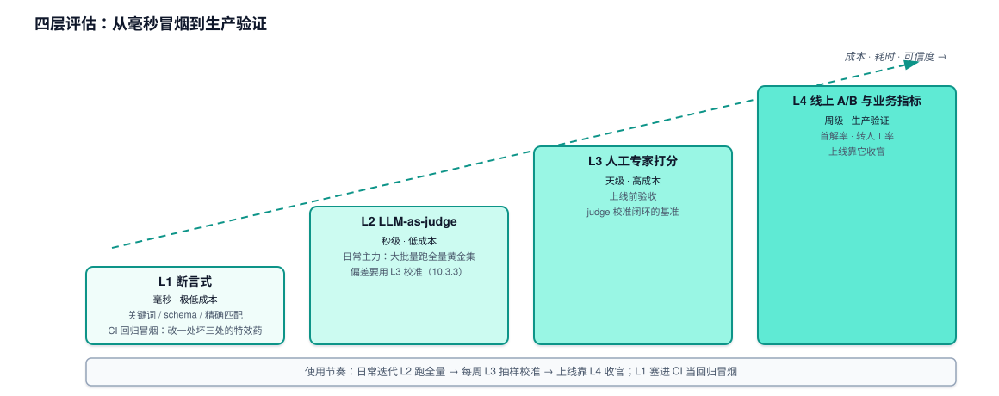
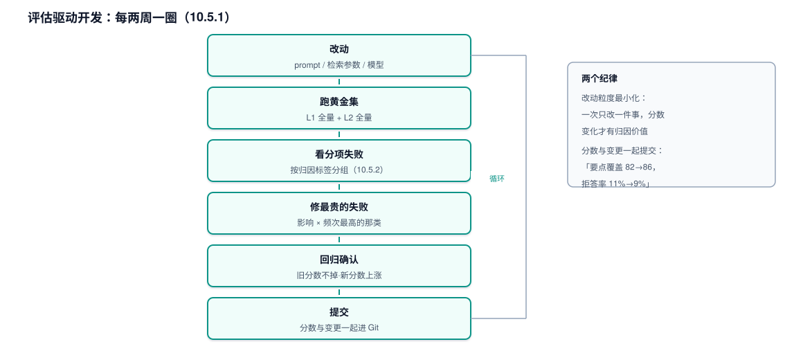

# 第 10 章 评估（Evals）：让系统"敢上线"的最后一公里

> **本章导读**："差不多能用了"是交付事故之源。OpenAI 的电信客户把语音客服 eval 从 60% 用六个月提到 90%+——评估不是科研活动，是交付的进度条。本章讲怎么建立适合 FDE 场景的评估体系：黄金集从哪来、四层评估怎么分层、LLM-as-judge 的偏差怎么治、多步 Agent 的轨迹怎么评——最后组成"评估驱动开发"的完整循环。本章的 `eval_runner.py` 是一个可运行的评估框架骨架，第 15 章的智能客服项目将直接复用它。


*（image-2 插画生成后替换：按 `docs/visual-prompts.md` §3 第 10 条 Prompt 生成 `assets/ch10-hero.png`，并把本引用扩展名改为 .png）*

---

## 10.1 为什么必须做 Evals

### 10.1.1 没有评估的三种死法

一个 AI 系统没有评估体系，死法是可以预言的：

1. **"感觉不对"死**：客户说"最近 AI 答得不太对"，你问"哪句？哪天？"——他答不上来，你复现不了，问题悬在空中，信任一格格流失；
2. **"悄悄劣化"死**：第 9 章讲过静默劣化——prompt 被改一个字、模型被换路由、知识库混入旧版。没有评估基线，你甚至**无法证明**系统变差了，只能"感觉";
3. **"改一处坏三处"死**：为了修 A 场景的错答改了 prompt，B 场景悄悄崩了——没有回归测试，每次改动都是赌博。

反过来的正面案例在 10.1.2——它证明了评估不只是"防死"，还是**进度条与信任工具**。

### 10.1.2 OpenAI 的 90%：评估作为交付进度条

OpenAI 官方博客里最重要的一个数字故事：电信客户的语音客服，eval 从 **60% 起步，花六个月提升到 90%+**。拆解这个故事的三个细节，每个都值得抄进你的交付手册：

- **60% 不是耻辱，是资产**：敢于测出 60% 的基线，意味着团队接受了"先看见问题"——多数项目死于不敢测；
- **六个月不是调参，是归因**：提升来自把失败案例逐个归因（口语 ASR 错误、检索错、生成错），分项修复——评估驱动开发（10.5）的完整流程；
- **90%+ 是验收口径**：客户业务方参与定义了"90% 意味着什么"（每条测试题的要点覆盖），所以这个数字能写进续约谈判——评估体系就是**双方都认账的尺子**。

FDE 的评估观由此定型：**不追求学术指标，追求客户认可的业务口径**。这句话是本章所有内容的总纲。

---

## 10.2 建立第一个黄金集

### 10.2.1 黄金集三件套

黄金集（golden set）= 一组"问题 + 期望要点 + 评分方式"的三元组。三个组件的常见错误正好对应三类失败：

| 组件 | 它是什么 | 常见错误 |
|---|---|---|
| **输入** | 真实问题样本（带日期/口语/错别字） | 用"想象中"的问题——干净的标准句线上永远不会出现 |
| **期望要点** | 答案必须覆盖的事实要点（不是逐字答案） | 写成唯一标准答案——把开放式问答做成了默写 |
| **评分方式** | 怎么判定"答对了"（断言/judge/人工） | 不指定——每题评分方式不同，分数没法比 |

"期望要点"值得展开：问"报销逾期了怎么办"，要点 = {系统锁单；需财务总监解锁}——只要答案覆盖这两点、且无事实错误，表述自由。**评"要点覆盖"而非"字句一致"**，是开放式问答评估的第一原则；而分类/抽取类任务（输出确定）才用精确匹配。

### 10.2.2 从哪来：三个来源与配比

黄金集不是坐在办公室编出来的：

- **真实渠道抽样**（占 50%+）：历史工单、客服记录、用户提问日志——第 15 章会演示从"真实来电记录采样 100 条"的完整脱敏流程；
- **边界用例**（占 30%）：库外问题（该拒答）、口语歧义（"话费"vs"流量费"）、恶意注入——线上翻车几乎全部发生在这里，办公室里编用例时最容易漏的也是这里；
- **专家补充**（占 20%）：客户业务方提出的"必须答对"题——它们通常价值最高，且**参与出题的环节本身就是信任建设**。

起步规模：**50-100 条**。多了维护不动，少了不显著。增长原则：线上每个"差评案例"在归因后都进黄金集——黄金集是活的，不是交付完就封存的标本。

### 10.2.3 确认仪式：黄金集评审会

黄金集要经过一个正式环节：**客户业务方逐条确认**。这不是形式主义——它是三件关键事的落点：期望要点由业务方拍板（免得日后"你们 AI 答的不对"变成罗生门）；边界用例的"正确行为"（拒答还是硬答）由业务方选择；评分方式当场试评 5 条，分歧当场消除。会议产出一份**确认记录**——它就是你 90% 分数的"米原器"：以后所有关于"好没好"的争论，都回到这把尺子。第 2 章"目标公式"的验收方式 C，指的就是这场会。

### 10.2.4 黄金集的工程管理：它也是代码

黄金集要享受代码的待遇，因为它会以完全相同的方式腐烂：**版本化**（golden_set 进 Git，每条带 ID 与来源标签，变更可 diff——10.5.5 的防异化防线）；**脱敏**（真实工单进黄金集前必须脱敏：人名、工号、金额按第 9 章 9.3.4 的规则处理——黄金集经常会被分享给评审与测试环节，是最容易泄密的资产之一）；**所有权**（谁负责滚动更新？写进交付文档：客户业务方负责"出题"，FDE 负责"维护"——分工不清的黄金集会在交付后三个月变成没人认领的标本）。把这三条写进你的交付清单，它们是黄金集"是活的"的保障条件。

---

## 10.3 四层评估分层

### 10.3.1 分层总表

评估方法不是选一个，是**按用途分层组合**：

| 层级 | 方法 | 成本 | 速度 | 适用 |
|---|---|---|---|---|
| **L1** | 断言式（关键词/JSON schema/精确匹配） | 极低 | 毫秒 | 每次改动的回归冒烟 |
| **L2** | LLM-as-judge | 低 | 秒级 | 大批量日常迭代（本章主角） |
| **L3** | 人工专家打分 | 高 | 天级 | 上线前验收、judge 校准 |
| **L4** | 线上 A/B 与业务指标 | 中 | 周级 | 生产验证 |



*图 10-1 四层评估分层（源文件 `assets/diagrams/eval-layers.drawio`）——沿阶梯上升，成本与可信度同向递增*

分层的使用节奏：**日常迭代 L2 跑全量 → 每周 L3 抽样校准 → 上线靠 L4 收官**。L1 不是"低级"——它是唯一能塞进 CI 秒级跑完的层，是"改一处坏三处"的特效药。

### 10.3.2 L1 断言式的三件武器

- **关键词断言**：答案必含"锁单"（要点词）——粗糙但零成本，适合做"最起码没答崩"的守门；
- **结构断言**：输出必须通过 JSON schema 校验（第 4 章 response_format 的评估侧镜像）；
- **不变量断言**：金额字段必须是数字、日期格式必须合法、拒答必须包含"未涉及"——把系统的承诺写成机器可查的合同。

### 10.3.3 L2：LLM-as-judge 的完整工程

L2 是日常主力，也是偏差重灾区。一个能用的 judge 需要：**评分 prompt**（把期望要点与评分标准写给裁判模型）、**偏置控制**、**校准闭环**。`examples/ch10/02-llm-judge.py` 逐块演示，其中偏差实验值得先讲：

**宽松偏差**：裁判模型有"老好人"倾向——问它"这个答案是否覆盖了要点"，90% 情况下它说"基本覆盖"。治法是把是非题改成**要点逐项核对**："要点①（系统锁单）：命中/未命中？要点②（需总监解锁）：命中/未命中？"——逐项判断把模糊空间挤掉，`02` 的对照实验实测了两种问法的分差。

**位置偏差**：裁判对长答案更宽容（内容越多越像"覆盖了"）、对先给的答案更偏爱（对比场景）。治法：控制答案长度方差（L1 里管）、对比场景做位置交换双评、评分维度拆细（让"长"没有套利空间）。

**自评偏差**：让模型评自己（或同家族模型）的输出，分数系统性偏高。治法：裁判模型与被测模型**跨家族**——用 A 家模型评 B 家系统的输出。

### 10.3.4 judge 校准：和人工对齐之后才算数

L2 分数在下结论前必须过一道校准：抽 20-30 条做 L3 人工打分，然后算 judge 与人的一致性。简化版的对齐检查（`02` 实现）：算两者分数的偏差幅度与方向——**如果 judge 系统性高 0.5 分，就有两个选择**：调 judge prompt（推荐，把偏差说明写进评分规则），或给 judge 分数打折（危险，掩盖问题）。一致性达到"20 条里 17 条以上判定一致（85%)"才允许 judge 分数进入交付报告。这一步的意义不是技术精度，是**第 2 章标准四的兑现**：你对客户报的每个数字，都要经得起"这个分是怎么打的"的追问。

### 10.3.5 L4：线上验证的指标设计

L4 回答的是 L2/L3 回答不了的问题：**真实用户觉得好不好用**。三组线上指标：业务结果指标（转人工率、首解率、单均处理时长——与基线对比）；使用行为指标（追问率、重述率——用户"用脚投票"的信号）；体验指标（满意度评分/差评案例数——差评案例回流黄金集，闭环）。A/B 设计的 FDE 注意事项：流量分层要按用户而非请求（同一用户体验稳定）；灰度期 ≥2 周（覆盖工作日/周末模式）；差评案例的**逐条归因**比统计分数更重要——每一个差评都是黄金集的种子。

---

## 10.4 轨迹评估：多步 Agent 怎么评

### 10.4.1 只看最后答案是漏判

单轮问答评"答案"，多步 Agent 评什么？看第 5 章报销查询的轨迹：`query_expenses(张三) → 观察 → query_policy(超限审批) → 观察 → 最终答案`。最终答案正确，但轨迹可能全对也可能侥幸——比如第一步查了李四，第三步靠模型自己的知识硬编了审批人。**答案对但步骤错**的 Agent 是定时炸弹：换个边界用例就炸。

### 10.4.2 轨迹的三个评估点

- **工具选择正确性**：每步该调哪个工具？调错了没有（查额度却调了查制度）？
- **参数正确性**：从用户话语里抽取的参数对不对（"上个月"是不是被翻译成了正确月份）？
- **终止合理性**：信息够了就停，没有打转与多余动作（对照第 5 章止损纪律）。

实现依托你在第 5 章就埋好的资产：**trace 日志**。`examples/ch10/04-trajectory-eval.py` 拿第 5 章 Agent 的 trace 格式做输入，对两条轨迹（一条"对得很干净"、一条"侥幸答对"）逐点评分——最终答案分相同，轨迹分一高一低。这个反差就是轨迹评估存在的全部理由。

### 10.4.3 轨迹评估的实践分级

轨迹评估的成本高于答案评估，实践中分级用：**关键路径用例**（涉及资金/权限/写操作）全量轨迹评估；日常用例只评答案 + 用 L1 断言守住"不该出现的工具调用"（比如拒答场景断言"没有 create/execute 类工具调用"）；打转与超步数直接零分（第 5 章止损的评估侧兑现）。

---

## 10.5 评估驱动开发：把循环跑起来

### 10.5.1 循环本体

前四节是零件，本节组装发动机——**评估驱动开发（eval-driven development）**：



*图 10-2 评估驱动迭代循环（源文件 `assets/diagrams/eval-loop.drawio`）——改动→跑黄金集→看分项失败→修最贵的失败→回归确认→提交，循环往复*

两个纪律：**改动粒度最小化**——一次只改一件事，分数变化才有归因价值（第 5 章三位一体的兑现）；**分数与变更一起提交**——prompt 进 Git 时 commit message 里带上评估分（"p20261108：要点覆盖 82→86，拒答率 11%→9%"），三个月后你的交付史就是一份完整的调优档案。

### 10.5.2 失败归因标签：分项报告的灵魂

评估报告不能只有一个总分。每次失败打一个归因标签：

| 标签 | 判定特征 | 修复去向 |
|---|---|---|
| **检索错** | 要点在库里但没进上下文 | 第 8 章四步法 |
| **生成错** | 要点进了上下文但答案没答对 | 第 5 章 prompt/第 4 章参数 |
| **格式错** | 内容对但结构崩（JSON/引用格式） | L1 断言 + response_format |
| **知识缺失** | 要点根本不在知识库里 | 补文档（业务动作！） |
| **越权/注入** | 答了不该答的 | 第 9 章闸门、第 7 章红线 |

"知识缺失"标签的统计意义特别重大：**它的占比就是"AI 解决不了、必须客户补文档"的证据**——这份分项报告拿着去找客户业务方，比任何口头沟通都有效（第 11 章会把它接进需求考古的流程）。

### 10.5.3 评估仪表盘：三条曲线

给客户看的日常视图只画三条曲线：**要点覆盖率**（质量）、**单次调用成本**（第 4 章费用工程的兑现）、**P95 延迟**（体验上限）。三条曲线同屏的意义：防止单指标优化——只看覆盖率会把 top_k 加到爆（成本曲线立刻报警）；只看成本砍注入量（覆盖率掉给你看）。**好系统的所有优化都在三条曲线的交集中**。

### 10.5.4 报告模板：给客户看的评估报告

评估报告（验收版）的四段结构（`eval_runner.py` 自动生成骨架）：**总分与结论**（一句话：是否达到验收线，附置信区间）；**分项表**（按归因标签的失败分布 + 典型案例各 3 条——正面案例同样要放，客户需要知道"它为什么好"）；**修复计划**（每个失败类的负责方与时间点——知识缺失类标注"需业务方配合"）；**基线对比**（与上一版本的分数变化，证明趋势）。写报告的唯一纪律：**每个数字都注明口径**（多少条题、谁打的分、L2 还是 L3）——回到 10.1.2，评估体系是双方都认账的尺子。

### 10.5.5 评估的反模式：当尺子开始说谎

评估体系用歪了比没有更糟——两个必须提前设防的反模式：

**指标异化（Goodhart 定律）**："当一个指标变成目标，它就不再是好指标。"如果团队 KPI 是"要点覆盖率"，最省力的路径不是把系统做好，而是**把黄金集里难答的题悄悄删掉、把期望要点写得宽松**——分数暴涨，系统原地踏步。防线：黄金集变更走评审（增删条目必须有 diff 记录和理由）；覆盖率必须和**线上业务指标**（L4）互为印证——黄金集分数涨而转人工率不降，必有蹊跷。

**黄金集过拟合**：评估集反反复复跑几百次迭代后，系统对这 100 道题"应试"满分，新题型一塌糊涂——因为你的迭代全部围绕已知失败做定向优化。防线有三条：黄金集**滚动更新**（每周从线上新增 3-5 条真实问题，同比例淘汰最老的——像换血一样保持代表性）；保留一条**从不参与调优的"封存集"**（holdout，10-20 条，只在验收时打开——它是检验过拟合的测谎仪）；对照失败案例时永远追问一句"这个修复是让这一题过了，还是让这一类题过了？"。

一个经验数字：如果你在黄金集上的分数长期 100% 而线上差评不断，别庆祝——**你的评估体系坏了，而不是系统完美**。健康的评估永远保留一点"让系统不舒服"的锋利度。

---

## 10.6 本章知识点卡

| 概念 | 一句话解释 | 关键词 |
|---|---|---|
| 黄金集三件套 | 输入/期望要点/评分方式 | 要点覆盖，非默写 |
| 确认仪式 | 业务方逐条拍板的评审会——"米原器" | 验收尺子 |
| 四层分层 | L1 断言/L2 judge/L3 人工/L4 线上 | 按用途组合 |
| 宽松偏差 | judge 的老好人倾向——治法：要点逐项核对 | 偏差之一 |
| 位置/自评偏差 | 长答案偏爱、同族偏爱——治法：位置交换、跨家族 | 偏差之二 |
| 校准 | judge 与人工 85% 一致才准进报告 | 20 条对齐 |
| 轨迹评估 | 答案对 ≠ 步骤对——评工具/参数/终止 | 定时炸弹 |
| 评估驱动开发 | 改→跑→归因→修最贵的失败→回归 | 最小改动粒度 |
| 知识缺失占比 | "必须客户补文档"的量化证据 | 业务动作 |
| 三条曲线 | 覆盖率/成本/P95 延迟同屏——防单指标优化 | 交集优化 |

---

## 代码实战：examples/ch10 四件套

- **`01-golden-set/golden_set.json`** —— 30 条黄金集样例（报销制度域）：三件套结构 + 边界用例配比示范（含库外题/歧义题/注入题）；
- **`02-llm-judge.py`** —— judge 工程实验室（纯标准库可运行）：是非题 vs 要点逐项核对的**宽松偏差对照实验**、位置交换双评、与人工分对齐的简化校准；
- **`eval_runner.py`** —— **本章主交付物**：可运行的评估框架骨架——加载黄金集 → 跑被测系统（可插拔：内置 mock 系统/接第 8 章检索/接任意 API）→ L1 断言 + L2 judge 评分 → 归因标签分组 → 生成四段式报告 + 三条曲线数据。第 15 章直接复用；
- **`04-trajectory-eval.py`** —— 轨迹评估：拿第 5 章 trace 格式，对"干净对"与"侥幸对"两条轨迹逐点评分，实测最终答案分相同、轨迹分一高一低。

```bash
cd examples/ch10
python eval_runner.py --system mock         # 完整跑一遍：黄金集→评分→报告
python eval_runner.py --system mock --report # 输出四段式验收报告骨架
python 02-llm-judge.py                       # judge 偏差对照实验
python 04-trajectory-eval.py                 # 答案对但步骤错的实测
```

---

## 章末习题

1. **建你的第一个黄金集**：为第 8 章的报销制度库手写 20 条黄金集（三件套结构，配比：10 真实风格 + 6 边界 + 4 注入），用 `eval_runner.py --system mock` 跑出基线分。重点体会：写"期望要点"时忍住不写标准答案的冲动。
2. **judge 校准实操**：把 `02-llm-judge.py` 的 judge 换成你自己的评分标准（比如"引用完整性"维度），对 10 条输出做人工打分，计算与 judge 的一致率。低于 85% 就迭代 judge prompt 直到达标——这个过程会让你对"评分标准是设计出来的"有肌肉记忆。
3. **最贵的失败**：用 `eval_runner.py` 的分项报告找出现在占比最高的归因标签，写出你的修复计划（一句话：先修什么、为什么、预期分数变化）。然后只做这一处改动重跑——验证"最小改动粒度"原则下分数的变化是否如你预期。

---

## 参考资料

- OpenAI《What FDE means at OpenAI》"补上智能缺口"章节（60%→90% 的原始出处，中文全译）：https://news.qq.com/rain/a/20261023A00XPA00
- OpenAI Evals 官方指南与 openai/evals 仓库（工业界评估框架参照）：https://github.com/openai/evals
- Anthropic 评估相关文档（LLM-as-judge 实践要点）：https://docs.anthropic.com/en/docs/test-and-evaluate
- 论文《LLMs as Evaluators / Judgment Bias》系列综述（宽松/位置偏差研究的代表）：https://arxiv.org/abs/2306.05685
- Ragas（RAG 专项评估框架，本章归因标签的工业版）：https://github.com/explodinggradients/ragas
- 第 5 章 trace（轨迹评估的数据源）、第 8 章失败诊断四步法（"检索错"标签的修复去向）
- 第 9 章 audit 日志（L4 线上指标的数据源）与静默劣化探针（评估的生产形态）
- 商汤"123 法则"（30 天上线节奏中评估的位置，第 13 章展开）

> 下一章预告：技术篇就此收官——你已经拥有完整的武器库。但武器不等于胜利：客户说"我们想要点 AI"的时候，一切才真正开始。第 11 章需求考古学：把模糊的愿望挖成可交付、可验收、有价值的目标——方法论篇，是 FDE 与 AI 工程师真正分道的地方。
