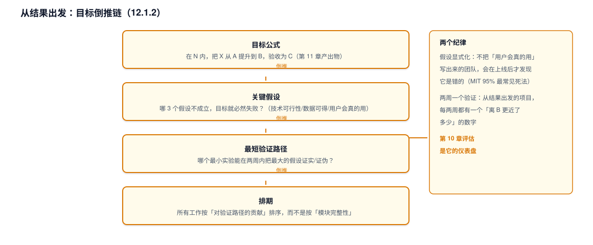
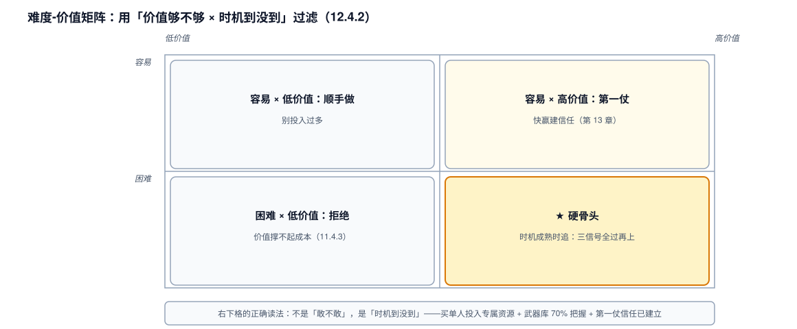
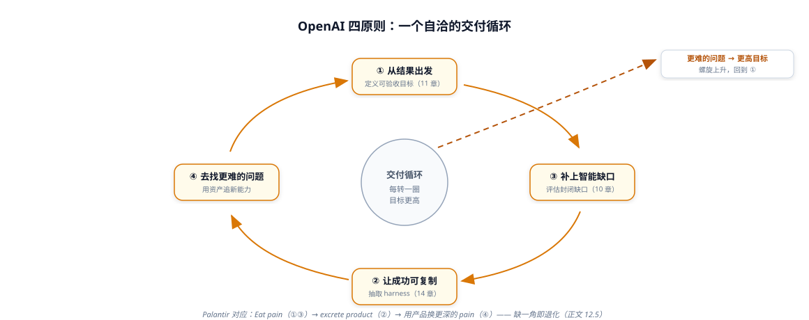

# 第 12 章 OpenAI 四原则：从结果出发、让成功可复制

> **本章导读**：2026 年 10 月，OpenAI 的 FDE 团队负责人 Colin Jarvis 在官方博客发表《What FDE means at OpenAI》，给出了四条工作原则——这目前是关于"怎么做 FDE"最权威的一手方法论。本章逐条拆解，每条配上可落地的工具与真实案例：半导体的 48%、Codex 的"删除 90% 定制代码"、电信的 60%→90%、约翰迪尔的"以前不可能"。最后把四条组装成一张系统图——你会发现它们不是并列的口号，而是一个自洽的循环，而且正是 Palantir"Eat pain, excrete product"的工程化展开。


*（image-2 插画生成后替换：按 `docs/visual-prompts.md` §3 第 12 条 Prompt 生成 `assets/ch12-hero.png`，并把本引用扩展名改为 .png）*

---

## 12.1 原则一：从结果出发（Start with the outcome）

### 12.1.1 先看一个"反着来"的世界

大多数技术项目的启动顺序是：我们有什么技术 → 技术能做什么 → 找客户问问要不要。这个顺序在卖标准软件时成立（产品已经存在），在交付场景是灾难的起点——你拿着锤子找钉子，客户被你感染也开始描述"钉子"，最后交付的方案精致地解决了一个**本来没那么痛的问题**。

第 11 章的需求考古学解决"找到真钉子"；本原则再往前一步：**钉子找到后，一切方案设计从"拔掉之后指标变成什么"倒推**，而不是从"我们打算用什么技术"正推。两字之差，是交付项目与外包项目的分水岭。

### 12.1.2 半导体的 48%：一个教科书级的目标锚定

OpenAI 的半导体客户案例值得逐帧回放：

- **起点不是技术**：客户没有说"我们要 Agent"，FDE 看到的是客户报表上最扎眼的成本项——芯片验证工程师的调试时间；
- **目标是公式不是愿景**：10+ 个内部用例、3-6 个月全部上线、调试时间节省约 48%——第 11 章目标公式 N/X/A/B/C 的满分实现；
- **用例服务于目标**：10+ 用例（脚本生成、规格书问答、日志归因……）全部围绕"压缩调试时间"展开，没有一个是因为"技术上有趣"而混进来的；
- **验收写在方案里**：48% 是与客户共同定义的口径，第 10 章评估体系为它提供进度条。

这个案例的教学价值在于它的**收敛性**：多而散的愿望（第 11 章考古前）被一个公式收拢，工程资源从此有唯一排序依据——"这个用例能不能把 48% 提前一周？"答不上来的用例，无论多炫，排队去。

### 12.1.3 落地工具：结果倒推清单

把原则变成开工第一天就能用的动作——结果倒推清单（`four_principles.py --outcome` 生成骨架）：



*图 12-2 目标倒推链（源文件 `assets/diagrams/goal-backchain.drawio`）——从结果出发：目标→假设→验证路径→排期，逐层倒推*

两个纪律：**假设显式化**——不把"用户会真的用"写出来的团队，会在上线后才发现它是错的（MIT 95% 的最常见死法）；**两周一个验证**——从结果出发的项目，每两周都有一个"离 B 更近了多少"的数字（第 10 章评估是它的仪表盘）。

### 12.1.4 反面模式：技术找问题的三个症状

自查清单——出现任何一条，你就正在违反原则一：

1. 方案文档里模型名词比客户名词多（DeepSeek/LangGraph 出现 8 次，"调试时间"出现 2 次）；
2. 团队争论"用哪个框架"的时间超过"验收口径怎么定"；
3. 客户问"这能帮我省多少时间"，你的回答以"我们用的模型是……"开头。

### 12.1.5 目标锚定的组织面：和谁的 KPI 对齐

结果倒推有一个常被忽略的变量：**“结果”在客户的组织里挂在谁的 KPI 上**。同一个“调试时间省 48%”，在验证部经理的 KPI 里是“效率提升”，在 CIO 的年度汇报里是“数字化转型成果”，在 CFO 的账本里是“单均成本下降”——同一条事实，三种叙事。FDE 要做的是让目标公式与**买单人本人的 KPI 语言对齐**：验收报告的第一页，用他 KPI 里的词写同一个数字。这不是文字游戏：对齐了，验收会变成他的“汇报材料”，他主动替你争取下一个阶段；没对齐，你的 48% 只是一个“供应商提供的数字”，他还要再翻译一道。第 11 章干系人三角里的“买单人”，在这里兑付。

### 12.1.6 一个来自 Anthropic 的同向印证

顺带一个行业对照：Anthropic 的《Building effective agents》给出了一个同样结构的判断——**多数业务问题适合 workflow（确定性流程，本书第 6 章），只有少数需要真正的 autonomous agent**。两家头部厂商殊途同归地指向同一个结论：复杂度是成本，不是炫技的资本——从结果出发的方案，永远选恰好够用的复杂度。

这个同向印证值得记在方案文档里：当客户质疑"你们用的不够先进"时，两家厂商的方法论就是你的回答。

---

## 12.2 原则二：让成功可复制（Make success repeatable）

### 12.2.1 单点成功的价值是零

原则一帮你赢下第一仗。但一个客户、一个用例、一次成功——在商业上等于零，甚至为负：定制代码在腐烂、经验在流失、下一个客户从零开始。原则二回答的问题是：**如何让第一个成功不依赖"你恰好在场"？**

这就是 Palantir 分工哲学的另一半（第 1 章）：Delta 消化痛苦，Dev 排出产品——痛苦若不变成产品，就只是被消化了，没有被回收。

### 12.2.2 Codex harness：删除 90% 的故事

OpenAI 的官方案例是原则二最硬核的注脚。早期每个 FDE 项目都长出了自己的定制工程代码：任务编排、检索封装、日志、评估——每个项目一套，大同小异。FDE 团队的动作是把这些共性抽取为一个以 Codex 为核心的**通用 harness（工程脚手架）**，把项目代码迁移进去。结果用官方口径直接引用：

> 迁移之后，**每个项目删除了约 90% 的定制代码**；推广到第二个团队，交付周期从两个月缩短到一天。

"两个月到一天"值得逐字咀嚼：那两个月里的工作——搭环境、写编排、调检索、配日志——没有一个动作是因为第二个客户有新需求，全部是因为第一个项目**没有沉淀**。harness 把这一个月零廿九天的浪费变成了纯粹的增量交付。判断你在第几个阶段的方法很简单，问一个问题：**"下一个项目的启动会议，议程上还有几项工作是因为'上一个项目没留下东西'才存在的？"**

### 12.2.3 落地工具：定制-通用账本

原则二的敌人是"我下个项目再收敛"——人们高估记忆，低估腐烂。工具是**定制-通用账本**（`four_principles.py --harness`），项目第一周就开账：

- 每写一段定制代码，问一句：**"会重复的概率是多少？"**（高/中/低三档）；
- 高概率项：当场写成参数化组件进 harness，多花的今天一小时，是省下的下个项目三天；
- 中概率项：登记进账本，交付前统一收敛（第 14 章"六个必须留下"的执行入口）；
- 低概率项：放心定制——不是一切都要通用化，**为永远不会重复的需求做抽象，是另一种浪费**。

账本的复盘价值：项目结束时统计"高概率项占比"——它就是你的 harness 成熟度。Palantir 的经验里，成熟期 FDE 团队的这个比例应该显著超过半数。

### 12.2.4 组织面：反哺通道的工程化

原则二不只是代码问题。现场经验回流产品需要**组织接口**（第 14 章展开）：定期的反哺提案例会（现场证据 → 重复频次 → 预估价值 → 产品建议的四段式，第 14 章模板）；Dev 与 Delta 的人员轮换（Palantir 的传统，让写产品的人定期去现场消化一轮痛苦）；以及最重要的预算口径——第 2 章口袋试金石：收敛工作必须是"产品投入"口径下的正式工时，靠 FDE 用爱发电的收敛，撑不过两个项目。

### 12.2.5 harness 的治理：资产怎么不变成新的烂尾楼

harness 本身也是一个系统，它有自己的生命周期问题——治理缺位的 harness 会烂得比定制代码更快（因为它骗取了所有人的信任）。四条治理纪律：

1. **有主**：harness 必须有明确的 owner（个人或小组），无主的公共代码 = 无人重构的垃圾场；
2. **有版本**：harness 独立发布版本，项目锁版本使用——项目不能因为 harness 昨晚的提交而在客户机房里坏掉（第 9 章变更管理的延伸）；
3. **有契约测试**：harness 每次改版本自跑冒烟集，与项目侧的适配层接口写入契约（第 7 章 test_client 的同一思路）；
4. **有文档门槛**：新项目接入 harness 的 onboarding 文档必须持续新鲜——**接入耗时是 harness 健康度的最诚实指标**（接入要两周的 harness，本质上是另一个定制系统）。

这四条与第 14 章"六个必须留下"互为镜像：前者管的是反哺资产的日常治理，后者管的是每个项目交接时的验收清单。

---

## 12.3 原则三：补上智能缺口（Close the intelligence gap）

### 12.3.1 缺口定义：从"模型默认输出"到"生产可用"

第 1 章把部署鸿沟定义为"模型看起来能做到的"与"真正能可靠用上的"之间的距离。本原则是它的操作化：鸿沟不是抽象距离，是**一个可测量的缺口**——模型默认输出与生产可用标准之间的分差。FDE 的核心工作就是逐个用例地封闭这个缺口，并给封闭过程一个**数字进度条**。

### 12.3.2 电信的六个月：60% 到 90% 的完整叙事

OpenAI 的电信客户做语音客服，eval 从 **60% 起步，六个月提升到 90%+**。这个故事在第 10 章已经作为评估案例拆解过，这里换一个视角——**作为"补缺口"的节奏**看它的三个阶段：

- **第一阶段：让缺口显形（60%）**。上线第一周就敢测基线——60% 是诚实的起点。归因发现缺口集中在三处：口语 ASR 错误、检索歧义、拒答缺失。**没有归因的分数只是情绪，有归因的分数才是路线图**；
- **第二阶段：逐类封闭**。口语映射表（第 8 章查询改写）、混合检索调优（第 8 章）、拒答阈值与兜底流程（第 8/5 章）——每个归因类用第二篇的对应武器，修一类测一类，分数台阶式上升；
- **第三阶段：冲刺最后的 10%**。从 80 到 90 的难度远高于 60 到 80——最后的缺口是长尾（口音、罕见问法、复合意图），靠黄金集滚动扩容 + 逐例攻坚。**90%+ 不是调出来的，是一个个失败案例修出来的**。

### 12.3.3 落地工具：智能缺口四象限诊断

缺口归因的最小框架——四象限（`four_principles.py --gap` 互动诊断）：

| | 上下文里有正确信息 | 上下文里没有 |
|---|---|---|
| **答案对** | ✅ 健康 | ⚠️ 侥幸（碰巧对——轨迹评估的重点关照对象，第 10 章） |
| **答案错** | **生成缺口**：prompt/参数/格式问题 → 第 5 章武器 | **检索缺口**：知识没进来 → 第 8 章武器（或知识缺失，补文档） |

诊断顺序永远从上排到下排：先把"侥幸对"修成"真对"（它们是定时炸弹），再修"错"（按象限路由到第 5/8 章）。四象限 + 第 8 章失败诊断四步法 + 第 10 章归因标签，构成完整的缺口检修流水线——**工具箱你已经全部拥有，本章给的是组合拳法**。

### 12.3.4 "让自己失业"：缺口的终极形态

Colin Jarvis 那句反常识的衡量标准值得原样引用并展开：

> **"每隔几个月让自己失业一次，才算好好干活。"**

意思是：每个项目你都应该把一部分自己的工作自动化掉——手工核查交给评估探针（第 10 章）、手工数据清洗写成脚本、口头交班变成 agent skills（第 7 章）。每自动化一段，你就空出双手去啃下一个更难的缺口（原则四的入口）。**FDE 的安全感不来自"这个岗位离不开我"，来自"我的工作永远在升级"。**这句话同时也是第 14 章"健康曲线"的个人版。

### 12.3.5 缺口的对外沟通：把进度条讲给客户听

补缺口是你和系统之间的事，但缺口**进展的叙事权**是你和客户之间的事。三个沟通纪律：

1. **同一条曲线对外只讲一张**：第 10 章三条曲线（覆盖率/成本/延迟）里，对外日常沟通只讲覆盖率——客户记不住三条曲线，只记得住一个故事："这周从 62 到 71 了"；成本与延迟进周报附件，不进正文；
2. **台阶报喜，绝不虚报顶**：每个归因类修完，报一次台阶式进展（"口语歧义类修完，整体从 71 到 77"）——比报"快到了"诚实，也比报最终目标保守。**永远不预支胜利**：80 分时报"冲刺中"，不报"就快 90 了"；
3. **拒答也是进展**：拒答率上升往往意味着系统变诚实了（阈值调对了）——向客户解释为什么这条曲线上升是好事，是原则三沟通里最考验叙事的一课，也是第 8 章"敢用"理念的客户教育。

---

## 12.4 原则四：去找更难的问题（Tackle harder problems）

### 12.4.1 容易的问题做十个，不如硬骨头啃一个

前三条原则让交付走向高效，第四条决定交付走向哪里。OpenAI 给 FDE 的方向是反直觉的：**不要在简单用例上刷数量，去解决"以前根本不可能"的问题**。两个公开案例的共性值得注意：

- **约翰迪尔的精准除草**：视觉模型识别田间杂草、变量喷洒减少农药——这不是"把人工流程自动化"（效率故事），是"以前做不到的事现在做到了"（能力故事）；
- **税务场景的深度文档处理**：复杂税务文档的理解与生成——攻克它意味着客户在合规风险最高的领域敢用 AI 了。

为什么难的问题反而值得追？三个理由按分量排序：

1. **信任杠杆**：解决一个"不可能"，客户对你能力上限的认知被一次性改写——后续所有普通需求的谈判地位完全不同；
2. **定价空间**：效率改进按省下的人力计价，上限是那笔人力预算；能力新增按新价值计价，上限是新价值本身——**"以前不可能"是唯一不卷价格的赛道**；
3. **沉淀质量**：难问题逼出来的资产（新组件、新方法论、新评估集）价值远高于简单问题——原则二的 harness 里最值钱的模块，全部来自啃硬骨头的项目。

### 12.4.2 落地工具：难度-价值矩阵

判断"哪个难问题值得追"（`four_principles.py --map` 附带练习）：



*图 12-3 难度-价值矩阵（源文件 `assets/diagrams/value-matrix.drawio`）——用「价值够不够 × 时机到没到」过滤，而不是「敢不敢」*

关键读法在右下格：**不是所有硬骨头现在都该追**。追的时机有三个信号——客户主诉方愿意为它投入专属资源（买单人确认）、当前武器库有 70% 把握（可行性过线，第 6 章四问）、且第一仗的信任已经建立（本原则是第三/四仗的打法）。用"价值够不够 × 时机到没到"过滤，而不是用"敢不敢"过滤。

### 12.4.3 难与险的边界：什么硬骨头不该啃

原则四不等于蛮干。三条红线（每条都通向第 9 章的审查体系）：

1. **合规红线**：难度再高，硬合规场景（医疗诊断级、资金清算级）没有第 9 章的审计与权限基础就不碰——"以前不可能"在监管语境里有时意味着"以前不被允许"；
2. **单点依赖红线**：需要某个客户专属人物全程配合的难问题，人一走项目就死——难问题的成功概率应该建立在体系上（数据、流程），不建立在某个人身上；
3. **沉没红线**：追了六周还没有第一个可验证中间产物的硬骨头，回到目标公式重估——**原则一优先级高于原则四**：再迷人的难题，如果不能服务一个可验收的目标，它就是技术自嗨。

---

> **一线故事：约翰迪尔的"不可能"与林舟的教训。** 原则四最好的公开注脚是约翰迪尔的精准农业：让视觉模型在田间识别杂草、变量喷洒减少农药——FDE 要在田里、在拖拉机驾驶舱里完成需求考古与验收（第 11 章跟岗观察的田间版本）。"以前不可能"在这里是字面意义的：老农看着屏幕上的变量喷洒地图说"种了三十年地，第一次这么打药"——**能力故事的信任杠杆，就藏在这样一句话里**。而原则四的反面教材来自本书虚构的林舟：他曾在第二个月执意启动一个炫技的"全自动周报生成"难题（价值矩阵的左下格——难且低价值），三周后被迫回滚，第一仗的黄金集因此推迟两周。他在复盘里写道：**"原则四没有错，错的是我拿它当原则一的免罪牌。"**两句话合成一条纪律：硬骨头要啃，但要啃在"买单人愿意付、武器库有七成、信任已建立"的交点上。

---

## 12.5 四原则的系统性：一张图讲完

四条不是并列的口号，是一个自洽的交付循环：



*图 12-1 四原则系统图（源文件 `assets/diagrams/four-principles-loop.drawio`）*

与 Palantir 的对应：Eat pain（①③）→ excrete product（②）→ 用产品去换更深的 pain（④）——四原则是它的工程化展开。

三个圈层的对应关系值得记住：原则 ①③ 是 **Delta 的现场姿态**（消化痛苦）；原则 ② 是 **Delta→Dev 的代谢通道**（排出产品，第 14 章整章展开）；原则 ④ 是 **整个循环的攀升方向**（Palantir 从阿富汗战场走向 Gotham 产品线的路径抽象）。四原则缺任何一角，循环都会退化：缺 ① 是技术找问题；缺 ② 是高端外包（第 3 章批评的形态）；缺 ③ 是 demo 工程；缺 ④ 是永远在低价值区打转。

### 12.5.1 循环断链的病理学：四种退化形态的症状表

把循环的断点诊断做成症状表（团队季度自查用，配合 `--map` 的循环图逐段检查）：

| 断在哪 | 症状 | 典型误诊 | 真正的修复 |
|---|---|---|---|
| 断在 ① | 方案很先进、客户不续约；验收会变成扯皮会 | "客户不懂 AI" | 回第 11 章重做考古 |
| 断在 ③ | 上线后三个月没人提它了；差评成谜 | "还需要多训练模型" | 回第 10 章补评估体系 |
| 断在 ② | FDE 团队人数随客户数线性增长；每人都在重复造轮子 | "业务太特殊无法抽象" | 重看口袋试金石与预算口径 |
| 断在 ④ | 项目做了很多但都是“更快的马”；没人知道你们能做什么新东西 | "市场不需要" | 回 12.4.2 检查三信号 |

这张表的最大价值在于最后一列：**四种退化都有各自看似合理的自我解释**（客户不懂/模型不够/业务特殊/市场不要），而它们全部指向同一个真相——循环的某一段停止了转动。FDE 的职业化程度，很大程度上取决于能不能在自己身上认出这四种症状。

### 12.5.2 从 Palantir 到 OpenAI：方法论的谱系

把四原则放回历史里看，能看到一条清晰的传承链：Palantir 在 2010 年代定义了角色分工（Delta 消化痛苦、Dev 排出产品）；到了 2025-2026 的 AI 落地潮，OpenAI 把它分解成了可操作的工程步骤——四原则 + harness + 评估体系。谱系的规律值得记住：**方法论每隔几年就被重新表述一次，但内核几乎不变**（到现场去、从结果出发、把定制变通用、然后去追更深的价值）。这对你的启示是：学任何新的方法论文章时，先找它的内核属于谱系的哪一段——四条里你总能认出至少三条是老朋友。**认出谱系的能力，是分清新东西与换皮术的最快雷达**（第 2 章判别能力的知识版）。

### 12.5.3 四原则与本书五篇的映射：方法论篇的承重结构

本章在全书中的位置值得点明——四原则是方法论篇的**承重梁**，其余三章都挂在它上面：第 11 章是原则一的考古版操作（把"结果"从客户的愿望里挖出来）；第 13 章是原则一与原则三的日历化（把目标和缺口封闭排成 1-2-30 节奏）；第 14 章是原则二的完全展开（账本、六个必须留下、反哺提案的完整体系）。技术篇的五到七章是原则三的武器（补缺口靠的工具），评估章是原则三的仪表盘。**如果你只有时间记住方法论篇的一句话，记住四原则循环图**——其余章节都是它的展开、工具化与案例注脚。

---

## 12.6 本章知识点卡

| 概念 | 一句话解释 | 关键词 |
|---|---|---|
| 从结果出发 | 从客户指标倒推方案，不从技术正推 | 48% 锚定 |
| 结果倒推清单 | 目标→关键假设→最短验证→排期 | 假设显式化 |
| 让成功可复制 | 单点成功价值为零；抽取通用 harness | 删 90% 定制代码 |
| 两个月→一天 | 没沉淀的代价就是每个项目重付一遍 | 启动会议议程测试 |
| 定制-通用账本 | 按会重复的概率当场上账收敛 | harness 成熟度 |
| 智能缺口 | 模型默认输出与生产可用之间的可测分差 | 60%→90% |
| 归因即路线图 | 有归因的分数才能指路 | 四象限诊断 |
| 让自己失业 | 每个项目自动化掉一部分自己 | 健康曲线个人版 |
| 去找更难的问题 | "以前不可能"是唯一不卷价格的赛道 | 信任杠杆 |
| 难与险的边界 | 合规/单点/沉没三红线；原则一高于原则四 | 重估 |
| 四原则循环 | 结果→缺口→沉淀→更难，缺一角即退化 | Eat pain 工程化 |
| 断链病理学 | 四种退化各有看似合理的自我解释——全部指向循环停转 | 季度自查 |

---

## 代码实战：four_principles.py 工作台

四个模式对应四条原则的落地工具（全部纯标准库、可离线运行）：

- **`--outcome`** 原则一：结果倒推清单生成器——输入目标公式（第 11 章产出），引导输出关键假设与两周验证路径，附三个反面症状自查；
- **`--harness`** 原则二：定制-通用账本——内置半导体项目的 12 条定制项示例，按"会重复的概率"打标，输出收敛优先级与 harness 成熟度（高概率占比）；
- **`--gap`** 原则三：智能缺口四象限诊断——10 条失败案例快问快答（上下文里有没有/答案对不对），输出象限分布与"路由到第几章武器"的修复清单；
- **`--map`** 原则四+系统图：难度-价值矩阵练习 + 四原则循环图的 ASCII 渲染。

```
cd examples/ch12
python four_principles.py --map        # 先看循环图建立全局
python four_principles.py --outcome    # 结果倒推（互动）
python four_principles.py --harness    # 定制-通用账本
python four_principles.py --gap        # 缺口四象限诊断
python four_principles.py --demo      # 半导体项目全流程回放
```

---

## 章末习题

1. **反面模式体检**：找一份你（或公开的）AI 项目方案文档，做 12.1.4 的三症状自查：数一数模型名词与客户业务名词的出现次数。如果命中任何一条症状，用结果倒推清单把方案的目标段落重写一遍，对比两版的差异——把差异最大的三处记入你的交付手册。
2. **账本实操**：回顾你最近的一个项目（工作或课程），把里面所有"只做一次"的代码/配置列成清单，逐项按"会重复的概率"打标。然后回答：哪些高概率项当时就该组件化？它们的共同特征是什么？（多数人的答案会收敛到：胶水代码和配置样板——这正是 harness 的第一刀该切的地方。）
3. **硬骨头评估**：为你的（真实或虚构）客户列出三个"以前不可能"的候选难题，用 12.4.2 的三信号（买单人/可行性 70%/信任时机）逐一打分。全过线的那个，写出它的目标公式与第一条红线（12.4.3）——没有全过线的，写出各自的补齐路径。

---

## 参考资料

- OpenAI《What FDE means at OpenAI》官方博客（2026-10-22，四原则与四个案例的原始出处）：https://openai.com/index/what-fde-means-at-openai/，中文全译：https://news.qq.com/rain/a/20261023A00XPA00
- 腾讯云开发者社区《OpenAI FDE 负责人最新访谈》（"Eat pain, excrete product"与四步工作法的对谈版本）：https://cloud.tencent.com/developer/article/2652339
- CSDN《OpenAI 的 FDE：把 AI 能力变成企业真正能用的系统》（约翰迪尔/半导体/税务三案例的深度转述）
- 36氪《硅谷最火岗位来了》（Palantir Dev/Delta 分工与反哺通道）：https://36kr.com/p/3477432643132036
- Anthropic《Building effective agents》（另一家厂商对"复杂度经济学"的同向判断——简单用例用 workflow、复杂能力靠攻坚）：https://www.anthropic.com/research/building-effective-agents
- 第 10 章（原则三的全部评估工具）、第 11 章（原则一的目标公式）、第 14 章（原则二的完整展开）
- Colin Jarvis 相关公开报道（原则四"更难的问题"的演讲口径）

> 下一章预告：原则有了，把它排进日历——第 13 章商汤"123 法则"与 30 天上线节奏：D1 价值定义、D2 Demo 验证、D3-30 稳定冲刺，以及每个里程碑的交付物清单。
