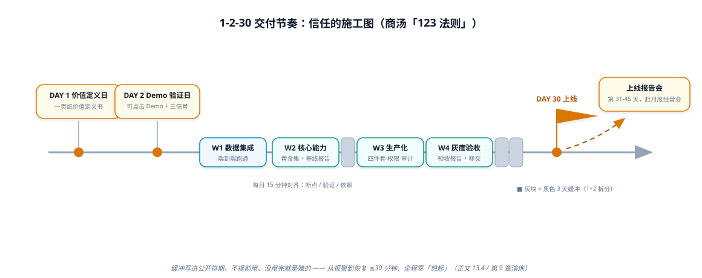

# 第 13 章 商汤"123 法则"与 30 天上线节奏

> **本章导读**：第 11 章把愿望挖成目标，第 12 章给了行动的原则——本章把方法论翻译成**日历**。以商汤"产业 FDE 模式"的"123 交付法则"（1 天定价值、2 天 Demo 验证、30 天稳定上线）为骨架，给出 FDE 交付的标准节奏表：D1 价值定义日、D2 Demo 验证日、D3-30 稳定冲刺的四周周表，每个里程碑的交付物清单，以及排期里必须预留的"黑色 3 天"。学完本章，你应该能在任何项目启动会上当场画出让客户点头的排期。


---

## 13.1 为什么是 1-2-30

### 13.1.1 "123 法则"：从项目交付到持续服务

商汤科技在 2026 年的世界人工智能大会上公布了它的"产业 FDE 模式"，其中最常被引用的构件是 **AI"123"交付法则**：

> **1 天明确业务价值、2 天完成 Demo 验证、30 天实现稳定版本上线。**

三个数字背后是一次服务模式的转变——由"项目交付"（做完走人）转为"持续服务支持"（上线只是关系的开始）。理解这个转变，就理解了为什么节奏要压缩得这么狠：**节奏不是赶工期，是信任的施工图**。客户对一个新供应商的信任是按里程碑建立的，不是按代码量——每兑现一次承诺，信任存一笔；每延期一次，信任支一笔。1-2-30 把头三个存款点排在前 34 天里，密度决定存钱速度。

### 13.1.2 三个数字的心理学

- **1 天**：价值定义必须在一天内完成，因为"再研究研究"是需求发散的温床。一天的时限强迫双方当场取舍——砍需求比加需求更能证明目标真实存在；
- **2 天**：Demo 的说服力来自速度本身。客户亲眼看到"上周三聊的问题，周五就能点"——这比任何 PPT 都更能定义他对你的交付能力的预期。心理学上这叫**锚定**：第一个锚抛在第二天，后面的合作全部在这个坐标系里进行；
- **30 天**：这是心理学与管理学的交叉点。一个月是客户组织里**决策周期的自然单位**（月度经营会、月度预算），30 天上线意味着第一个价值报告能赶上下一次月会——FDE 的第一份战果要用客户组织的节拍来交付。

### 13.1.3 30 天的适用边界

诚实声明：30 天不是放之四海皆准。它的适用条件是——用例边界清晰（第 11 章打分选出的"第一仗"，而不是旗舰级用例）、数据可得（两周内能拿到并清洗完成）、集成深度可控（不超过两三个外部系统）。三个条件不满足时，节奏形态换档：**商汤法则依然有效，但单位放大**——"1 周定价值、2 周 Demo、1 个季度稳定上线"（OpenAI 半导体案例的 3-6 个月即此形态，10+ 用例的旗舰项目）。判断口诀：**第一仗用 1-2-30，旗舰项目用周-周-季**——先用 30 天打一仗建信任，再开季度级的战役。本章按 1-2-30 讲解，所有方法按比例放大即可。

### 13.1.4 1-2-30 与四原则的关系

123 法则是第 12 章四原则的时间投影：D1 是原则一的日历化（一天把"结果"钉死）；D2 是原则三的前哨（用最粗糙的 Demo 探测智能缺口的地形）；D3-30 是原则三的主战场（逐类封闭缺口，第 10 章评估是进度条）；而"30 天之后"的部分（13.5）通向原则二与四。**原则回答"怎么想"，节奏回答"哪天做"**——两者咬合，方法论才从墙上走进了日历。

---

## 13.2 D1：价值定义日

### 13.2.1 议程模板

一天的价值定义，标准议程（`sprint_123.py --d1` 可打印）：

```
09:00-10:30  痛点叙事（第 11 章五问现场版）
             —— 只收事件，不收愿望；谁为痛买单，谁必须在场
10:45-12:00  用例打分（矩阵当场填，客户亲手打"价值"分）
14:00-15:30  目标公式共创（N/X/A/B/C 逐项过，基线当场确认数据源）
15:45-16:30  边界与红线（明确不做什么；第 11 章风险登记册起草）
16:30-17:00  签认与排期公布（价值定义书当场签认，D2 时间当场敲定）
```

议程设计的三个心机：**买单人必须在场**（第一场就请对人——他缺席的价值定义会，签认时必然翻烧饼）；**打分让客户亲手打**（他打的分他不赖账，你打的分他永远质疑）；**D2 时间当场敲定**（不给出"下周约"的模糊空间——下一场会议定在 48 小时内，是"2 天 Demo"成立的前提）。

### 13.2.2 交付物：一页纸《价值定义书》

D1 的唯一交付物，一页纸（第 11 章 `--card` 生成器的产出）：

- **目标公式**：在 30 天内，把 X 从 A 提升到 B，验收方式为 C；
- **第一个用例**：场景一句话 + 边界（明确不做什么）；
- **干系人**：买单人/使用者/审批人三行（第 11 章三角）；
- **基线数据源**：A 的出处与采集方式；
- **风险登记**：前三条风险与预案；
- **签认栏**：买单人签字 + 日期。

一页纸的纪律：**第二页出现的那一刻，它就从"契约"退化成了"文档"**——没人会签认一份文档。所有细节（用例清单、技术方案）进附件，正文永远一页。

### 13.2.3 D1 的三种死法（与急救）

- **买单人缺席**："李总临时有个会。"——急救：改期，不降级。缺席的价值定义会照开，产出标记"待确认"，但 D2 必须等确认后启动——**宁可慢三天，不能错锚点**；
- **目标公式谈不拢**：双方对 B 各执一词——急救：回退到 A。基线是客观的（系统数据/秒表实测），先把 A 钉死，B 写成区间（"预期 30-50% 改善"），30 天后用数据说话；
- **范围爆炸**："既然做，顺便把 A、B、C 也放进来吧"——急救：用第 11 章的词典翻译——"顺便"的都进用例清单排队，本期只有打分第一的那个。清单本身就是安抚：**被排队的需求不是被拒绝了，是被记录了**。

### 13.2.4 复杂组织的 D1：当干系人不止一桌

真实世界里，价值定义会常常不止“一桌人”：集团客户有总部与分公司的两张 KPI 表，每个用例的买单人可能分居两地。应对是**分层开价值定义会**，而不是把所有人塞进同一个会议室——二十人的 D1 是一场大型需求发散现场，没人能当场取舍。分层的标准动作：**先核心后外围**——D1 正日只请三到五人（买单人、使用者代表、审批人代表），当晚或次日为外围干系人（IT、法务、数据团队）开一场 90 分钟的“约束确认会”——只谈约束不谈目标（目标已签认，他们的输入是边界条件）。两个常见变体：跨部门用例（两个买单人）→ 把目标公式拆成两段各自的指标，或干脆拆成两个用例排队；跨层级（集团 vs 分部）→ 与总部谈框架目标，与分部谈落地目标，两层目标公式都要签认，且**分部的公式优先**——离现场越近的公式越真实。

### 13.2.5 一线故事：D1 的“签认灵异事件”

本书虚构的林舟在第二个项目上遇到过一个“灵异事件”：D1 当场签认的目标公式，两周后买单人在周会上说“这不是我们的重点”。复盘发现根因：D1 那天买单人提前半小时离场，签字的是他投权的副手——**签字人与拍板人不是同一人时，签认只是仪式**。修复动作从此写进林舟的手册：D1 结束后的 24 小时内，把价值定义书拍照发到买单人在场的群里，请他回一句“确认”——**一句话的数字痕迹，比一页纸的签字更防翻烧饼**。第二个对策：把目标公式原话写进 D2 的 Demo 首页——买单人不可能对每天开机看到的数字翻脸不认。

---

## 13.3 D2：Demo 验证日

### 13.3.1 48 小时 Demo 的工程法

48 小时做出 Demo 的秘密不是手速，是**取材**。90% 的 Demo 由现成组件组装（第二篇的武器库就是为此准备的）：

- **流程底座**：第 6 章 LangGraph 图的桩函数版——D1 定下的分支图直接落成五个节点；
- **知识注入**：第 8 章 toy RAG 原样跑（数据用 D1 拿到的 20 份真实样本，**不用造数据**——真实数据的脏，恰好是 Demo 最有说服力的部分）；
- **界面**：内网跑通一条对话链 + 终端输出足矣；真需要 UI，用 FastAPI + 一页 HTML 模板，一小时的事；
- **定制亮点（10%）**：唯一新写的代码是 D1 选定用例的"灵魂动作"——Demo 的记忆点。

48 小时的分配参考：第一天上午搭通链路（复用武器库），下午接真实数据并处理前三处脏点，晚上跑通第一个端到端；第二天上午修 demo 路径上必须修的缺口，下午排练。**第二天下午的排练不是可选项**——见 13.3.2。

### 13.3.2 Demo 脚本：演示什么、隐藏什么、观察什么

Demo 不是技术表演，是一场**带着测量仪器的对话**。三段式脚本（`sprint_123.py --d2` 打印模板）：

**演示什么**（准备 3 个场景，从最痛的开始）：D1 里客户亲手讲的那个故事原样重演——"小王的招待费单据，当场查规则"。用真实角色名、真实单据样例；第二个场景做 D1 打分第二的用例（展示不是单点玩具）；第三个场景做一个**边界演示**——故意问库外问题，展示拒答机制（第 8 章）——**拒答演示是 D2 最超值的动作**：它把"AI 会出错"从隐患变成了设计。

**隐藏什么**：未完成的分支、会暴露粗糙的中间过程、一切需要等待超过 5 秒的操作（提前缓存或录屏兜底）。藏的不是缺陷，是**不在此刻讨论的议题**。

**观察什么**（Demo 的真正产出是三个信号）：

1. **身体前倾时刻**：哪句话让客户身体前倾了？——那是真痛点被命中的生理反应，记录之（下一阶段的优先级证据）；
2. **沉默时刻**：客户在哪个功能上安静了？——沉默通常是"这个和我有什么关系"的翻译，D3 排期时的沟通重点；
3. **追加时刻**："那能不能顺便……"——现场出现的新需求进用例清单（11.2 的规则：进清单打分，不当场答应也不当场拒绝）。

### 13.3.3 D2 交付物与"验证结论"

D2 结束时的三件交付物：**可点击的 Demo**（留在客户环境里跑，哪怕只能跑三天——留在现场的东西才会被反复谈论）；**演示复盘**（三信号记录 + 客户原话摘录）；**验证结论**——D2 的正式名字是"验证日"，验证的是三件事的答案：技术可行性（Demo 跑通了）、需求真实性（身体前倾了吗）、价值定义书的存活（目标公式要不要修订）。验证结论里最专业的一句话是：**"D1 的目标公式，经 D2 验证后修订如下"**——敢当场修订目标，比死守 D1 的纸上承诺更赢得信任。

### 13.3.4 Demo 的暗面："能不能直接就用这个？"

D2 的高光时刻藏着一个危险的提问：客户看着 Demo 说"这个挺好，能不能就直接用起来？"——答应它，你就亲手埋下三颗雷：**Demo 代码没有权限、没有审计、没有评估**（生产三件宝在 D2 阶段一样都不存在，也不应该存在）。技术债的起点往往不是懒惰，是高光时刻的顺水推舟。

正确的应对话术，同时守住信任与工程底线：

> "能跑和敢上线之间还差三道工序：权限、审计、评估——W3/W4 会把它们补齐。这两周里如果您迫不及待，我建议选五个内部测试用户灰度试用 Demo 环境，试用反馈直接变成黄金集——您等于提前两周开始验收了。"

这个回应的三个巧妙处：拒绝的是"直接用"，接住了"迫不及待"（把冲动转化为受控的灰度）；试用反馈变成黄金集（把风险变成评估资产）；"您提前两周开始验收"把客户放到了参与者的位置而不是等待者。**好的期望管理永远不是说不，而是把"不"翻译成另一个更受控的"是"。**

### 13.3.5 Demo 的后续处置：三天后它在哪

D2 结束不是 Demo 生命的终点，它的处置方式也需要设计（`sprint_123.py --d2` 的清单里有此项）：留在客户现场跑的 Demo，默认存活三天，之后要么升级进 W1 的开发环境（如果它已经承担了灰度试用的角色），要么安静下线——**半死不活的 Demo 是最坏的状态**：有人在用它，没人知道它连的什么数据、用的什么 prompt 版本。对每场 Demo，在 D2 复盘里就写清它的去向。

---

## 13.4 D3-30：稳定冲刺的四周周表

### 13.4.1 周节奏总表

四周冲刺的标准节奏（每行右边是该周的"验收物"——没有验收物的周等于没过）：

| 周 | 主题 | 关键交付物 |
|---|---|---|
| **W1** | 数据与集成打通 | 数据管道跑通；第一个端到端流程（哪怕质量差） |
| **W2** | 核心能力打磨 | 黄金集 v1（30-50 条）；基线评估报告 |
| **W3** | 生产化 | 部署四件套（第 9 章）；权限与审计（第 9 章）； |
| **W4** | 灰度上线与验收 | 灰度计划；验收报告；运维手册 v1 |



*图 13-1 1-2-30 节奏全景（源文件 `assets/diagrams/sprint-123.drawio`）*

四周的内在逻辑是"**风险前置**"：W1 攻克最可能翻车的依赖（数据、接口——它们的外部性最强、最不可控），W2 才在稳定地基上做能力，W3 的生产化是重活但可计划，W4 只留灰度与收尾——**把不可控的事放在前面，把可控的事放在后面**，30 天的最后一天才敢承诺上线。

### 13.4.2 W1：数据与集成打通

W1 的别名是"丑陋的一周"——目标是打通，不是打磨。三个动作：

- **数据管道**：D1 拿到的真实数据全量接入，脏数据先按第 8 章解析纪律处理，处理不完的**登记不硬扛**；
- **第一个端到端**：不求质量，只求"从输入到输出能走完"——W1 结束时能跑通的丑陋流程，价值大于 W2 结束时才跑通的漂亮流程（前者让你提前一周看到所有断点）；
- **集成地雷排查**：W1 每天更新"外部依赖风险板"——哪个接口的文档是错的、哪个权限还没批。W1 的会议围绕它转，**集成问题越早暴露，黑色 3 天越可能不用动用**。

### 13.4.3 W2：核心能力与基线评估

- **黄金集 v1**：30-50 条，三件套结构（第 10 章），从 D1-D2 收集的真实事件采样——黄金集的每一条最好都能追溯到 D1 现场的某句话；
- **基线报告**：跑分 + 归因分布（第 10 章评估框架）——**W2 交付的基线报告是整个 30 天最重要的一页纸**：它告诉所有人缺口在哪、距离多远、按什么路线封闭；
- **能力迭代**：按归因逐类修复，每修一类重跑分数（评估驱动开发循环）。

### 13.4.4 W3：生产化

第 9 章的全部内容压缩进一周，靠的是"分层验收"：

- 部署四件套容器化（Dockerfile 与 compose 模板第 9 章已备）；
- 权限矩阵落地（第 9 章四道闸）——审批人还没配好就上灰度，等于裸奔；
- 审计日志接通（trace_id 三类日志）——**W3 有一票否决项：审计没接通，不许进 W4**；
- 演练：W3 周五做一次桌面回滚演练（第 9 章剧本）。

### 13.4.5 W4：灰度上线与验收

- **灰度计划**：先 10% 流量或单部门试用，观察指标与差评（第 10 章 L4）；
- **验收报告**：四段式（第 10 章模板）+ 目标公式的对账——从 A 到 B 的证据链；
- **运维手册 v1 与培训**：给客户 IT 的交接材料（第 9 章六个必须留下的部署版）。

### 13.4.6 每日 15 分钟与"黑色 3 天"

**每日对齐**：FDE + 客户侧关键人（工程师或业务接口人）每天 15 分钟，只对三件事：昨天的断点、今天的验证、明天的依赖。仪式感大于信息量——它是客户侧关键人"参与交付"的触点，参与过的人才会替你说话。

**黑色 3 天**：30 天的排期里必须预留 3 天缓冲（建议拆成 1+2：W2 末 1 天、W4 末 2 天），用于吸收翻车。三条纪律：**缓冲不提前用**（第一天就消耗掉缓冲的排期等于没有缓冲）；**缓冲必须写进公开排期**（写"风险缓冲"而不是留白——客户看得见的缓冲是专业，看不见的留白是心虚）；**缓冲没用完就是赚的**——宁可让项目提前两天完成，也不要用缓冲去接新需求。

### 13.4.7 客户侧力量的节奏管理：把“他们”变成“我们”

30 天冲刺不是 FDE 独舞——客户侧的两类人决定冲刺质量：**关键人**（每日 15 分钟的那位业务/技术接口人）与**IT 对接人**（W3 生产化的拍档）。两类人的节奏管理各有要点：

关键人：把他当“共创者”而非“翻译器”——黄金集出题、D2 排练观众、灰度第一批用户，这些“活儿”不是帮忙，是**让他从项目外变成项目内**（他的老板也是你的买单人时，他替你说话的次数决定项目生死）；

IT 对接人：W1 就拉进地雷排查板（他知道哪个接口文档是错的），W3 前给他第 9 章的验收清单让他自己勾——**亲手勾过清单的人不会在验收会上提出清单外的问题**。节奏上给 IT 留一个“提前量”：生产化周（W3）他需要提前申请防火墙端口与账号权限——这两件事的审批周期通常比开发周期长，启动日就把申请提交上去。

### 13.4.8 当冲刺偏航：节奏急救三板斧

30 天里总会偏航，三种症状对应三种急救：

1. **W2 末基线分太低**（缺口比预期深）→ 缩范围不缩质量：从用例里砍掉最难的 20% 问题（黄金集同步剪裁，重新签认范围）——**减范围是诚实，降质量是自杀**；
2. **集成延期吞掉 W1** → 启动 B 计划：人工导入/导出作为过渡数据通道（保留端到端推进），自动化接口移入二期——集成地雷不该埋葬整个冲刺，只该延期它那一段；
3. **客户侧资源迟迟不到位**（关键人总"在忙"）→ 升级到买单人，用 D1 签认的目标公式做筹码："目标要在 30 天兑现，需要您指定的人每周 5 小时"——**签认过公式的买单人有义务提供资源**，这正是 D1 那一页纸的第二次兑现。

---

## 13.5 30 天之后：从上线到续约

30 天上线不是终点站，是换乘站。三个后续动作把"项目"变成"服务"：

1. **上线报告会（第 31-45 天）**：向买单人做目标公式对账汇报——从 A 到 B 的证据链（第 10 章四段报告的正式版）。会议的隐藏议程是**下一个用例的启动共识**：黄金集的"知识缺失"占比、D2 观察到的身体前倾时刻，都是下一个用例的证据；
2. **月度价值复盘**：商汤模式的"持续服务支持"落地——每月一次，三条曲线（第 10 章）+ 差评案例归因 + 黄金集滚动更新。它是服务的"心跳"：稳定心跳 = 稳定续约；
3. **用例扩展的节奏感**：第二个用例按 1-2-30 再走一遍，但速度应该更快——harness 里已经有第一个项目的沉淀（第 12/14 章），D2 可能压缩到一天。**用例扩展的速度本身是沉淀质量的试金石**：第二个 30 天比第一个 30 天慢了，说明原则二断链了。

### 13.5.1 1-2-30 的失败病理：三种典型死法

节奏表能防住意外，防不住误用。三种最典型的失败形态（每种都值得对照自查）：

**死法一：把 30 天当魔法。**团队把 1-2-30 当成"什么都能 30 天做完"的承诺——没有经过第 11 章考古、没有经过 13.1.3 档位判断就许诺 30 天，W1 第一周就发现数据都拿不全。病理：**节奏代替了选型**。处方：先档位判断再许诺——宁可承诺 90 天并兑现，不要承诺 30 天后道歉。

**死法二：里程碑过、交付物空。**D1 开了、D2 演了、四周也排了，但交付物栏是空的——基线报告没有、验收报告用"顺利上线"充数。病理：**节奏变成了表演**。处方：验收物检查制——每个里程碑的交付物清单在启动会上就公布，过里程碑的唯一证据是交付物入库。

**死法三：黑色 3 天变成加班 3 天。**缓冲被前置的延期吃光，最后三天团队通宵冲刺补缓冲。病理：**缓冲是排期工具不是加班预案**——用体力换计划错误，是 30 天里最隐蔽的自我欺骗。处方：缓冲用完即升级范围决策（13.4.8 三板斧），而不是用人肉填坑。

三种死法的共同根都是同一个：把节奏当成了目标而不是工具。回到 13.1.2 的原点：**节奏是信任的施工图——施工图服务建筑，不足以为建筑本身**。

### 13.5.2 与敏捷的关系：它不是 Scrum 换皮

读者里熟悉敏捷的人可能会问：1-2-30 不就是双周迭代换了个说法？关键差异在三个维度：**目标形态**——Scrum 迭代交付"功能"，1-2-30 交付"业务结果"（验收的是指标不是功能清单）；**节奏驱动**——Scrum 由团队内部节律驱动，1-2-30 由客户组织的节拍驱动（月度经营会）；**里程碑密度**——Scrum 的 D1-D2（前 48 小时就有可点击 Demo）远超敏捷的一般密度——这不是营销速度，是锚定策略（13.1.2）。理解这个差异的实用价值：当客户的工程团队用敏捷经验质疑 1-2-30 时，你能用他们听得懂的话讲清楚为什么——**同一个骨架，换了目标与节拍，就不是同一个动物**。

---

## 13.6 本章知识点卡

| 概念 | 一句话解释 | 关键词 |
|---|---|---|
| 123 法则 | 1 天定价值、2 天 Demo、30 天稳定上线 | 信任施工图 |
| 锚定 | Demo 的说服力来自速度本身 | 第 2 天的锚 |
| 周-周-季 | 旗舰项目的放大档：条件不满足时换档不硬套 | 适用边界 |
| D1 三心机 | 买单人在场/客户亲手打分/D2 当场敲定 | 签认率 |
| 一页纸 | 第二页出现就退化成文档 | 价值定义书 |
| 90+10 取材法 | Demo 的 90% 用武器库现成件，10% 是灵魂定制 | 48 小时的秘密 |
| 拒答演示 | 把"AI 会出错"从隐患变成设计 | D2 超值动作 |
| 三信号 | 身体前倾/沉默/追加——Demo 的真正产出 | 带测量仪的对话 |
| 风险前置 | 不可控的事放前面（W1），可控的放后面（W4） | 丑陋的一周 |
| 黑色 3 天 | 1+2 拆分的公开缓冲：不提前用、写进排期 | 专业 vs 心虚 |
| 一票否决 | W3 审计没接通不许进 W4 | 生产化底线 |
| 服务心跳 | 月度价值复盘 = 稳定续约的心跳 | 持续服务 |

---

## 代码实战：sprint_123.py 排期生成器

- **`--plan`**：输入起始日期与项目名，生成完整 1-2-30 日历——D1/D2 议程、W1-W4 周表与交付物、黑色 3 天的位置、上线日与上线报告会日期；
- **`--d1` / `--d2` / `--w`**：各阶段的操作手册打印（议程/脚本/周表的即查版）；
- **`--scale`**：档位判断——回答三个问题（用例边界/数据可得/集成深度），输出"30 天"还是"周-周-季"的建议；
- **`--demo`**：报销规则查询项目的完整 1-2-30 回放（第 11 章考古结论的排期版）。

```
cd examples/ch13
python sprint_123.py --plan          # 生成你的 1-2-30 日历
python sprint_123.py --scale         # 30 天还是季度档？
python sprint_123.py --d2            # Demo 日操作手册
python sprint_123.py --demo          # 完整案例回放
```

---

## 章末习题

1. **排期实操**：用 `sprint_123.py --plan` 为第 11 章习题 1 产出的目标公式生成 1-2-30 日历，然后做一次"黑色 3 天压力测试"：给自己注入三个事故（接口延期 3 天、黄金集确认会推迟一周、灰度发现严重缺陷），重排日历——写出哪些交付物被你降级了、哪些死守。这次练习的产出就是你未来项目里"排期弹性"的手感。
2. **Demo 排练**：为第 8 章的报销制度 RAG 写一份 D2 演示脚本（三场景：含一个拒答演示），并对着同学/同事完整排练一次。记录他们的"身体前倾时刻"与"沉默时刻"——对照 13.3.2 的三信号，评估你选的演示顺序是否需要调整。
3. **档位答辩**：客户带着三个用例来找你（①制度问答 ②跨三个系统的审批自动化 ③全部销售邮件的智能归档）。用 `--scale` 的三条件逐一判断各用例的档位，然后写出你的排期方案：哪个用 1-2-30？哪个用周-周-季？它们的启动顺序和理由？（提示：顺序的选择本身就是一次第 12 章原则四的练习。）

---

## 参考资料

- 百度百科"产业FDE模式"词条（商汤 AI"123"交付法则原始出处）：https://baike.baidu.com/item/产业FDE模式/69256944
- 商汤科技 WAIC 2026 相关报道（"项目交付→持续服务支持"模式转变的公开口径）
- OpenAI《What FDE means at OpenAI》（3-6 个月的季度档形态与 10+ 用例管理）：https://news.qq.com/rain/a/20261023A00XPA00
- 第 11 章（D1 的全部材料：词典/五问/矩阵/价值定义书）
- 第 10 章（W2 基线报告与 L4 灰度指标）、第 9 章（W3 生产化与 W4 交接）
- 第 12 章 12.5.3（123 法则是四原则的时间投影）
- 明略科技吴明辉观点报道（FDE 与传统实施的区别：把一线能力反馈后台——13.5 的组织基础）

> 下一章预告：项目收官的那一刻，才到了 FDE 与"高端外包"真正分道的时刻——第 14 章沉淀与反哺：六个必须留下、定制代码收敛术、反哺提案的写法，以及把每个项目变成复利资产的体系。
