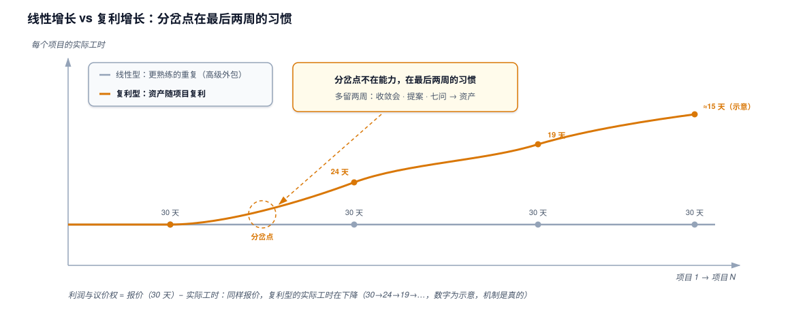

# 第 14 章 沉淀与反哺：从定制代码到通用 harness

> **本章导读**：区分 60 分 FDE 和 90 分 FDE 的分水岭只有一个问题：**交付完，留下了什么？** 走的时候两手空空，你只是换了个名字的高级外包；留下了系统之外的可复用资产，你的每一次交付都在为下一次降本。本章讲"反哺"的完整体系：六个必须留下、定制代码收敛术、反哺提案怎么写、复盘项目七问，以及最底层的沉淀经济学——线性增长与复利增长的分岔点，就藏在项目的最后两周。


---

## 14.1 六个必须留下：交付物的验收清单

### 14.1.1 一次合格交付走的时候留下什么

验收会上系统演示很成功，但三个月后客户 IT 接手运维时发现：配置说明在某个人的聊天记录里、测试用例根本不存在、权限规则没人说得清——这就是"系统留下了、资产没留下"的交付。一次合格交付，六个必须留下（缺任何一项都应在验收清单上亮红灯）：

1. **系统**：可运行、可重启、可迁移的生产系统本身——这是唯一"显然"的一项，也常是唯一被留下的一项；
2. **文档**：不只是 README——架构决策记录（为什么这么做）、运维手册（怎么保活）、排障指南（坏了怎么查）三件套；
3. **测试用例**：黄金集 + 契约测试 + 回滚演练记录——让下一个修改者敢动手（第 10/7/9 章产出物的正式移交）；
4. **配置说明**：环境变量全表、部署形态、依赖清单——配置不可见是"重启恐惧症"的根源（第 9 章 .env.example 的交付版）；
5. **权限规则**：权限矩阵 + 审批流配置 + 各角色的边界说明——**权限规则只存在于代码里等于不存在**，必须文档化（第 9 章"权限最小化写成文档"的兑现）；
6. **运维手册**：升级步骤、监控告警、日志位置、值班与升级路径——让客户 IT 从"不敢碰"到"敢接手"的那份文件。

### 14.1.2 六项的检验法：接手测试

怎么验证六项真的留全了？最诚实的检验是**接手测试**：请一位没参与过项目的工程师（客户侧的，或你自己团队的新人），只凭交付物接手三个任务——重启一次服务、修一个测试用的故障、回答"谁能看到这个数据"。三项全过，六项才算真的留下；卡在哪一步，哪一项就是假的。这个测试值得写进交付流程：**接手测试通过日，才是项目真正交付日**——比验收会更硬的仪式。

### 14.1.3 "让客户不依赖你"：健康曲线的交付版

第 1 章讲过 Palantir 的经验、第 12 章讲过"让自己失业"：FDE 的工作量应该随客户增多而**下降**——这条健康曲线在单个项目上的落点，就是这六项。留全六项的项目，客户三个月后不需要再打你的电话；六项残缺的项目，你永远在给前一个客户"售后"——你的时间被上一个项目的欠账吃掉，下一个项目自然延期。**六项不是为了客户道德，是为了你自己的产能**。虎嗅的批评文章说 FDE 可能成为"新式客户锁定"——六个必须留下，就是这种批评的最好回答：锁定的反面写在交付清单上。

### 14.1.4 交付物的交付仪式：怎么交比交什么更重要

六项内容齐了，交付方式不对仍会功亏一篑。三个交付仪式的关键设计：

**入仓而非发文件。**交付物不是一堆微信里的 PDF，而是进客户的文档库/仓库（wiki、Confluence、代码仓库）——**进仓的文档有 URL，有 URL 才能被链接进工单、被搜索、被后续人引用**；发出去的文件只有收件人记得它存在过。交付验收标准里加一条：六项每项都有可访问的 URL。

**交到人而非交到邮箱。**每项交付物指定接收人（运维手册→IT 对接人；黄金集→业务接口人），并当面（或视频）走一遍——**只发不讲的交付物，默认永远不会被打开**。这场“交接宣讲”同时是接手测试的预演：对方听得懂的部分，接手测试就能过。

**版本与责任声明。**文档头部三行：版本号、适用系统版本、责任人（谁负责后续更新）。**无主的文档在三个月后变成过时的毒药**——新人按旧手册操作新系统，是运维事故的高发源。这三行同时是 FDE 离场后的“尾巴声明”：文档谁来养、多久校对一次，都写进去。

交付仪式的最后一步是象征性的：把所有交付物的 URL 汇成一页“交付索引”，发给所有干系人。**一页索引是你的收官作品——它让客户在多年后仍能找到一切**，也让你自己走得干净。

---

## 14.2 定制代码的收敛术

### 14.2.1 从账本到收敛：第 12 章的下半场

第 12 章建了定制-通用账本：写代码时按"会重复的概率"打标，高概率项当场上 harness，中概率项登记待收敛。本章兑现那个"登记"——**项目交付前的收敛会**。为什么不"当场全部收敛"？因为收敛有成本（抽象、测试、文档），项目进行中停手收敛会伤交付节奏；为什么不能"以后再说"？因为项目一交付，那些登记项的死亡率是百分之九十——没人会再为已交付的代码做抽象。

收敛会的标准流程（`harvest.py --ledger` 引导执行）：

1. **过账**：把账本里所有"中"概率项摆出来，逐项回答：第二个客户会用它吗？（用真实证据回答——D2 观察到的相似需求、其他项目的观察记录，而不是感觉）
2. **分拣**：答案为"会"的进收敛队列，"不会"的正式关闭——**关闭也要留痕**（"该项确认仅此客户使用，不做抽象"），否则三个月后同样的争论再来一遍；
3. **收敛**：每项收敛按固定动作——参数化、补契约测试、写文档、进 harness 仓库（有主、有版本，第 12 章治理四纪律）；
4. **度量**：收敛会结束时更新两个数字——本项目的 harness 贡献数（进了几个新组件）与定制残留数（确认不收敛的项数）。前者是资产，后者是下个项目的已知负债。

### 14.2.2 收敛的技术手法：三个常用刀法

- **参数化**：最常见的一刀。客户 A 的"审批线 1500"、客户 B 的"审批线 2000"——同一个函数抽成配置项。看似简单，做对的要点是**默认值取自哪个行业**、**配置项命名用谁的业务语言**——错误的抽象比没有抽象更贵；
- **适配层**：客户系统对接（SSO、OA、ERP）不进 harness 本体——harness 定义标准接口（第 7 章 MCP 的角色），每个客户一个薄适配层。判据：适配层代码行数应显著小于你对接的工作量总和，否则是假抽象；
- **行业模板**：收敛不了代码时收敛"形态"——报销制度问答的黄金集结构、评估报告模板、权限矩阵样例（本仓库 examples/ 目录就是这种形态的沉淀）。**模板是 zero-code 的 harness**，它的复制成本趋近于零。

### 14.2.3 MCP Server 与 agent skills：标准化集装箱

第 7 章说过：MCP Server 是"现场能力的产品化集装箱"。本章把它放进收敛的完整版图——**harness 有三层沉淀物，价值密度递增**：

```
第一层：代码组件（参数化函数、适配层）——复用需要工程师
第二层：MCP Server（标准协议封装的能力）——复用只需要一个配置
第三层：agent skills + 模板（方法论与最佳实践）——复用只需要一次加载
```

Anthropic 的 FDE JD 把"MCP 服务器、子智能体、agent skills"并列为交付物，三层全占——这不是偶然：**越往上层的沉淀，越接近"方法论"而远离"代码"，它的可复制性与可移交性越高**。你的项目复盘时值得问一句：本项目的沉淀，最高到第几层？（全部停在第一层的 FDE，本质上是"会写组件的外包"。）

### 14.2.4 收敛的认知偏差：三种假收敛

收敛会开得热闹不等于收敛有效。三种最常见的假收敛（每个都有合理的伪装）：

1. **表演式收敛**：把定制代码整个搬进 harness 仓库，改名为"组件"——但没参数化、没契约测试、没文档。仓库变大了，复用能力为零。检验：新项目接入它时需要读源码吗？要读就是假组件；
2. **过度抽象**：为"万一将来"抽出的参数化，实际只有当前一个客户用过——抽象比直接写更贵（多出的间接层、参数组合爆炸）。检验：这个组件被第二个客户用到之前，它就还是定制代码——**先用副本，第二次出现再抽象**（rule of three 的两步版）；
3. **抽象错层**：把业务规则抽进了技术层（审批线 1500 写死在引擎里），或把技术细节暴露在业务层（配置项叫 max_concurrent_rpc）。检验：改一个业务规则需要读技术文档，就是错层。第二例客户接入时错层会加倍疼痛。

三种假收敛的共同根治法：**用接入耗时做验收**（第 12 章治理纪律）——新项目接入这个组件花的时间，就是它作为资产的真实价格。

---

## 14.3 反哺产品：组织接口

### 14.3.1 反哺提案：用产品团队的语言写

现场发现进不了产品路线图，不是产品团队傲慢，是**语言不通**：FDE 说的是"客户故事"，产品团队听的是"优先级证据"。反哺提案的四段式（`harvest.py --proposal` 生成器）：

```
【现场证据】宏达制造要求"跨部门可见性配置"——不是个例：
  另两个客户现场出现同类请求（附工单/会议记录摘录）
【重复频次】同类需求 3 个客户 / 累计约 5 人日定制
【预估价值】进产品后：同类客户售前演示可开箱演示，缩短签约周期；
  交付侧每客户省约 1.5 人日
【产品建议】建议作为"权限矩阵预设"进入 v2.3；
  我可以提供现场版实现作为参考，并有客户愿意当 beta 用户
```

四段各自的要义：证据要**可追溯**（不是"我觉得很多客户要"）；频次要**量化**（人日是产品团队自己的货币）；价值要**用产品侧的指标表述**（签约周期、支持成本，不是"客户很高兴"）；建议要**降低对方的行动成本**（附实现、附 beta 客户——你把路铺到脚下，对方只需点头）。

### 14.3.2 反哺的组织保障：三个机制

单靠提案的热情撑不起反哺通道，它需要三个机制配合：

- **定期例会**：FDE 团队与产品团队的固定接口（双周或月度），提案进例会有明确的响应时限——**没有时限的提案渠道等于没有渠道**；
- **人员轮换**：Palantir 的传统——写产品的人定期去现场（Delta/Dev 双向流动，第 1 章）。轮换让"现场感"成为产品团队的直接经验，而不是二手叙述；
- **预算口径**：第 2 章口袋试金石的组织版——FDE 的收敛与提案工时计入"产品投入"而非"项目交付成本"。没有这个口径，反哺永远是 FDE 用加班做的慈善。

三个机制里任何一个缺失，反哺都会退化为"提案越多、石沉大海越快"。评估一家公司 FDE 模式的成色（求职者视角，第 2 章七问的答案），看这三个机制比看 JD 词汇更准。

### 14.3.3 三路人马格局里的反哺通道

明略科技吴明辉总结过 FDE 热潮中的三路人马：大厂亲自下场交付、企业服务商用 AI 重做定制开发、企业自建内部 AI 先行官。三路人马各有自己的反哺通道：

- **大厂 FDE**：反哺对象是模型厂商的产品与专业服务模板（Anthropic 的 MCP/skills 交付物即此路）；
- **服务商 FDE**：反哺对象是公司的行业解决方案资产库——每个项目都在把"定制"翻译成"可复制交付物"；
- **企业内建 FDE**：反哺对象最有意思——**反哺的对象是"组织记忆"**：把某个业务专家的隐性知识变成知识库与 agent skills（第 7 章"脑"的比喻），让组织不因人员流动而失忆。

第三条通道对本书读者有特殊意义：它意味着**即使你永远不进大厂，FDE 的方法论在你的公司内部同样成立**——你的"产品团队"是公司的业务流程本身。

### 14.3.4 当提案石沉大海：反哺失败的三层处理

现实是：多数反哺提案的默认命运是杳无音信。这不一定是组织烂，多数时候是带宽问题（产品团队的路线图比 FDE 以为的满得多）。三层递进处理，避免你在第一层就心态崩溃：

**第一层：等一个周期，再提一次。**提案进例会后一个月没动静，礼貌追一次（附一句新证据——另一个客户的同类需求出现）。多数提案死在"只提一次"——被拒一次就转身的提案，等于从未提出；
**第二层：降维自救。**产品团队不接，就把这个能力沉淀在自己的 harness（第二层 MCP Server 形态）——交付侧先复用起来。**当第三家客户受益于这个组件时，你的提案从"想法"变成了"已验证的资产"**——第三次提案的证据强度完全不同（四段式里的频次栏从此有硬数据）；
**第三层：识组织。**三次提案三个周期无响应、例会形同虚设——这是第 2 章"标准三（反哺产品）"的现场红灯：你在一家不接反哺的组织里做 FDE，积累的定制永不成资产。第 18 章会回到这个信号：它也是你评估去留的输入之一。**反哺不是产品的慈善，是你职业生涯的复利通道——通道赌死时，资产只能记在自己的账上。**

---

## 14.4 方法论的个人化：你的私有交付手册

### 14.4.1 四件私有资产

组织有 harness，个人也应该有手册。每个 FDE 都该有（并且持续维护）的四件私有资产：

1. **需求访谈脚本**：你验证过的开场话术、追问清单、坏话术记录（第 11 章脚本的个人修订版）；
2. **评估报告与文档模板**：黄金集结构、验收报告、运维手册——每次交付后的打磨版；
3. **踩坑清单**：按章节分（数据/权限/部署/沟通），每坑一条——症状、根因、解法、预防。**这是最值钱的一件**：组织的 harness 收敛代码，你的踩坑清单收敛"判断力"；
4. **Demo 脚本库**：你排练过的每个成功演示的结构与观察记录。

### 14.4.2 复盘项目七问

私有资产的更新仪式是复盘。项目结束时（不是"忙完这阵"——永远没有那阵）七个问题，每个写三行以上：

1. 这个项目里**哪里最痛**？（下次最先投入设计的地方）
2. **哪一天最险**？（离翻车最近的一刻——是因为哪项准备缺失？）
3. 如果删掉本项目 30% 的工作，**删什么不影响验收**？（假勤奋的重灾区）
4. 客户那里**什么留下了**？（六项的实际完成度与接手测试结果）
5. **谁救了场**？（值得感谢与学习的具体动作——包括客户侧的人）
6. 客户**复购或续约了吗**？真实的决策理由是什么？（唯一的市场检验）
7. **下一个项目，我要带走什么**？（一条就够——带走三条以上等于什么都没带走）

七问的产出不是给老板看的汇报（那是另一个文体），是给三个月后的自己看的手册修订输入。**写完第七问的那个动作——把答案真的誊进踩坑清单或手册——是复盘闭环的最后一厘米，也是大多数人断掉的地方。**

### 14.4.3 Docs as Code：用本书仓库的方式管理方法论

私有手册的形态建议直接抄本仓库：**文档即代码**——Markdown 进 Git、模板进 examples/、清单可打勾、复盘有 diff。三个好处：版本可追溯（你的方法论哪天变强了，log 里看得见）；可复用（换工作带走一个仓库比带走一段记忆可靠）；可被搜索（关键时刻"我以前写过类似的东西"的检索效率，决定你的经验是否真的被使用过）。到第 18 章你会看到：这套私有资产同时就是你的作品集（18.3 的三件套之一）。

### 14.4.4 归属的边界：哪些沉淀是公司的，哪些是你的

一个必须想清楚的现实问题：私有手册与公司 harness 的边界在哪？踩线轻则引发纠纷，重则触碰法律。清晰的归属判断三条：

- **客户与公司的数据、代码、模板，永远不属于个人**——脱敏也改变不了来源归属，这是红线，没有讨论空间（第 9 章合规纪律的知识产权版）；
- **方法论与判断力，永远属于个人**——访谈话术、踩坑清单的"判断"部分（哪里痛、为什么错、怎么防），是从你自己的经历里长出来的能力，写在任何地方都带得走；
- **灰色地带的处理原则：形式留司，判断留人**。黄金集的具体题目是客户的资产（"留司"），但"黄金集怎么建、配比怎么定、确认仪式怎么开"的方法论是你的（"留人"）——本仓库的每个 `--retro/--check` 工具，教的都是"留人"的部分。

职业含义：FDE 的职业安全感的正确来源由此清楚了——**不是占有公司的代码（做不到，也不该），而是占有"从项目里提炼判断"的能力**。后者写进你的私有手册，谁也拿不走，且随项目数复利。

---

## 14.5 沉淀的经济学

### 14.5.1 线性增长与复利增长的分岔点

两种 FDE 的人生曲线（数字为示意，机制是真的）：



*图 14-1 线性与复利的分岔（源文件 `assets/diagrams/compound-curve.drawio`）——数字为示意，机制是真的：线性型每个项目都是 30 天的熟练重复；复利型每个项目减去上一项目沉淀的复用（30→24→19），利润与议价权随项目数上升*

分岔点不在能力，在**最后两周的习惯**：交付验收完就奔赴下一个项目的 FDE 走线性；多留两周开收敛会、写提案、誊七问的 FDE 走复利。两周的"亏损"（少接一单的错觉）换来的是资产——而资产的定义就是**能在未来反复产生现金流的东西**。

### 14.5.2 虎嗅批评的正面解法

回顾第 3 章引用过的批评："FDE 团队随客户数线性增长 = 没有规模效应 = 高端外包。"本章整个体系就是这条批评的正面解法——并且可以反向引用它做自我体检：

- 收敛会正常开吗？→ 团队人均"项目启动耗时"应该在下降；
- 提案有响应时限吗？→ 产品路线图里应该有 FDE 的姓氏；
- 复盘七问在誊写吗？→ 新项目踩旧坑的频率应该在降低。

三个"应该"都在发生，FDE 模式就修好了自己的规模效应缺陷；三个都没发生，虎嗅的批评就是精确预言。**好的方法论不怕批评，把批评翻译成体检指标**——这也算本章的一条元方法。

### 14.5.3 个人版经济学：职业资产的复利

同样的结构发生在职业层面（第 18 章展开细节，此处立论）：把每次交付沉淀成可展示的资产（开源仓库、复盘文章、行业模板），你的市场可见性以内容的方式复利；只把交付沉淀成"经验"二字，它随记忆衰减。**FDE 职业生涯的本质区别：你交付的是工时，还是工时 + 资产。**第 1 章那句"Eat pain, excrete product"的个人版翻译：消化过的痛苦，要以某种**可被检索的形态**排出——产品如此，文章如此，踩坑清单也如此。

### 14.5.4 资产负债表：把复利记到账上

复利不发臭的秘诀是记账。给团队（或自己）建一张简单的**交付资产台账**（`harvest.py --demo` 的末尾就是一版示范）：每行一个资产——名称 / 所在层（组件/Server/模板）/ 来源项目 / 累计复用次数 / 最后一次复用的时间。这张表的两个读法：

- **正向读**：复用次数就是复利的利息——一个被复用 5 次的模板，替你免掉了 5 份从零开始；**“累计节省人日”可以直接换算成你或团队的市场价值**（简历与晋升材料里最硬的那类数字，第 18 章直接可用）；
- **负向读**：台账里超过一年零复用的条目，就是假资产（当年收敛的其实不是资产，是闲置代码）——**敢于在年度盘点时下架零复用条目**，资产台账才不会腐化成另一个垃圾仓库。

这张表也回答了本篇最后一个悬而未决的问题：虎嗅批评说 FDE 模式"没有规模效应"——**台账的复用次数列就是规模效应的显微镜**：数字在滚，批评就被证伪；数字不滚，你至少提前一年看见了它。

---

## 14.6 本章知识点卡

| 概念 | 一句话解释 | 关键词 |
|---|---|---|
| 六个必须留下 | 系统/文档/测试/配置/权限/运维手册 | 交付验收清单 |
| 接手测试 | 新人凭交付物完成重启/排障/答权限——通过日才是交付日 | 最诚实的检验 |
| 健康曲线交付版 | 留全六项，客户三个月后不需要打你的电话 | 产能而非道德 |
| 收敛会 | 交付前过账分拣收敛——交付后登记项死亡率 90% | 最后两周 |
| 三层沉淀 | 代码组件 → MCP Server → skills/模板（复用成本递减） | 价值密度递增 |
| 反哺提案四段 | 证据/频次/价值/建议——用产品团队的货币说话 | 语言翻译 |
| 反哺三机制 | 例会有时限 + 人员轮换 + 预算口径 | 缺一即退化 |
| 三路人马反哺 | 大厂反哺产品 / 服务商反哺资产库 / 内建 FDE 反哺组织记忆 | 通道各异 |
| 私有交付手册 | 访谈脚本/模板/踩坑清单/Demo 库——个人的 harness | 判断力收敛 |
| 复盘项目七问 | 每问三行，第七问只带一条 | 誊进手册才闭环 |
| 线性 vs 复利 | 分岔点在最后两周的习惯 | 资产=未来现金流 |
| 批评当体检 | 虎嗅批评的三条反向指标 | 元方法 |
| 交付资产台账 | 复用次数列是规模效应的显微镜——年度下架零复用条目 | 记账 |
| 形式留司，判断留人 | 客户数据代码永归公司；方法论判断永远属于个人 | 归属边界 |

---

## 代码实战：harvest.py 交付物收敛检查器

本章工具把"最后两周"的流程装进一个可运行的检查台：

- **`--check`**：六个必须留下的逐项检查（接手测试三任务引导 + 打勾清单），输出"交付完成度"与红灯项；
- **`--ledger`**：收敛会流程引导——过账/分拣/收敛/度量，结束时统计 harness 贡献数与定制残留数；
- **`--proposal`**：反哺提案四段式生成器（互动输入，产出可直接进例会的提案文本）；
- **`--retro`**：复盘七问引导（每问带追问提示），产出 Markdown 手册修订输入；
- **`--demo`**：宏达制造项目的"最后两周"完整回放。

```
cd examples/ch14
python harvest.py --check        # 交付前：六项检查 + 接手测试
python harvest.py --ledger        # 收敛会引导
python harvest.py --proposal      # 反哺提案生成
python harvest.py --retro         # 复盘七问
python harvest.py --demo        # 完整回放
```

---

## 章末习题

1. **接手测试实操**：用 `--check` 对你手头（或过往）的一个项目做六项检查，然后请一位没参与过的同事做真实的接手测试（三个任务）。把卡点记进你的踩坑清单——这大概是本书性价比最高的三小时练习。
2. **提案演练**：假设你在第 16 章"宏达制造"项目现场发现了"口语-术语映射表"的通用需求（三个客户都出现过）。用 `--proposal` 写一份完整的反哺提案，并回答：如果产品团队回复"排不进下季度"，你的下一步动作是什么？（提示：14.3.2 的三个机制里，哪个可以先动？）
3. **七问复盘**：为一个你真实经历过的项目（工作、课程或本书的学习过程）完整走一遍七问。硬性要求：第 7 问的答案誊进你的踩坑清单或手册——**没誊写，这次复盘就不算完成**。两周后回头翻看，检查你是否真的用上了它。

---

## 参考资料

- OpenAI《What FDE means at OpenAI》"让成功可复制"章节（harness 与 90% 收敛的原始口径）：https://news.qq.com/rain/a/20261023A00XPA00
- 36氪《硅谷最火岗位来了》（Palantir Delta/Dev 双向流动与"4000 亿美金"的资产化叙事）：https://36kr.com/p/3477432643132036
- 虎嗅《被吹爆的FDE角色，正在掩盖AI产品的核心问题》（14.5.2 批评的原始出处与三条反向指标）：https://www.huxiu.com/article/4902748.html
- 明略科技吴明辉观点报道（三路人马与"组织记忆"，2026 世界机器人大会相关报道）
- 《企业本体论：人人都是FDE》（审计追踪、性能评测、回滚机制的工程落点）：https://item.jd.com/14820967.html
- Anthropic FDE JD（MCP 服务器/子智能体/agent skills 三层交付物）：https://www.anthropic.com/jobs
- 第 12 章（账本与 harness 治理——本章 14.2 的上半场）、第 2 章口袋试金石（预算口径）
- 第 7 章（三层沉淀的协议基础）、第 18 章（私有资产→作品集的变现路径）

> 下一章预告：方法论篇到此收官——认知、武器、原则、节奏、沉淀你都有了。第四篇实战篇开始把一切装进真实项目：第 15 章智能客服——RAG + 语音，eval 从 60% 到 90% 的完整复现。
