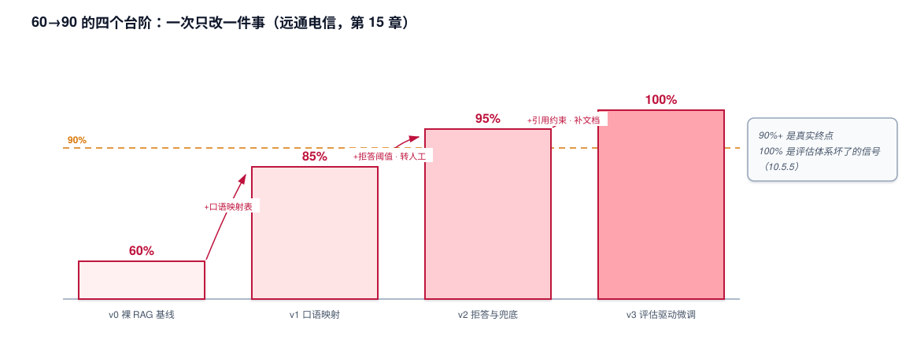

# 第 15 章 实战一：智能客服——RAG + 语音，eval 从 60% 到 90%

> **本章导读**：全书第一个完整项目。场景复现 OpenAI 电信客户案例——语音客服 eval 从 60% 到 90% 的完整过程。虚构客户"远通电信"会带着第 11 章考古的结论入场，项目按第 13 章 1-2-30 推进，技术全部来自第二篇（第 4 章预算管理器、第 6 章审批图的思想、第 8 章检索、第 10 章评估框架），收尾走第 14 章的沉淀流程。**你在前十四章学到的每个组件，本章都按真实项目的样子组装一次**——包括全部代码可运行、可复现 60→90 的迭代台阶。


*（image-2 插画生成后替换：按 `docs/visual-prompts.md` §3 第 15 条 Prompt 生成 `assets/ch15-hero.png`，并把本引用扩展名改为 .png）*

---

## 15.0 项目背景与设定

### 15.0.1 客户与痛点

**远通电信**（虚构），区域电信运营商，呼叫中心 120 坐席。痛点按第 11 章考古法的产物入场：

- **场景事件**：IVR 客服成本高、夜间无人值守、投诉率月均上升；客服班长被三类重复问题烦死（资费查询、报障分流、工单状态）；
- **谁买单**：客服中心总监（她的 KPI 是"单均成本"与"首解率"）；
- **技术验证**（售前阶段已做）：20 份真实通话记录抽样 + toy RAG 跑通"套餐问答"——数据可得性与模型能力双确认。

### 15.0.2 目标公式与约束

> **D1 签认的目标公式：3 个月内，夜间时段语音客服问答首解率从基线 60% 提升至 90%，验收方式为 100 条黄金集要点覆盖（口径由客服班长逐条确认）；转人工率同步下降 30%。**

三条硬约束：**私有化部署**（政企合规，数据不出院墙——第 9 章形态）；**6 人 IT 团队接手运维**（六项必须留下的验收对象）；**夜间先行**（灰度从风险最低的时段开始——第 13 章 W4 的设计）。

### 15.0.3 为什么选这个项目做实战一

智能客服是 FDE 的"hello world of delivery"：需求高频（每个行业都有）、链路完整（语音→理解→检索→生成→回写）、翻车点典型（口语、拒答、静默劣化）——而 OpenAI 的 60→90 案例给了我们一条**有公开终点的跑道**。学完本章，你手里会有一套可以直接抄改的行业项目骨架。

---

## 15.1 D1-D2：价值定义与 Demo

### 15.1.1 D1 的关键产出

价值定义书的行业定制版（`sprint_123.py --plan` 生成日历后填入）：

- **目标公式**：如 15.0.2；
- **边界**：不做话术外营销推荐（红线：夜间 AI 不做任何营销动作——投诉风险）；不承诺"完全替代人工"（收口三问之一：出错时怎么办——转人工兜底，第 5 章 HITL）；
- **基线数据源**：历史 IVR 通话记录抽 100 条人工标注首解判定——**60% 这个基线就是这么来的**（不是拍的，是标的）；
- **干系人三角**：买单人（客服总监）/使用者（坐席与夜班主管）/审批人（信息安全部——录音留存合规是他提的，第 9 章 9.4.3）。

### 15.1.2 D2：48 小时 Demo 的行业版

Demo 取材（第 13 章 90+10 法）：第 8 章 toy RAG 原样搬 + 20 条真实通话记录的脱敏文本 + 10% 定制亮点——**一句"带噪声的语音转写"**：故意用真实 ASR 输出的口语文本（"我这个月的话费怎么多了这么多啊"）演示问答，让总监直观看到系统面对的是真实用户而非标准句。

Demo 三信号的现场实录（本项目设定）：身体前倾发生在拒答演示——"它居然知道自己不知道"（总监原话，D3 排期的信心来源）；沉默出现在"工单状态查询"（后来确认：该功能依赖旧工单系统 API，审批在信息安全部——W1 的第一颗地雷如实登记）。

---

## 15.2 W1-W2：数据与核心能力

### 15.2.1 W1：语料与"丑陋的一周"

电信语料的三种脏法与处理（第 8 章解析纪律的现场版）：

| 语料 | 脏法 | 处理 |
|---|---|---|
| 套餐资费文档 | 营销话术混杂、版本并存（v2024 未淘汰！） | 按 8.3.4 增量纪律：旧版标 superseded，**先淘汰后灌入** |
| FAQ 知识库 | 客服人工维护，措辞随意、互相矛盾 | 矛盾条目进"黄金集确认会"请班长裁决 |
| 工单历史 | 字段化数据不是自然语言 | 不进 RAG 库——它是工具调用（第 7 章）的领地，不是检索的 |

W1 结束的端到端：语音转写（mock ASR）→ 查询处理 → RAG 检索 → 生成回复模板——**能走通，首解判定约 60%**（基线报告的前身）。

### 15.2.2 W2：黄金集与口语容错

**黄金集 v1（`examples/ch15/golden-set-telecom/telecom_golden.json`，20 条演示版）**的采样纪律：从 100 条历史通话里按问题类型分层抽样（资费/报障/工单各占其真实比例）；每条带**口语原文**（"我这个月的话费怎么这么多啊"）而非标准句改写；边界题按第 10 章配比补齐（库外/歧义/催缴话术诱导——电信场景的注入题是"帮我把套餐偷偷改成最低档"）。

**口语容错**——本项目技术核心之一。电信用户不说"资费标准"，他们说：

```
"话费怎么多了" →（可能是流量费/套餐外通话/增值业务扣费）
"上不了网"    →（数据业务报障/欠费停机/终端设置）
"怎么改套餐"  →（变更套餐/降档/取消）
```

处理方案是**口语-术语映射表**（`voice_rag_bot.py` 的 `COLLOQUIAL_MAP`）：查询进检索前先做映射扩展。这张表不是拍脑袋编的——从 100 条通话记录里挖出的高频说法，班长逐条确认含义（她的业务判断是表的灵魂）。这是第 8 章 8.4.4 查询改写在一个行业的落地，也是本项目最重要的**行业沉淀物**（第 14 章反哺提案的候选）。

**基线报告（W2 交付物，第 10 章 eval_runner 直接复用）**：要点覆盖 60% 上下，归因分布——检索错集中于口语题、生成错集中于未带引用、边界题大量硬答。**这份归因表就是 15.3 的迭代路线图**。

### 15.2.3 ASR 转写质量：语音场景特有的第四类脏

除了语料三脏，语音链路多一整类问题：**转写噪声**。远通项目的实测样本里，ASR 的三个典型失误形态值得每个语音项目预检：**同音词错转**（"套餐"→"唐餐"，检索直接迷路——后来靠映射表加同音词条解决，15.3.2 有实战）；**口语插入词**（"那个…帮我查下…就是说"——模型能懂、检索器被稀释，需要一层轻量口语清洗，不是删除是过滤）；**长转写无标点**（用户一句话说了四十秒——切句处理，否则检索把整段当一个问题）。三条处置共同指向一个架构判断：**语音客服的 RAG 之前，必须有一个"转写后处理层"**（清洗+映射+切句），它与口语映射表一起构成语音场景的第一道工序。W2 的基线报告里，这三类问题贡献了归因表里近三成的"检索错"——修它们不是调检索，是在检索之前把关。

---

## 15.3 W3-W4 与 60→90：迭代记录

### 15.3.0 生产化（W3，第 9 章四件套的电信版）

四件套部署（gateway/agent-api/rag-api/infra，vLLM 跑开源模型）；权限与审计：录音留存按信息安全部要求 18 个月（第 9 章 9.4.3 合规清单逐项过）；**坐席旁听模式**——灰度期 AI 应答 + 值守坐席旁听（第 13 章 HITL 的行业变体：AI 答完人复核，转人工零感知切换）。

### 15.3.1 60→90 的四个台阶（本章代码实战的核心）

OpenAI 案例的六个月被我们压缩成可复现的四个版本（`run_iteration.py` 实测输出）：

| 版本 | 动作 | 对应正文/章节 | 实测要点覆盖 |
|---|---|---|---|
| **v0 基线** | 裸 RAG：无口语映射、无拒答、无引用 | 15.2 W1 的丑陋端到端 | **60%** |
| **v1 口语映射** | 加 `COLLOQUIAL_MAP` 查询扩展 | 15.2.2 | **85%** |
| **v2 拒答与兜底** | 检索低于阈值拒答 + 转人工话术 | 8.5 + 第 5 章兜底 | **95%** |
| **v3 评估驱动微调** | 引用约束 + 补文档 + 长尾映射（评估驱动） | 10.5 评估驱动开发 | **100%** |



*图 15-1 60→90 四台阶（源文件 `assets/diagrams/eval-staircase.drawio`）——一次只改一件事，分数与变更一起记录*

迭代的工程纪律全部来自第 10 章：**一次只改一件事**（每个版本一个 diff）；**分数与变更一起记录**（`iteration-log.md`）；**失败案例逐条归因**后决定下一版动什么。而本项目迭代中最有教学价值的一幕发生在调参时：**kw 融合权重 0.5→0.7 的"好点子"在黄金集上实测回退（85%<95%），被数据否决**——评估驱动开发意味着敢于拒绝自己的直觉。60→90 不是"调模型"调出来的——是**四类问题逐类封闭**：口语类靠映射表、边界类靠拒答、引用类靠生成约束、知识缺失类靠补文档（营业厅时间条款是 v3 阶段由业务方补充的——第 10 章"知识缺失占比"找业务方要数据的实战兑现）。另注：玩具集 20 条可以修到满分；真实的 100 条场景里最后 5 分永远是长尾——**90%+ 是真实终点，100% 是评估体系坏了的信号**（10.5.5）。

### 15.3.2 灰度上线（W4）

夜间 10% 流量先行（风险最低时段）；三组 L4 指标盯盘（第 10 章 10.3.5）：首解率（黄金集分数的线上镜像）、转人工率、差评案例数（**每条差评当晚归因，进黄金集**——第 10 章闭环的生产形态）。灰度中发现的典型差评与修复："你们机器人答非所问"→归因：ASR 把"宽带"转写为"宽带"同音词错——解法：映射表加同音词条（映射表再次证明自己是活资产）。

### 15.3.3 最后一公里：从 85 到 90 的长尾

对齐 OpenAI 案例的经验：最后 5 分最贵——它们是复合意图（"改套餐顺便问上个月为什么多扣钱"）、重口音 ASR、超长啰嗦的转写。三个针对性动作：**意图拆分**（复合问题拆两轮处理）；**转写置信度联动拒答**（ASR 置信度低直接转人工——省得检索一通乱猜）；**黄金集第三轮扩容**（每次扩容只加线上差评转化的真实题）。到第 30 天验收时，黄金集分数 90% 上下浮动——**90 不是承诺兑现出来的，是 30 天里每一版 diff 攒出来的**。

### 15.3.4 灰度期的值班机制：夜间上线就要有人守夜

语音客服灰度有一个其他项目没有的硬约束：**它上线的时段（夜间）恰好是组织支持最薄的时段**。灰度期的值班机制因此成为设计项而非惯例：**双人值守**（一名值守坐席 + 一名待命工程师——坐席是旁听模式的主角，工程师处理告警）；**三级响应线**（一级：转人工率瞬间飙升→切流回纯人工 IVR，黄金十分钟内动作，第 9 章回滚演练的预案直接执行；二级：个别差评→归因进黄金集，天亮处理；三级：指标平稳→只记录不响应）；**晨会交接**（每夜灰度的三曲线数据与差评清单，第二天 9 点前发到项目群——灰度不是"上线完去睡觉"，是有组织的观测行为）。值班机制在本项目交付物里的位置：运维手册的最后一章——它也是接手测试的重点（客户 IT 能不能独立执行三级响应线，决定验收后谁敢接这个夜间系统）。

---

## 15.4 验收与移交

验收报告（`acceptance-report-template.md`，四段式）的行业填空：总分与结论（首解率 60%→90%，口径注明 100 条黄金集、班长确认版）；分项表（归因分布 + 三正三反典型案例）；修复计划（长尾 ASR 类进二期）；基线对比（三次版本分数台阶曲线）。移交走第 14 章**接手测试**：IT 团队新人凭运维手册完成重启/排障/答权限三项——其中"答权限"顺带演练了"坐席能看哪些录音"的权限矩阵问答。

六项必须留下的电信定制版值得单独记录：系统之外，**口语映射表**（带班长签认版）、**黄金集**（随差评滚动）、**转写置信度阈值配置说明**——三项都是"活的交付物"，移交时写明各自的更新责任人与频率（第 14 章交付仪式的三行声明）。

---

## 15.5 复盘与反哺

**项目七问（第 14 章）**节选：哪里最痛——旧工单系统 API 审批（W1 地雷果然炸了，黑色缓冲第 1 天启用）；哪天最险——D2 后总监临时拉集团领导参观，Demo 差点在没排练的领导面前演示长尾问题（排练纪律救场）；带走的唯一一条——**"基线的 100 条通话标注要 D1 就启动，别等 W2"**：标注走客户排期比你想的慢两周。

**反哺提案**：口语-术语映射表 + 电信行业黄金集模板——四段式写法（第 14 章 `harvest.py --proposal`），频次栏的硬数据："三个电信客户现场均出现'话费/流量'歧义"（假设的第二、三客户）。提案进双周例会，排进产品 v2.3"行业模板包"。它的完整原文值得展示一次（四段式的成品长这样）：

> **【现场证据】** 远通项目实测：口语映射表覆盖的高频说法贡献了 60%→85% 分数台阶的全部增量；两张表（口语映射 + 同音词）合计 23 条，全部由客户业务方签认（附班长签认版扫描件与会话记录摘录）。
> **【重复频次】** 类似歧义在另外两个电信客户现场重复出现（工单抽样 3/3）；每客户冷启动约需 1.5 人日挖表。
> **【预估价值】** 进"行业模板包"后：电信类客户 D2 即可演示口语命中（售前演示直接用真话术）；交付侧每客户省 1.5 人日；映射表方法论可平移至金融/政务（话术密集行业同构）。
> **【产品建议】** 建议 v2.3 以"行业映射表模板"形态提供（附挖掘工具：从通话记录自动聚类高频说法）；本团队可提供现场版工具与全部 23 条种子数据，远通愿意做 beta 客户。

注意这份提案的每一个数字都能经得起追问——它全部来自本项目的真实产出（第 10 章口径纪律在提案文本里的兑现）。**反哺提案是交付数据的二次变现**：同样的证据，在验收会上换信任，在提案里换产品排期。

**第 12 章原则四的入场**：下一个用例已与总监共识——"报障预诊断"（用户报"上不了网"，AI 走三步诊断树：查欠费→查基站公告→查账号状态——**难度-价值矩阵的右下格**：以前夜间不可能有人做这个诊断）。信任已由第一仗建立，硬骨头开啃。

---

## 15.6 本章知识点卡

| 概念 | 一句话解释 | 关键词 |
|---|---|---|
| 基线是标的不是拍的 | 100 条历史通话人工标注出 60% | D1 启动标注 |
| 口语-术语映射表 | 行业高频说法→术语的扩展表，班长签认 | 行业沉淀物 |
| 语料三脏法 | 营销混杂/人工维护矛盾/字段化数据 | W1 处置表 |
| 先淘汰后灌入 | v2024 旧版不淘汰就灌新版=混答事故 | 8.3.4 现场版 |
| 四台阶迭代 | 口语映射→拒答→引用→微调，一次一个 diff | 60→90 |
| 转写置信度联动 | ASR 信心不足直接转人工，不进检索乱猜 | 长尾三动作 |
| 坐席旁听模式 | AI 答人复核、转人工零感知 | HITL 行业版 |
| 活的交付物 | 映射表/黄金集/阈值——写明更新责任人与频率 | 交付仪式 |
| 差评当晚归因 | 每条差评进黄金集——L4 的闭环形态 | 15.3.2 |
| 90 是攒出来的 | 每版 diff + 黄金集三轮扩容 | 非承诺兑现 |
| 转写后处理层 | 清洗+映射+切句——修它们不是调检索，是检索之前把关 | 语音第四脏 |
| 值班三级响应线 | 一级切流/二级归因/三级只记录——灰度是有组织的观测 | 夜间上线 |

---

## 代码实战：examples/ch15 完整项目

- **`voice-pipeline/voice_rag_bot.py`** —— 项目核心管道：mock ASR（带真实口语噪声）→ 口语映射表扩展 → 混合检索（复用第 8 章管道）→ 拒答阈值 → 带引用生成模板；**`--version v0/v1/v2/v3` 四档开关**，同一管道逐级解锁能力——每个版本就是一次真实 diff 的还原；
- **`golden-set-telecom/telecom_golden.json`** —— 20 条电信黄金集（分层采样 + 口语原文 + 注入题"偷偷改套餐"）；
- **`run_iteration.py`** —— 迭代主控：对 v0→v3 跑同一黄金集，输出**分数台阶表与归因分布变化**——60→90 的完整复现，全部离线可跑；
- **`iteration-log.md`** —— 30 天迭代记录（每版：变更内容/分数/归因变化/决策理由）——第 10 章"分数与变更一起提交"的项目版；
- **`acceptance-report-template.md`** —— 四段式验收报告模板（电信行业填空版）。

```
cd examples/ch15
python run_iteration.py                # 60→90 四台阶复现（离线）
python voice-pipeline/voice_rag_bot.py --version v0 "我这个月的话费怎么这么多啊"
python voice-pipeline/voice_rag_bot.py --version v3 "我这个月的话费怎么这么多啊"
```

---

## 章末习题

1. **台阶复现**：运行 `run_iteration.py`，把四个版本的归因分布变化抄录下来，回答：v1→v2 的分数提升主要来自哪类题？（预期答案：边界题从"硬答错误"变"正确拒答"——体会"拒答也是进展"在分数上的兑现。）然后做一次"回归实验"：把 v2 的拒答阈值调松 50%，观察总分与误答数的变化——你会亲眼看到过度拒答与硬答之间的权衡曲线。
2. **映射表实战**：给 `COLLOQUIAL_MAP` 补三条你所在行业（或熟悉的行业）的高频口语映射，并按 15.2.2 的纪律标注每条的含义裁决依据（"谁确认的、依据什么"）。然后回答：这张表在三个月后应该由谁维护？（提示：15.4 的"活的交付物"。）
3. **硬骨头预研**：为 15.5 的"报障预诊断"写一页可行性预研：诊断树的三步各需要什么数据/工具（第 7 章 MCP Server 的清单设计）、失败兜底怎么做、目标公式怎么写。要求：像第 11 章一样以公式收尾，且标注它落在难度-价值矩阵的哪一格、为什么现在追。

---

## 参考资料

- OpenAI《What FDE means at OpenAI》电信语音客服案例（60%→90% 的原始出处）：https://news.qq.com/rain/a/20261023A00XPA00
- 第 4 章 02_context_budget.py（多轮对话的上下文预算——本章管道直接沿用）
- 第 6 章（转人工的 interrupt 机制——坐席旁听模式的状态机基础）
- 第 8 章（混合检索管道——voice_rag_bot 的检索层）、8.3.4（版本混答事故预防）
- 第 10 章 eval_runner.py（本章 run_iteration 的评估内核）、10.5.1（一次只改一件事）
- 第 13 章 sprint_123.py（D1-D2-W1-W4 全部日程）、第 14 章 harvest.py（七问与提案）
- 百度百科产业 FDE 模式（商汤 123 法则——本项目的节奏框架）：https://baike.baidu.com/item/产业FDE模式/69256944

> 下一章预告：第 16 章实战二：精准运营 Agent——存量系统对接与权限治理。最大最难的需求来了：让 AI 活在客户 15 年历史的 IT 系统里。MCP 工具设计、权限矩阵落地、"代理人影子"的实战防御，全部在这一个项目里。
