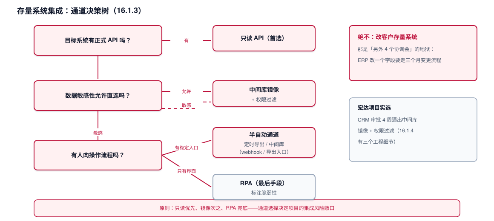
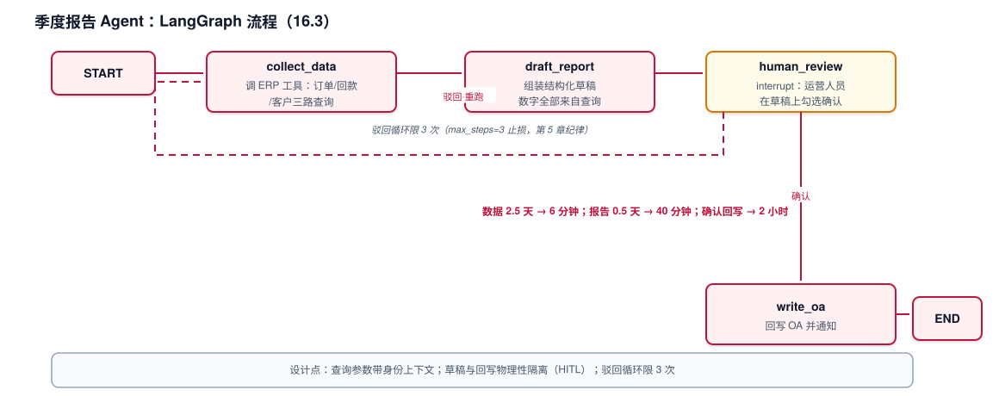

# 第 16 章 实战二：精准运营 Agent——对接存量系统与权限治理

> **本章导读**：FDE 最大的脏活在第 15 章还没碰到——让 AI 活在客户 20 年历史的 IT 系统里。本章项目"宏达制造"：销售运营人员每天在 ERP、CRM、OA、BI 四个系统间来回导数据做季度报告。核心训练点不是模型，而是**集成与权限**：摸清存量系统的地质图、按第 7 章粒度设计 MCP 工具层、把第 9 章权限矩阵落进真实角色、防御"代表人的影子"。项目代码把第 6 章 LangGraph、第 7 章 MCP Server、第 9 章权限矩阵组装成一条完整流程——前两册的武器在本章会师。


---

## 16.0 项目背景与设定

### 16.0.1 客户与痛点

**宏达制造**（虚构），500 人规模的装备制造商，销售运营团队 8 人。第 11 章考古法的产出入场：

- **场景事件**：季度销售报告制作要 3 天——从 ERP 导订单、从 CRM 拼客户信息、从 BI 抄回款看板，全部人肉搬运进 Excel，格式每周都变；运营人员被戏称"人肉 SQL"；
- **谁买单**：销售运营总监（他的 KPI 是"报告时效"——上季度报告因延期一天，错过了集团经营会）；
- **隐藏痛点**（跟岗观察发现）：运营人员**每天**都在回答销售的临时数据问题（"我这个月回款多少"）——临时问答比季度报告更高频。

### 16.0.2 目标公式与约束

> **D1 签认：一个季度内，季度报告制作周期从 3 天压缩到 4 小时（口径：与上季度报告逐项对照评分）；运营数据问答准确率 ≥95%（验收：历史真实报告与问答双黄金集）。**

约束：**存量系统不可改造**（ERP 是自研系统改造了 15 年，"改它的接口要开 4 个协调会"——D1 现场原话）；**权限极度敏感**（客户与价格数据是销售看家的东西，总监唯一反复强调的红线）；**IT 团队 3 人**（其中 1 名工程师）——工具层必须可移交。

### 16.0.3 为什么这个项目是"必修课"

第 15 章做的是"知识"（文档→答案），本章做的是"行动"（AI 替你跑系统）——**行动类用例的风险等级完全不同**：答错可以撤回，错误的数据搬运和越权查询会直接造成业务事故。FDE 交付里最贵的能力就是"敢让 AI 行动"——它靠的不是胆量，是工具设计与权限工程。学完本章，你面对任何"帮我们在 XX 系统 XX 系统之间自动化"的需求都有了完整的作战图。

---

## 16.1 调研：存量系统的集成地质图

### 16.1.1 四张地质剖面

W1 的头三天是地质勘探（第 9 章调研十问的深钻版），宏达的剖面图：

| 系统 | 状态 | 接口现实 | 集成策略 |
|---|---|---|---|
| **ERP**（自研 15 年） | 在用，改造冻结 | 有内部 API，**无文档**；测试环境是三年前的副本 | 只读 API + 老带新摸接口（找当年的开发者） |
| **CRM**（SaaS） | 在用 | 有开放 API，但**审批要厂商走流程（4 周）** | 中间库策略：CRM 每日导出到本地镜像表 |
| **OA** | 在用 | 无正式 API，但有内部 webhook（运维知道） | RPA 兜底：webhook 优先、界面 RPA 备胎 |
| **BI** | 在用 | 只能读 | 不集成——**BI 的数据是 ERP 的二手加工**，直接查 ERP 源头 |

四张剖面收敛出一条黄金法则：**优先级 = 只读 > 中间库 > RPA > 改造**——存量系统集成的阻力排序永远是这个顺序，每往右一档，工程成本与协调成本翻倍。

### 16.1.2 地质图上的三个意外

真实调研里，地质图总会挖出意外（每一个都进了风险登记册）：

1. **ERP 的"幽灵字段"**：订单表里有个 `status2` 字段，老员工说"别用它，那是一年前试运行留下的"——**字段存在≠字段有效**，元数据必须向使用者（不是系统文档）核实；
2. **CRM 审批周期 4 周 > 项目周期**：如果 D1 没问审批流程，这个雷会在 W2 炸——中间库策略是地雷排查的直接产物；
3. **BI 依赖链**：运营人员以为 BI 数据"更准"，实际是 ERP 数据的滞后 24 小时镜像——**集成 ERP 后 BI 依赖消失**，这是调研的意外红利（报告可以引用实时数据了，成为超预期交付的素材）。

### 16.1.3 集成策略决策树（可复用）



*图 16-1 集成通道决策树（源文件 `assets/diagrams/integration-tree.drawio`）——只读优先、镜像次之、RPA 兜底——绝不改客户存量系统*

### 16.1.4 中间库的工程细节：同步、失效与权限

CRM 审批 4 周逼出的"中间库策略"值得展开——它是最常被低估的集成方式，细节做不好就是新的故障源。三个工程要点：

1. **同步策略按业务节奏定**，不按技术上限定：CRM 数据每日一次全量镜像（运营问答场景的实时性要求够用），但**报告用例要用同步时间戳声明数据截止点**（"数据截至昨 24:00"——第 10 章口径纪律在数据层的应用）；
2. **失效处理前置**：同步失败时的降级设计——继续用昨日镜像并在 UI 标注"CRM 数据未更新"，而不是静默给旧数据；连续三天失败触发告警（第 9 章静默劣化的集成版）；
3. **镜像表继承源系统的权限元数据**：CRM 的客户归属人字段随数据同步进来，权限闸才能在镜像表上工作——**没有权限元数据的镜像库就是新的越权入口**（把敏感数据从有权限体系的系统搬到了裸表里，这是真实发生过的事故形态）。

中间库的隐性收益也值得一提：它把"外部依赖的可用性"与"AI 系统的可用性"解耦了——CRM 厂商升级故障的那天，宏达的运营 Agent 依然能答昨天的数据，而不是全线瘫痪。**集成层的降级设计，就是交付可靠性的免费加固。**

---

## 16.2 MCP 工具层设计

### 16.2.1 从第 7 章模板到宏达场景

第 7 章 CRM Server 的四工具粒度模板（入口搜索/精确查询/分页/两段式写）原样迁移，宏达版工具清单：

| 工具 | 参数 | 设计要点 |
|---|---|---|
| `query_orders(region?, quarter?)` | 可选过滤 | **入口工具**：参数化过滤替代 N 个单查询工具（第 5 章 5.4.1 纪律） |
| `query_payments(customer_id, page≤50)` | 分页硬顶 | 回款数据量大，分页是权限也是性能 |
| `query_customer_profile(id)` | 精确 ID | 模型友好报错给可用值（7.3.2） |
| `generate_report_draft(quarter, sections)` | 草稿两段式 | **唯一的"生成"类动作**：产出报告草稿，**人确认才落 OA** |

第四个工具是本项目的灵魂：报告的每个数字来自前三个工具的真实查询（第 15 章的教训——**算术必须交给代码**），生成的是"结构完整的草稿"，落库前必经人审（第 6 章 interrupt 机制的用武之地）。

### 16.2.2 工具说明书里的权限语义

`examples/ch16/erp-mcp-server/server.py` 的一个关键设计：**权限语义写进工具说明书**（description），而不是只靠拦截层——"本工具仅返回请求者可见范围内的数据；跨区域数据需经理权限，系统会自动过滤并在结果中注明"。两层好处：模型提前知道边界，不会反复发起注定被拒的调用（省 token 与轮次）；权限行为对用户**可预期**——Agent 不会突然拒绝一个用户以为能查的东西而不解释。这是第 9 章四道闸与第 5 章说明书纪律的合流。

### 16.2.3 错误信息的"可修正"设计

存量系统对接的高频失败不是"没查到"，是**参数世界不匹配**：模型猜的区域名是"华东大区"，ERP 里叫"华东区"。工具层的处理（server.py 实测）：

```
❌ ERROR: invalid region
✅ 无效区域 "华东大区"。可用值：华东区、华南区、华北区。
   请更正后重试，或调用 query_orders 不带区域参数获取全部。
```

三条可用行动（改值/换参数/查全部）让模型自主修正——存量系统集成的报错设计，比 RAG 的拒答还要关键，因为它直接影响 Agent 能不能走完流程。

---

## 16.3 权限治理：矩阵落地与影子防御

### 16.3.1 宏达的权限矩阵

第 9 章四道闸的宏达版（`examples/ch16/permission-matrix/matrix_manufacturing.py`，角色×数据×工具的完整交叉表）：

| 角色 | 数据范围 | 工具权限 | 写动作 |
|---|---|---|---|
| 运营专员 | 本区域 | query_*（全） | report_draft（草稿） |
| 运营经理 | 全部区域 | query_*（全） | report_draft + approve（批草稿） |
| 销售人员 | 本人客户 | query_customer_profile | 无（**不给运营工具**） |
| 总监 | 全部 | 全部 + 审计导出 | approve |

一个容易忽略的设计点在第三行：**销售人员只给最小工具集**——他们问的"我这个月回款多少"由 Agent 代表运营专员的数据权限回答？不——这是"代表人的影子"的高发区，见 16.3.2。

### 16.3.2 代表人的影子：三个实战防御

第 9 章立了铁律（Agent 可见性≤代表人），本项目的三种落地防御：

1. **会话绑定身份**：每次会话挂载真人身份（SSO claims），Agent 的所有工具调用**以该身份的权限执行**——不存在"Agent 自己的权限"这种东西（`server.py` 的 `acting_as` 参数全链路传递）；
2. **数据闸下推到 SQL/查询层**：区域过滤写在查询里（`WHERE region = :user_region`），不是查完再过滤——**过滤后发生的数据不会出现在任何日志、缓存、上下文里**，连"被过滤掉的数据存在"都不暴露；
3. **越权尝试的"软拒绝"话术**：用户要求超范围数据时，Agent 回复"您所在角色可见 XX 区域的数据（依据：权限矩阵 v1.2 第 3 行），如需跨区域数据请走审批流"——拒绝+出口+依据（第 8 章拒答三件套的权限版），把每一次拒绝变成权限体系的活广告。

### 16.3.3 审计：行动类用例的加倍配置

行动类 Agent 的审计配置比问答类加倍（第 9 章 9.4 的行动版）：工具调用日志必含 `acting_as`（谁的身份）与 `on_behalf`（名义上为谁执行）两个字段——多数字段重合，但在"经理让 AI 替实习生跑报告"这种场景里，两者的差异就是责任认定的关键。每周的审计抽检不是走形式：抽 10 条**高权限会话**（经理/总监）逐条核——越权事件永远藏在高权限的阴影里。

---

## 16.4 交付与验收：报告流程的完整组装

### 16.4.1 LangGraph 报告流程图

项目主流程用第 6 章的图组装（`examples/ch16/report-flow/graph.py`，零 API Key 可运行）：



*图 16-2 季度报告流程图（源文件 `assets/diagrams/report-flow.drawio`）——LangGraph 流程：三路查询→草稿→人审 interrupt→回写 OA；驳回限 3 次*

图的三个设计点：`collect_data` 的查询参数带**身份上下文**（16.3.2 第 1 条在图里的落点）；`draft_report` 与 `write_oa` 之间**物理性隔离**（interrupt，第 6 章 checkpoint + HITL 的完整兑现）；驳回循环限 3 次（第 5 章止损）。

### 16.4.2 时间账：3 天到 4 小时的对账

验收的核心证据是时间账（`report-flow/graph.py` 的实测输出）：数据收集 2.5 天→**6 分钟**（三路工具自动查询）；报告组装 0.5 天→**40 分钟**（草稿生成+人工校对）；确认与回写当日→**2 小时**（人审+OA 流程）——合计 4 小时内，对账成立。**时间账必须拆到动作级**——"快了很多"是感觉，"6 分钟/40 分钟/2 小时"是续约谈判的弹药。

### 16.4.3 验收口径：历史报告对照评分

报告质量不能只看速度——用第 10 章"要点覆盖法"做**历史对照**：取上季度人工报告的 20 个数据要点（数字与结论），验证 AI 草稿的覆盖与准确（本项目实测 19/20，偏差一处在 BI 镜像滞后的老问题——调研红利 16.1.2 第 3 条在此兑现为优势）。黄金集之外，**报告模板本身也成为交付物**（第 14 章"活的交付物"清单+1）。

### 16.4.4 组织落地：让 3 人 IT 团队接得住

行动类 Agent 的移交比问答类更重——工具层和权限矩阵是"活的系统"，不是"跑起来就完"的产品。宏达项目的三个组织设计：

- **职责分层而非全栈交接**：IT 工程师接"部署与升级"（第 9 章六项），运营团队接"知识维护"（报告模板、黄金集），权限矩阵归**业务方**（销售运营总监）与信息安全部共管——**权限是业务决策，不该让 IT 单独背**。三层职责写进交接文档，各自签认；
- **结对交付从 W1 就开始**：宏达的工程师从集成地雷排查就全程结对（16.1 的地质勘探他全程在场）——交付时他不是"接手一个陌生系统"，而是"接手自己参与过的系统"。第 17 章会把这条升级为正式的结对制度；
- **一条运营规则提前立**：权限矩阵的任何变更（哪怕"就加一个人"）走变更单——W4 的培训上总监亲手签了第一条，作为仪式。**规则的第一条由业务最高决策者亲手签，后面的就顺了**（第 13 章 D1 签认同款心理学）。

三周后的健康信号（第 14 章接手测试的延时版）：运营团队自己新增了两条报告模板段落；IT 工程师独立完成了一次镜像库同步故障的处理；权限矩阵迎来第一个变更单——按流程走的。**移交成功的定义不是"他们没来找你"，是"他们不需要你就把系统用出了你没设计过的用法"。**

---

## 16.5 复盘与反哺

**项目七问节选**：哪里最痛——ERP 无文档接口（W1 黑色缓冲第 1 天启用，产出物：接口说明文档反而成了给客户的意外交付）；删掉 30%——BI 对接（调研红利：源数据直查后 BI 集成整体裁掉）；带走的唯一一条——**"集成策略的调研结论要在 D1 谈判前就拿到"**——CRM 审批 4 周这种事，应该在报价前知道。

**反哺提案**：ERP 查询 MCP 组件（参数化区域过滤版）进 harness 第二层；报告生成流程进第三层模板（agent skill："季度报告"工作流）。四段式的频次栏数据：**本项目的 collect_data 三路查询与半导体项目的脚本生成共用同一编排骨架**——harness 的复用第一次跨行业发生，复利开始滚（第 14 章 14.5.1 的实测）。

**第 12 章原则四预告**：下一个用例已锁定"设备报修工单智能分派"（难度-价值矩阵右下格，三信号已过线）——但那是另一个项目的故事了。

---

## 16.6 本章知识点卡

| 概念 | 一句话解释 | 关键词 |
|---|---|---|
| 集成地质图 | 四系统剖面+意外清单——字段存在≠字段有效 | W1 头三天 |
| 集成优先级 | 只读 > 中间库 > RPA > 改造；每右一档成本翻倍 | 绝不改存量 |
| BI 依赖链 | 镜像数据是二手加工——直查源头的意外红利 | 调研红利 |
| 权限语义进说明书 | 边界写进工具 description——可预期、省轮次 | 两层好处 |
| 参数世界不匹配 | "华东大区"vs"华东区"——可修正报错三行动 | 存量报错设计 |
| 会话绑定身份 | 工具以真人身份执行——不存在"Agent 的权限" | acting_as |
| 数据闸下推 | 过滤写进查询——被过滤的数据不出现在任何地方 | SQL 层闸门 |
| 软拒绝话术 | 拒绝+出口+依据——每次拒绝都是权限体系的广告 | 权限版拒答 |
| acting_as / on_behalf | 身份与名义双字段——责任认定的关键 | 行动类审计 |
| 动作级时间账 | 6 分钟/40 分钟/2 小时——不是"快了很多" | 续约弹药 |
| 历史对照评分 | 上季度报告 20 要点做黄金集 | 验收口径 |
| 骨架跨行业复用 | collect_data 与半导体脚本生成共用编排——复利实测 | 14.5.1 |
| 中间库三要点 | 同步按业务节奏 / 失效标注 / 权限元数据随行 | 镜像≠裸表 |
| 职责分层移交 | IT 接部署、业务接知识、权限归业务与安全共管 | 组织落地 |

---

## 代码实战：examples/ch16 完整项目

- **`erp-mcp-server/server.py`** —— 宏达 MCP 工具层：四工具（订单/回款/客户/报告草稿）+ 权限语义说明书 + `acting_as` 身份链路 + 可修正报错 + 区域数据闸下推——第 7 章模板的制造业落地；
- **`permission-matrix/matrix_manufacturing.py`** —— 宏达角色矩阵（含"销售人员最小工具集"设计）+ 六条自动越权测试——第 9 章矩阵的行业填空；
- **`report-flow/graph.py`** —— 报告流程主图（LangGraph）：collect_data→draft_report→human_review（interrupt）→write_oa，含 checkpoint、驳回循环止损、**动作级时间账实测输出**——第 6 章图的完整组装；
- **`README.md`** —— 组装关系表（本章与前 15 章的组件复用索引）。

```
cd examples/ch16
python report-flow/graph.py --auto          # 全流程演示（含时间账输出）
python report-flow/graph.py --human        # 人审中断→确认→回写 OA
python permission-matrix/matrix_manufacturing.py   # 六条越权测试
python erp-mcp-server/server.py --checks    # 工具层契约自检
```

---

## 章末习题

1. **地质图实战**：为你熟悉的一个组织（公司/学校）画集成地质图：列出主要系统、接口现实、三个"意外"。然后用 16.1.3 决策树给每个系统定集成策略。把"BI 依赖链"式的问题专门找一找——**有没有一个系统在用另一个系统的二手数据？**
2. **影子攻防**：在 `matrix_manufacturing.py` 中新增一个角色"实习生"（可见：本区域；工具：query_customer_profile）与一条越权路径："实习生要求查询经理可见的全量订单"。实现拦截并按 16.3.2 第 3 条写出"软拒绝"的完整话术（含依据与出口）。然后回答：审计日志里这条 deny 记录应该包含哪些字段？
3. **时间账答辩**：客户 CFO 质疑"3 天到 4 小时的数据从哪来"。基于 16.4.2 的动作级拆分写一页答辩材料：每个数字的测量口径、样本量、以及"为什么不是 1 小时"（诚实边界：人审 2 小时是流程的下限，不是技术上限——但你不会想消灭它，第 5 章 HITL 纪律）。

---

## 参考资料

- 第 7 章 02-crm-mcp-server（四工具粒度模板与模型友好报错——本章工具层的母版）
- 第 9 章 03-permission-matrix/matrix.py（四道闸——本章矩阵的母版）、9.3.3（代表人的影子铁律）
- 第 6 章 langgraph-approval（interrupt/checkpoint——报告流程图的母版）
- 第 5 章 5.4（工具说明书四要点）、第 8 章 8.5.2（拒绝+出口+依据的三件套结构）
- 第 10 章（要点覆盖评分——历史报告对照验收的方法论）
- 第 12 章 12.2（harness 复利——collect_data 骨架跨行业复用的出处）
- 阿里云 × 昆仑数智 FDE 联合团队案例（制造业驻场与存量系统对接的公开参照）
- Anthropic《Building effective agents》（工具设计中"简单 vs 复杂"的同向判断）

> 下一章预告：实战篇压轴——第 17 章复刻 OpenAI 的企业软件场景：多用例并发交付与 harness 化，"删除 90% 定制代码"的完整路径，与第 12 章原则二的真实对账。本章的 collect_data 骨架将在那里跨行业复用——复利曲线的第一段，值得亲眼看着它发生。
