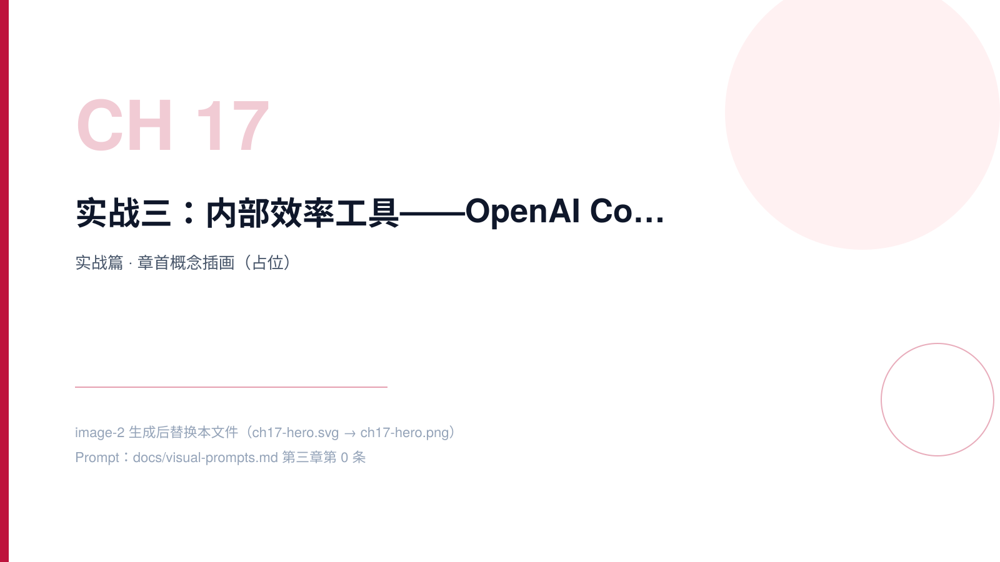
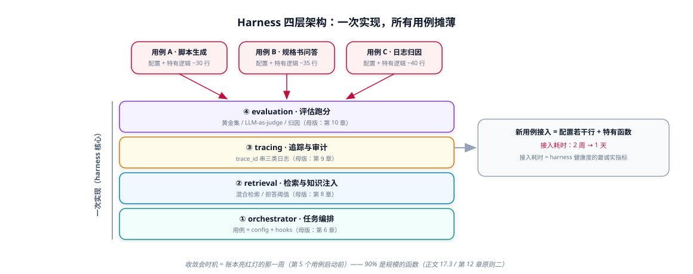

# 第 17 章 实战三：内部效率工具——OpenAI Codex 案例复刻

> **本章导读**：实战篇压轴项目。复刻 OpenAI 半导体客户的企业软件场景：晶芯半导体的验证工程师每天写大量验证脚本、翻规格书、调试失败用例——FDE 的任务是让 10+ 用例在 3-6 个月内全部上线、调试时间下降约 40%，并且完成第 12 章原则二的终极考验：**把 N 套定制收敛为 1 个通用 harness，直至"每项目删除 90% 定制代码"**。本章代码将用可运行的度量工具把这句话变成可对账的数字——这是全书复利曲线的实测现场。



*（image-2 插画生成后替换：按 `docs/visual-prompts.md` §3 第 17 条 Prompt 生成 `assets/ch17-hero.png`，并把本引用扩展名改为 .png）*

---

## 17.0 项目背景与设定

### 17.0.1 客户与痛点

**晶芯半导体**（虚构），2000 人芯片设计公司，验证部门 60 名工程师。第 11 章考古产出入场：

- **场景事件**（跟岗观察三天）：验证工程师每天 60% 时间在写重复结构的验证脚本（UVM 环境配置、寄存器测试序列）；查规格书要翻几百页 PDF 定位寄存器定义；调试失败用例时要在万行日志里人肉找第一条 ERROR；
- **谁买单**：验证部总监（他的 KPI：产品验证周期——上一颗芯片的验证占了整个项目周期的 45%）；
- **D2 的身体前倾时刻**：演示"从寄存器 Excel 自动生成测试序列骨架"时，一位资深验证工程师说出了本章题眼：**"这个东西以前根本不可能——每次都是我从头手写。"**（第 12 章原则四的信任杠杆原话实录。）

### 17.0.2 目标公式与约束

> **D1 签认：6 个月内，10+ 验证用例全部上线；验证调试时间从基线下降约 40%（口径：按用例统计工程师调试工时，与上两颗芯片的历史均值对比）；首用例 30 天出可用版本（1-2-30 档与季度档的混合——见 13.1.3）。**

约束：**内网封闭环境**（芯片设计数据是最高密级，纯内网私有化——第 9 章满配形态）；**EDA 工具链专属**（ Synopsis/Cadence 环境，接口需 FDE 逐个摸）；**验证团队自己要能改**（60 人的部门，"每次都找你们改"不可持续——结对交付是硬需求，不是加分项）。

---

## 17.1 用例组合拳：10+ 用例怎么并发

### 17.1.1 用例谱系与打分

10+ 用例不是一天选出来的——D1 的矩阵只选出第一批，后续用例靠"滚动打分"进场（每两周全谱重排一次）：

| 用例 | 价值 | 可行性 | 可见性 | 首批 |
|---|---|---|---|---|
| 验证脚本生成（寄存器→UVM 序列骨架） | 5 | 4 | 5 | ★ |
| 规格书问答（RAG，第 8 章全装） | 5 | 5 | 4 | ★ |
| 日志归因（万行日志找第一条 ERROR+上下文） | 4 | 3 | 5 | ★ |
| 回归报告自动化 | 4 | 4 | 4 | 二批 |
| 断言模板生成 / 环境配置检查 / 交叉覆盖分析…… | 3-4 | 2-4 | 3 | 滚动 |

滚动打分的关键改进：**可见性权重随阶段变化**——首批用可见性拉信任（Demo 时代"人人能看见"最重要），信任建立后第二批上调"价值"权重（啃断言生成这种硬骨头，第 12 章原则四的入场时机管理）。

### 17.1.2 并发交付的团队模式

OpenAI 案例的数字（10+ 用例、3-6 个月）背后是一套小队形：

- **1 名 FDE + 客户侧 2 名工程师结对**（晶芯版：1 FDE + 验证工程师小陈 + IT 工程师小林）；
- **每个用例走"迷你 1-2-30"**：D1 定价值 → D2 Demo → 三周冲刺——用例之间错峰启动（用例 A 的 W3 恰逢用例 B 的 W1），保证结对人手不超载；
- **共用一切**：第 15-16 章的项目骨架（预算管理器、评估框架、四件套部署、口语映射表的位置换成"寄存器术语表"）跨用例共享——**用例并发的前提是基建不并发**。

### 17.1.3 首用例为什么选"脚本生成"而非"问答"

谱系里规格书问答可行性最高（第 8 章武器直接打），但首用例选了脚本生成——三个理由：价值分更高（写脚本比查文档耗时多）；**"以前不可能"的信任杠杆**（17.0.1 的原话——能力故事比效率故事值钱，第 12 章 12.4）；客户工程师结对写它最有感觉（结对交付从他最痛的活开始）。**首用例的选择永远不是"最容易的"，是"最能建立信任的"。**

---

## 17.2 首用例深度复刻：验证脚本生成

### 17.2.1 现场调研：跟着工程师写一天脚本

跟岗观察（第 11 章方法）在验证场景的产出：工程师写一个寄存器测试序列的实际动作链——打开 Excel 寄存器表（约 200 行）→ 逐行翻译成 UVM 测试代码 → 手写断言 → 跑仿真 → 改 5-10 轮。**痛点不在"写代码"在"翻译"**：从表格到代码的机械转换占 70% 时间，且格式约定在部门里靠口口相传。FDE 的判断（也是与 OpenAI 案例的同构处）：这类"结构化数据 → 规范代码"的翻译是 harness 的完美素材——确定性高、可评估性强、价值密度大。

### 17.2.2 实现：Agent + 规格书 RAG + 模板库

用例的架构（`examples/ch17/usecase-verilog-gen/` 的骨架可运行）：

```
寄存器 Excel → 解析（结构化）
            → 模板库（部门约定 → UVM 骨架生成，代码即翻译——零模型！）
            → 生成测试序列 → 评估：与人工样本对照编译通过率 + 断言覆盖率
            → Agent 层（第 5-7 章）：处理"帮我给这个序列加异常注入"类开放需求
```

架构里最值得注意的设计：**主链路根本不用大模型**——Excel→UVM 是纯代码翻译（第 4 章决策树："算术交给代码"的工程版：**确定性转换交给模板，开放性增强才交给模型**）。Agent 只负责增量需求（加异常、改位宽）。这个"零模型主链路"让本用例的评估基线出奇地高（编译通过率 95% 起步）——**先摘确定性果实，再啃概率性难题**，是多用例项目里最常见的正收益起点。

### 17.2.3 评估：以历史脚本为黄金集

黄金集 = 300 行真实寄存器表 × 20 位工程师的手写样本（脱敏后）：评分口径是**编译通过率 + 断言语义覆盖**（LLM-as-judge 评"语义等价"，第 10 章 L2 的代码版）。基线报告：模板版 95% 编译通过 / 82% 语义覆盖——剩下的 18% 全部是"模板没覆盖的部门口头约定"（比如"状态寄存器要加读清零注释"）——**归因表直接变成模板库的迭代清单**，每个口头约定变成一条模板规则，两周后语义覆盖 97%。这就是"评估驱动开发"在代码生成场景的样子。

---

## 17.3 Harness 化：从 N 个定制到 1 个通用

### 17.3.1 收敛的时机：第 5 个用例启动的那一周

10 个用例做到第 4 个时，账本（第 12 章定制-通用账本）出现了明显信号：每个用例都在重新写"任务编排循环、日志收集、评估跑分、配置管理"——第 17.1.2 节"基建不并发"的承诺眼看守不住。**第 5 个用例启动的那一周，团队暂停一切，开了一次为期三天的收敛会**（第 14 章 harvest 流程的团队版）：把前四个用例的共性抽进 harness，把差异压进各用例的"配置+特有逻辑"。

### 17.3.2 Harness 四层架构

收敛产出的分层架构（`examples/ch17/harness-architecture/` 可运行骨架）：



*图 17-1 Harness 四层架构（源文件 `assets/diagrams/harness-architecture.drawio`）——三个用例房间（规格 QA `usecase_spec_qa.py`、Verilog 生成 `usecase_verilog_gen.py`、日志分诊 `usecase_log_triage.py`）各自以几十行配置接入四层，接入耗时从第一用例的 2 周收敛到一天*

判据（第 14 章 14.2.4 的正面版）：**新用例 = 配置若干行 + 特有函数若干个**，接入耗时从第一用例的两周降为第 9 个用例的一天——接入耗时是 harness 健康度的最诚实指标（第 12 章治理纪律），这句话在这里第一次被数字兑现。

### 17.3.3 "删除 90%"的可运行对账

OpenAI 说迁移到通用 harness 后"每项目删除约 90% 定制代码"——本章把它做成**可运行的度量**（`examples/ch17/customization_metrics.py`，实测输出）：

- **对照组**：naive 版用例（每个用例独立写完整管道——`usecase_naive_spec_qa.py` 是真实写出来的独立实现，不是假想的行数）；
- **harness 版**：harness 四层 + 用例配置；
- **度量输出**：定制占比 = 用例特有行数 ÷ 总行数；**收敛率** = 1 - harness版总行数 ÷ naive版总行数。

玩具规模下这个数字是诚实而有趣的（实测输出）：**单用例即省 48%**（harness 版增量 29 行 vs naive 版 56 行），但整体收敛率要 5 个以上用例才转正——因为玩具用例太轻（56 行），harness 的固定成本（91 行）需要摊薄。真实用例是几千行（含部署、评估、前端），收敛率在早期就会高得多——OpenAI 的 90% 是几十个用例、更大代码量规模的数字。`customization_metrics.py` 用"收敛率-用例数"曲线演示这个趋势（脚本内实测 + 外推）——把"90% 是规模的函数"这个关键认知变成看得见的图：**它同时教给你一个反直觉的推论——harness 化太早会亏（固定成本无处摊），太晚会烂（定制已长成）——第 5 个用例启动的那一周（17.3.1）就是账本给出的时机。**

### 17.3.4 一线故事：收敛会那三天

第 5 个用例启动前的那三天收敛会，值得逐日还原（`customization_metrics.py` 就是它的产物）：

**第一天**是四个人（FDE、小陈、小林、总监特批的一名架构师）对账本：48 个"中"概率登记项逐项过，发现真正的收敛队列比预想短——第 2、3 个用例里登记的"大概会复用"项，一半其实已经过时（用例演进中变了形）。**账本不更新，收敛会就是在收尸过时的抽象**——这成了团队此后每周更新账本的铁律。

**第二天**是争论：检索层要不要抽进 harness？日志归因用例的检索是"日志模式匹配"，规格书问答是"文档余弦"——两派意见从午饭吵到晚饭。最后收敛的判据来自第 14 章三刀法：**抽"管道"（召回→重排→注入的骨架），不抽"算法"（两个用例各自的打分函数留在 hooks）**。这个"抽骨不抽肉"的原则让四层架构第一天就立住了——后来第 6 个用例（断言模板）接入时只写了两小时，验证了它的正确。

**第三天**是接入实测：拿规格书问答用例当场"重新接入"收敛后的 harness——两小时完成，全程被总监围观。他当时的那句话后来成为晶芯内部 FDE 团队的 motto，也值得作为本章的落点抄给你：**"我以为你们在停工三天，原来是在给后面五年修路。"**

### 17.3.5 MCP 化与产品化路径

harness 稳定后走第 14 章三层沉淀的升级：EDS 工具接口（跑仿真、查日志）封装成 MCP Server（第 7 章层二）；"验证脚本生成"工作流写成 agent skill（层三）——晶芯验证团队的每个新人入职时加载它就继承了部门的最佳实践。三层就位后，这条从"现场痛苦"到"可移交资产"的链路完整闭环：**第 14 章的集装箱理论，在本项目全部装满货物**。

---

## 17.4 组织落地：结对交付制度

### 17.4.1 结对交付：从好习惯到制度

第 16 章宏达项目的结对从 W1 开始——晶芯把它升级为正式制度：

- **结对结构**：每用例 1 FDE + 1 客户工程师结对到底（不是"培训"而是"共同作者"——git blame 上每个用例都有客户工程师的提交记录，这是移交信心的最硬证据）；
- **结对节奏**：每天的每日 15 分钟对齐（第 13 章）+ 每周一次"反向教学"——客户工程师向 FDE 讲一遍本周他理解的架构，讲错的地方就是文档该补的地方（**最好的文档素材是结对者的困惑**）；
- **毕业标准**：每个用例的"毕业"= 客户工程师独立完成一次该用例的变更（新寄存器表进来，他一个人搞定）——毕业后该用例的 FDE 支持降到"按需响应"。

### 17.4.2 内部 FDE：晶芯自己长出来的角色

三个月后，晶芯做了本书第 1 章预告过的组织决定：**设立内部 FDE 岗位**（第 14 章"三路人马"的第三路——企业自建 AI 先行官）。小陈（结对了四个用例的验证工程师）成为首任——他的知识结构正是本书的成长篇路径：工程出身 × 业务纵深（懂验证）× 交付方法（在结对里泡出来的）。他接手后的第一个动作颇有意味：**把 FDE 的口语映射表思路平移到了"寄存器命名约定"上**——方法论脱离了原作者，开始自己生长。这是本书能期望的最好结局：**你交付的方法论，在客户组织里有了自己的下一代。**

### 17.4.3 用例看板：让信任可见

多用例并发需要一个"信任可视化"工具：用例看板（每个用例一行——上线状态/使用频次/本周价值数据/下一位使用它的部门）。它挂在验证部门大厅的屏幕上（第 16 章交付索引的实时版）——**总监路过看一眼，比十次汇报都有效**：10+ 用例的价值不再是 FDE 的叙述，是滚动更新的数字。

---

## 17.5 验收与长期服务

### 17.5.1 价值报告与 40% 对账

六个月后的价值报告（第 10 章四段式的旗舰版）：总分——调试时间较历史基线下降 **42%**（口径：用例级调试工时统计，对比上两颗芯片均值——数字超目标 2 个点）；分项——10 个用例的使用频次与各自的时间账（脚本生成用例：人均周省 3.2 小时——工程师自己的工时记录）；修复计划——日志归因用例的长尾（多时钟域日志）进下一季度；基线对比——三条曲线（覆盖率/成本/延迟）六个月全景。报告的最后一页是**收敛率曲线**（17.3.3 的度量）——第 12 章原则二的验收，用的是这一条曲线而不是任何形容词。

### 17.5.2 持续服务：月度节奏与下一个季度

按第 13 章服务节奏落地：月度价值复盘（三条曲线+差评用例归因+用例滚动打分）；季度用例扩展会（第二个季度新增 4 个用例，全部由小陈的内部 FDE 团队主导，FDE 退居评审位——**服务的成熟形态是客户开始不需要你**，与第 1 章"让自己失业"遥相呼应）；知识库与模板的更新责任已全部移交（第 14 章交付仪式的三行声明，每项有主）。

### 17.5.3 复盘七问节选

哪天最险——第 5 用例启动前的三天收敛会（停了所有交付，总监问"你们在干嘛"——答案是"在给后面五个用例修路"，看板上的收敛率曲线抚平了这个疑问）；删掉 30%——规格书问答用例的"全量翻译"功能（工程师只要能查，不要翻译件——第 11 章"删什么不影响验收"的实战注脚）；带走的唯一一条——**"收敛会要提前预约客户的心理预期：三天的停顿换来的是后面每个用例少两周"**——把 17.3.1 的时机管理写成手册条目。

---

## 17.6 本章知识点卡

| 概念 | 一句话解释 | 关键词 |
|---|---|---|
| 滚动打分 | 用例谱系每两周重排；可见性权重随阶段变化 | 组合拳 |
| 基建不并发 | 用例并发的前提：骨架、评估、部署跨用例共享 | 小队形 |
| 首用例选信任 | 不是最容易的，是最能建立信任的（"以前不可能"） | 原则四入场 |
| 零模型主链路 | 确定性转换交给模板，开放增强才交给模型 | 摘确定性果实 |
| 归因即迭代清单 | 18% 未覆盖=口头约定清单→两周后 97% | 评估驱动 |
| 第 5 用例时机 | 收敛会开在"账本亮红灯"的那一周 | 修路 |
| harness 四层 | 编排/检索/追踪/评估——用例只写配置+特有逻辑 | 接入耗时=健康度 |
| 收敛率曲线 | 90% 是规模的函数：玩具 60%，真实规模逼近 90% | 可运行对账 |
| 结对毕业标准 | 客户工程师独立完成一次变更=用例毕业 | 共同作者 |
| 内部 FDE | 方法论在客户组织里有了自己的下一代 | 最好结局 |
| 用例看板 | 价值滚动可见——总监路过看一眼胜过十次汇报 | 信任可视化 |
| 服务的成熟形态 | 客户开始不需要你 | 让自己失业 |

---

## 代码实战：examples/ch17 完整项目

- **`harness-architecture/`** —— 可运行的 harness 四层骨架：orchestrator（任务编排）/retrieval（知识注入）/tracing（trace 四元组）/evaluation（评估跑分）——每层都是前册组件的最小化封装，加上三个用例的"配置+特有逻辑"文件；
- **`usecase-verilog-gen/`** —— 首用例骨架：寄存器表→UVM 序列模板翻译（**零模型主链路**，可运行，编译通过率自查）+ Agent 增量层接口；
- **`usecase-naive/`** —— **对照组**：同一"规格书问答"用例的独立完整实现（真实写出的 naive 版，不假想）——为收敛率提供诚实分母；
- **`customization_metrics.py`** —— **本章核心度量工具**：扫描全部文件行数，计算定制占比与收敛率（naive vs harness 的真实对比），并输出"收敛率-用例数"趋势曲线——**"删除 90%"从口号变成可复现的函数**；
- **`README.md`** —— 接入手册（onboarding playbook）与新用例三步接入模板。

```
cd examples/ch17
python customization_metrics.py          # 收敛率对账（真实行数计算）
python harness-architecture/orchestrator.py --demo   # 四层编排演示（跑一个用例全链）
python usecase-verilog-gen/verilog_gen.py --demo      # 寄存器表→UVM 模板翻译演示
```

---

## 章末习题

1. **收敛率实测**：运行 `customization_metrics.py`，记录玩具规模的收敛率；然后做两个扩展实验——新增第四个用例（只写配置~30 行）看收敛率变化；再手写一个 naive 版第四用例看分母变化。把三条数据点画进你自己的"收敛率-用例数"曲线，回答：**你们团队的项目里，第几个项目启动时该开收敛会？**（提示：答案不在本书里，在你的账本里。）
2. **零模型判断**：判断你身边五个自动化候选任务，哪些主链路是"确定性转换"（该用代码）、哪些是"开放增强"（才该用模型）——各写一行理由。这个判断决定每个用例的评估基线从 50% 还是 95% 起步——它比模型选型值钱得多。
3. **结对制度答辩**：你的项目经理质疑"结对拖慢交付——FDE 带个人等于两个人干一个人的活"。用 17.4 的三条制度写一页答辩（提示：git blame 的共同作者记录、毕业标准的变更次数、内部 FDE 的接手时间点——把"慢"翻译成"移交成本的前置支付"）。

---

## 参考资料

- OpenAI《What FDE means at OpenAI》半导体案例全文（10+ 用例 / 删除 90% / 两个月→一天的原始出处）：https://news.qq.com/rain/a/20261023A00XPA00
- 第 12 章 12.2（原则二与账本——本章 17.3 的上半场）、12.5.3（四原则映射——本章是原则二的案例终章）
- 第 14 章 harvest.py（收敛会/账本/三路反哺——17.3 与 17.4.2 的流程母版）
- 第 13 章（迷你 1-2-30 的错峰排期）、第 16 章 16.4.4（结对的组织雏形）
- 第 15 章口语映射表 → 本章"寄存器命名约定"的方法论平移（内部 FDE 的第一动作）
- 第 10 章（语义覆盖评估——LLM-as-judge 的代码生成版）
- Anthropic《Building effective agents》（确定性 workflow 优先——零模型主链路的方法论同构）

> 下一章预告：实战篇收官——全书最后一章《简历、作品集与面试》。三个实战项目你已经全部打过一遍，第 18 章把它们翻译成职业语言：简历公式、作品集三件套（本仓库就是其中一件）、模拟面试与 L4 之后的地图。
