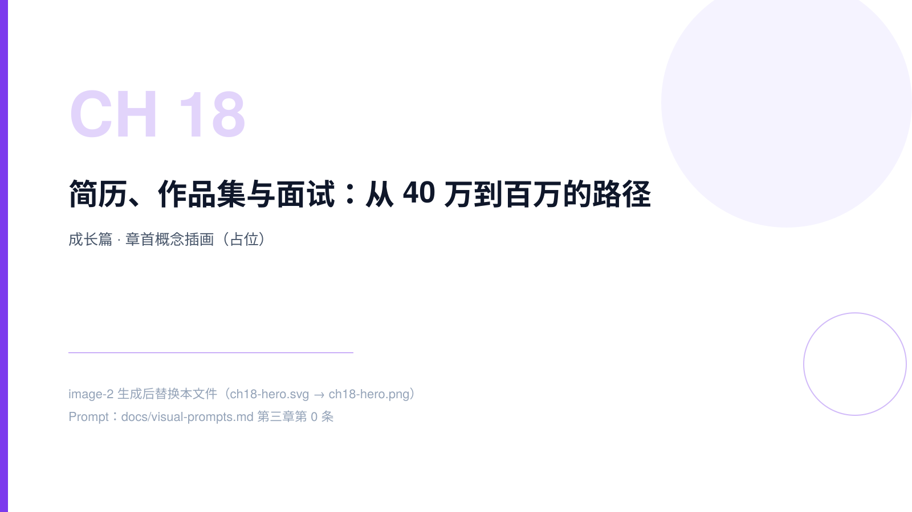
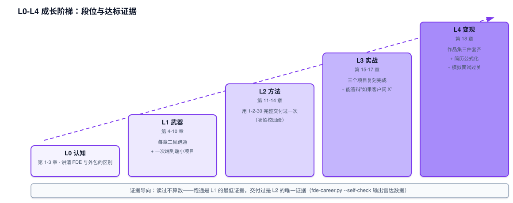

# 第 18 章 简历、作品集与面试：从 40 万到百万的路径

> **本章导读**：最后一章，把能力翻译成职业机会。三个实战项目你已经全部打过一遍——现在的问题是：怎么让市场知道？本章覆盖简历公式、作品集三件套（本仓库就是其中一件）、双向面试（公司面你 + 你面公司）、薪酬谈判，以及 L4 之后四条出路的地图。结尾是全书结业：FDE 的自我修养。所有数据沿用第 3 章的口径纪律——每个数字带出处。



*（image-2 插画生成后替换：按 `docs/visual-prompts.md` §3 第 18 条 Prompt 生成 `assets/ch18-hero.png`，并把本引用扩展名改为 .png）*

---

## 18.1 FDE 人才市场全景（2026 口径）

### 18.1.1 薪酬数据速览

先复习第 3 章立过的数字（口径不变，出处随行）：

- **国内**：猎聘 2026-09 专项报告——FDE 平均年薪 40.8 万元；成熟 FDE 普遍 60-120 万元；供需比 0.28（四个岗位抢一个人）；
- **公开 JD 量级**：字节 3.5-7 万 × 15 薪；蚂蚁 4-6 万 × 15 薪；智谱 6-8 万/月；腾讯 WorkBuddy 5-8 万/月；阿里云 2-5 万 × 16 薪；
- **海外**：Perspective AI 2026 调查（1500 名 FDE）——前沿实验室资深 FDE 总薪酬中位 48.5 万美元；Anthropic FDE JD 20-30 万美元 + 25% 差旅。

两个必须配平的数字：岗位增长 42 倍的另一面，是媒体冷静的提醒——**只有约 20% 挂着 FDE 头衔的人实际能力与岗位定位匹配**（招聘从业者口径）。这个数字对求职者的含义是双面的：市场上真懂 FDE 的人稀缺（好消息），但头衔通胀严重（坏消息是筛选环境嘈杂）。本章的任务就是让你成为那 20%，并且**自带可验证的证据**。

### 18.1.2 岗位地图：你该投哪一类

第 3 章 3.6 的全球岗位族谱在求职期的用法——按"能力半径"匹配投递优先级：

| 岗位类型 | 能力要求侧重 | 典型适合者 |
|---|---|---|
| 模型厂商 FDE（OpenAI/Anthropic 系） | 工程深度 + 英文 + 大客户场景 | 有大厂工程背景的转型者 |
| 国内大厂 FDE（字节/腾讯/智谱系） | 工程能力 + 中文场景理解 | 本书读者的主战场 |
| 行业解决方案商（阿里云生态/商汤系） | 行业纵深 + 方法论输出 | 有行业背景的转型者 |
| 企业内建 FDE（第 14 章"三路人马"第三路） | 业务理解 + 全栈落地 | 在现有公司内转岗者 |
| 独立 FDE（高风险高自由） | 交付战绩 + 获客能力 | 有客户资源的资深者 |

投递策略不是海投，是**按作品集的匹配度分层投**（18.3 的三件套恰好对应上表前三类）。

### 18.1.3 市场信号雷达：持续跟踪这个赛道

一次性的市场调研会过期——求职是周期性行为，值得建一套低成本雷达（每周 15 分钟）：

- **岗位量与结构**：招聘平台搜 "FDE/前沿部署"，每月固定日记录岗位数与 JD 关键词变化——第 2 章四标准的变化趋势（比如"评估"出现在多少份 JD 里）比任何行业报告都实时；
- **大厂动向**：模型厂商博客与招聘页（本章参考资料的官方源）——新设部门、新认证体系、新交付形态都从这里首发；
- **叙事温度计**：垂直媒体与社区（第 3 章报告过的那些源）的标题风向——标题从"什么是 FDE"变成"FDE 避坑指南"时，说明赛道从早期走向成熟，你的策略要从"入场红利"切换到"硬战绩差异化"；
- **个人对标**：每季度翻一次目标公司同岗位人的公开履历（领英/个人页）——你在下个周期需要补什么，答案写在他们现在长什么样里。

雷达的产出不是收藏夹，是每季度的三行笔记：市场在变暖还是变冷？我的段位差在缩小还是拉大？下一步动作是什么？**职业策略不需要高频决策，需要的是低频校准。**

---

## 18.2 转型路径：你从哪来

### 18.2.1 三条主路

**技术转 FDE（本书多数读者的路径）**：工程底座已稳，补两课——业务判断（第 11 章的考古学，找机会跟一次真实的客户访谈，哪怕是旁听）与交付叙事（把你的技术工作翻译成业务结果，18.3 的公式就是训练工具）。优势：技术篇的武器你已经会大半；短板：对"人"的工作容易轻视——补课的方式不是读书，是**去现场**。

**业务转 FDE**：客户语言强、行业纵深深，短板是工程能力——这是**硬门槛**，绕不过去。但"硬门槛"不等于"高门槛"：第 4-10 章的技术篇就是为这条路径设计的（零基础起步、全部可运行验证）。一个现实的评估方式：跑通本仓库全部 examples（特别是 ch05 的 50 行 Agent 与 ch10 的评估框架），你就有了面试中"我亲手做过"的底气。

**应届生路线**：认证与实训项目（第 3 章 3.3.2 的工信部/人社部体系）解决的是"入场"，不是"胜任"——第 2 章的四条标准对证书免疫。应届生的正确姿势：把本书的项目全部跑一遍 + 在校内找一个真实的"客户"（某学院、某实验室、某社团——需要 AI 落地的任何组织）做一次完整的 1-2-30，你就同时拥有了作品集与面试故事。

### 18.2.2 L0-L4 能力自查

用五篇的能力清单给自己打分（`fde-career.py --self-check` 互动执行，输出雷达数据）：

| 段位 | 对应本册 | 达标证据 |
|---|---|---|
| L0 认知 | 第 1-3 章 | 能向非技术者讲清 FDE 与外包的区别 |
| L1 武器 | 第 4-10 章 | 每章工具跑通 + 一次端到端小项目 |
| L2 方法 | 第 11-14 章 | 用 1-2-30 完整交付过一次（哪怕校园级） |
| L3 实战 | 第 15-17 章 | 三个项目的复刻全部完成 + 能答辩"如果客户问 X" |
| L4 变现 | 本章 | 作品集三件套齐 + 简历公式化 + 模拟面试过关 |



*图 18-1 成长阶梯（源文件 `assets/diagrams/growth-ladder.drawio`）*

自查的纪律：**证据导向**——"读过"不算数，"跑通"是 L1 的最低证据，"交付过"是 L2 的唯一证据。诚实段位比高估段位值钱：L1 段位投 L4 岗位的简历会在第一轮被戳穿，L3 段位应聘时谈 L4 的薪酬反而有筹码。

---

## 18.3 简历与作品集

### 18.3.1 简历公式：业务结果 + 技术手段 + 现场证据

FDE 简历每一条经历都应该是这个结构（`fde-career.py --resume` 生成器）：

```
【业务结果】智能客服首解率 60%→90%，转人工率降 30%（100 条黄金集口径）
【技术手段】LangGraph 流程图 + RAG 混合检索 + 口语映射表 + 评估驱动迭代
【现场证据】驻场 3 个月；D1-D2 价值定义与 Demo；地图表由客户班长签认
```

三段的顺序就是重要度排序：FDE 面试官先看结果（你是谁），再看手段（你会什么），最后看证据（你是不是真的）。**没有第一段的条目是工程师简历，没有第三段的条目值得被怀疑。**

### 18.3.2 简历反模式十条

1. 罗列模型与框架名词（"熟悉 LangChain/Dify/Coze"）——名词不构成区分度，结果才构成；
2. "参与""协助""配合"开头——第 2 章反面信号的简历版：说清你**个人**做了什么；
3. 无指标的项目描述（"开发了智能问答系统"——多少用户？什么分数？）；
4. 指标无口径（"准确率 95%"——多少条题、谁打的分、什么口径？第 10 章的数字纪律）；
5. 把培训/课程项目写成工作经历——诚实标注"个人项目"，可复现性是你的辩护理由；
6. 技术段写成了架构图讲解——面试官要的是"你的判断"，不是组件清单；
7. 每条经历都是"独立完成"——FDE 是协作岗，写清结对与移交（17.4 的结对是加分项）；
8. 没有现场词汇（驻场/验收/移交/基线）——FDE 的语言指纹缺失会被 AI 工程师简历淹没；
9. 薪酬期望写"面议"以外的任何数字——留给谈判阶段（18.5）；
10. 与作品集零链接——2026 年的 FDE 简历必须带着可点击的证据。

### 18.3.3 作品集三件套

**第一件：一个端到端项目**（最重要）。要求：可运行（README 里三行命令跑起来）、有评估（黄金集 + 分数，不接受"demo 截图"）、有复盘（迭代记录或七问——展示思考深度）。**本仓库就是范本**：18 章 + 40+ 个可运行示例 + 三份完整迭代记录——你把它 fork 之后加进自己的项目与改造，它就从"书"变成了"你的作品集"。

**第二件：一份评估报告**。任何一次 AI 尝试的评估报告（哪怕是给学校社团做的问答机器人）：四段式结构 + 归因分布 + 修复计划——它证明你不只会做，**还会知道自己做得怎么样**。这一件把 80% 的竞争者甩在身后，因为大多数人的作品集只有"做了"没有"测了"。

**第三件：一篇复盘文章**。700-1500 字的一次真实交付复盘（公众号/知乎/博客皆可）——它证明三样东西：你有交付经验（或至少有深度实践）、你能写作与表达（FDE 的沟通能力证据）、你有公开输出的习惯（第 14 章 Docs as Code 的公众版）。

三件套的投放：简历附件链接 + GitHub 置顶仓库 + 面试时的"十五分钟自我展示"素材（18.4.2）。

### 18.3.4 作品集的维护成本：别让它变成死资产

三件套建成的那天就进入折旧周期——面试官点开一个两年没更新的仓库，印象分直接变负数。维护策略按成本从低到高排：**项目库**只需保证 README 可跑（每季度跑一次三行命令，坏了就修——半小时的事）；**评估报告**是一次性交付物，不需要更新，但要标注时间与口径（诚实披露"这是 2026 年的项目"比伪装新鲜安全）；**复盘文章**是唯一值得持续生产的——写作素材直接来自私有交付手册的更新（第 14 章 Docs as Code 的机制在此闭环：手册更新 → 每季度选一篇脱敏公发）。一个经验数字：维护三件套的合理成本不超过每月 4 小时——超过说明你把展示当成了主业；低于零（从不更新）说明作品集已经死亡，只是还没下葬。

---

## 18.4 面试：双向甄别

### 18.4.1 面试题型与备法

FDE 面试的三大题型（每类都要求现场证据）：

**场景题**（"客户要做 AI 客服，你怎么开始？"）——考的是方法论结构感：正确答案永远从目标公式与考古开始（第 11 章），而不是技术选型。备法：把三个实战项目的开场两周各讲 3 分钟版本，背熟"结果→手段→证据"的结构。

**系统设计题**（"30 天给这个客户上线，你的方案？"）——考的是排期与取舍：答案里必须有基线、黄金集、灰度、六项留下（第 13/14 章）。高频陷阱：面试官故意给"做不完"的范围——考的是你敢不敢缩范围（13.4.8 三板斧），缩范围时的表达本身就是考点。

**行为题**（"讲一次你搞砸的事"）——FDE 岗位的行为题不是送分题，是**职业性格检测**：没有翻车经历的人要么没做过事，要么不诚实。讲法照第 14 章七问的结构：痛→险→根因→带走的一条。注意收尾必须落在"带走的那一条后来怎么用的"——翻车故事的卖点不是事故，是学习曲线。

### 18.4.2 模拟面试：完整对话脚本

`fde-career.py --interview` 收录了完整的三轮对话脚本（场景/设计/行为），此处摘最关键的一段——**开场十五分钟自我展示**的正确展开（对照错误版本）：

```
❌ 错误开场（工程师版）：
"我熟悉 LangChain 和 Dify，用过 GPT-4 和 Claude，做过 RAG 系统……"
（面试官心里的批注：又一个名词型候选人。）

✅ 正确开场（FDE 版）：
"我先讲一个最近的项目：给一家制造商做运营报告自动化，交付
 结果是报告周期从 3 天压到 4 小时——这个数字有动作级时间账
 和历史对照评分背书。我在里面做对的一件事是 D1 就把权限矩
 阵和买单人签认了，这让 W3 的生产化没有返工；最惊险的一刻
 是集成层发现客户 CRM 审批要 4 周，我们用中间库策略绕开了……"
（面试官心里的批注：有结果、有口径、有现场词汇、有事故与救场——值得深聊。）
```

差异不在表达技巧，在**叙事结构**：前者罗列能力，后者展示判断——判断只能从真实交付里长出来，这也是全书要你跑三个项目的原因。

### 18.4.3 反向面试：你的七个必问

第 2 章 2.3 的七问是你在面试"你有什么想问的"环节的武器，此处补三个 L4 级的增补问题：

8. **"这个岗位的评估集在哪？"**——问对方"你们怎么知道自己做得好不好"：有评估体系的团队会兴奋地展示，没有的会含糊其辞——**评估成熟度就是团队成熟度**（第 10 章 10.1 的面试版）；
9. **"上一个从这里离职的 FDE 去了哪？"**——看团队是输出人才还是消耗人才（第 14 章反哺通道健康度的旁证）；
10. **"你们怎么计算交付侧的复利？"**——harness、模板、账本的现状（第 12/14 章）——这个问题会让好团队眼睛发光，让"外包换皮"的团队瞬间失语。

十个问题的总分用法同第 2 章：好答案 ≥7，值得认真考虑；≤5，无论 JD 多漂亮按外包岗重新估值。

---

### 18.4.4 面试后的复盘：把每次面试当一次评估运行

求职周期里最浪费的行为是不做面试复盘。把每次面试当评估运行（第 10 章方法论的平移）：**当天**记三样——哪个问题我答得不稳？面试官追问到了哪里？哪个反向提问让对方明显兴奋/失语？**每周**归因一次——是不熟（补课可解）还是不真（没做过，讲不出细节）？后者的唯一解法是回去做（段位自查的入口）。**求职季结束**后把全部复盘誊成个人版"面试黄金集"——下次求职季你手里就有针对性的训练集。三个周期后你会发现：答得稳的问题高度集中在真实战例周边——**面试的极限就是你交付经历的边界**，与全书主线完全同构。

---

## 18.5 薪酬谈判与 offer 选择

### 18.5.1 影响薪酬的四个变量

1. **结果案例**（最大变量）：一个"60→90"或"3 天→4 小时"的完整战例，价值超过任何技能清单——它直接对应对方的收入想象（第 2 章口袋试金石的镜像：你在给对方算你的收入贡献）；
2. **行业纵深**：在制造/金融/医疗某一行业的持续交付记录——行业知识是模型厂商 JD 里"懂 XX 行业"溢价的真实来源；
3. **英文与跨文化**：海外客户交付能力直接对标 48.5 万美元档位——本书读者的边际性价比最高的一项投资；
4. **主动性证据**：作品集、公开写作、开源贡献——它们让谈判断言从"我行"变成"我已经证明过"。

### 18.5.2 谈判的三条纪律

- **不先出价**：被问期望薪酬时的标准回应——"想先了解这个岗位的职责范围与考核方式，相信贵司有成熟的薪酬结构，我们可以基于匹配度再谈"（把话题引回能力证明，同时拒绝被低价锚定）；
- **谈判的是结构不是数字**：base/奖金/差旅补贴/学习预算/竞业条款——FDE 岗位的高频可谈项是**差旅补偿与远程政策**（25% 差旅是常态，条款差异巨大）；
- **书面确认一切**：口头承诺的"半年调薪"写进 offer——第 11 章风险登记册的个人版。

### 18.5.3 Offer 选择：三条路的风险收益

大厂 FDE（品牌与体系溢价，螺丝钉风险）；创业公司 FDE（期权与全链路经验，生存风险）；企业内建 FDE（最稳的转型入口，天花板早期可见）。第 3 章 3.5 独立 FDE 的冷思考在这里兑现为选择原则：**先在牌桌上赢够筹码，再考虑下牌桌**——三条路的共同前置是 L2/L3 的战绩，而战绩只能从"进场"里攒。

### 18.5.4 薪酬数据的自我校准：把报告变成个人坐标

本章开头的数据是行业平均——但你不在平均里，你在自己的坐标里。校准方法：用三份数据给自己的预期定价。**第一份：目标公司的公开 JD**（薪资区间是最真实的锚——它已经按该公司的四变量预期折算过）；**第二份：同城市同段位者的自述**（社区匿名贴的抽样中位数，比官方报告更接近你实际能谈到的位置）；**第三份：你自己的机会成本**——当前薪酬 + 涨幅预期 + 隐性福利（通勤/成长/稳定性）的折算总和，它是你的底线而不是你的开价。三份数据画出的区间里：JD 上限是你顺利况下的天花板，社区中位是你大概率落在的位置，机会成本是你的退出阀。谈判季开始前把这个三件套写下来——**谈判中最贵的行为是现场临时起意**，无论开价还是让步都是。

---

## 18.6 L4 之后：四条出路的地图

### 18.6.0 组合观：四条路不是单选题

先说清一个认知前提：四条出路在真实的职业轨迹里几乎从不单选——它们是**组合**：管理线的人需要技术线的资产才能服众（第 17 章小陈的内部 FDE 团队，靠的是技术线的模板资产）；创业线的起点是技术线攒的 harness（18.6.3 的验证方式）；独立线更是三者的全项要求。健康的心态是把它们看作同一份职业资产在不同市场的报价——你的 harness 在公司内是晋升材料（管理线）、在市场上是创业选项（创业线）、在行业内是个人品牌（技术线）。**先把资产做出来，路线自会在报价最高的地方浮现**——这与第 12 章"先做结果"同构。

### 18.6.1 技术线：行业本体设计师

深耕一个行业的 harness 与本体（第 14 章层三层的极致形态）——行业模板与 agent skills 的资产化，目标是成为"这个行业 AI 落地绕不开的人"。复利在 3-5 年后显现：资产每被使用一次都在为你工作（第 14 章台账的曲线拐点）。

### 18.6.2 管理线：FDE 团队负责人

带团队交付并输出方法论——考核指标从个人战果变成**团队的健康曲线**（FDE 人均产出、启动耗时、收敛率）。本书第 13/14 章在管理线是字面意义的操作手册。关键转身：你的产出不再是项目，是**能交付项目的人**。

### 18.6.3 创业线：从交付洞察到 SaaS

Services-Led Growth 的个人终局：交付中发现的通用痛点 → 做成产品（第 12 章原则二的商业化）。判断时机：当你的某个 harness 组件在 3+ 客户处复用且客户愿意为"不用你也在"付费——那是产品的第一声啼哭。注意第 3 章的警示仍然有效：**从交付到 SaaS 的死亡率极高**——用最小代价验证（MVP 由现 harness 改造，而不是从零开发）。

### 18.6.4 独立线：超级个体 FDE

纯靠手艺与口碑的独立执业——第 3 章讲过它的三个结构性困境（信任/纵深/获客）。破局路径恰是本章的三件套 + 认证生态（厂商认证 FDE 是独立者的获客通道）：作品集解决信任、行业纵深解决交付、厂商生态解决获客。这条路成立的前提是**先有 50 人团队打不过你的细分领域**——它不是起点，是终点。

### 18.6.5 转换时机：什么时候该换环境

四条路都涉及"何时离开当前位置"的问题，三个通用信号（每个都以本书的机制做检查器）：**学习信号**——连续两个项目的复盘七问高度雷同（第 14 章的教训不再更新），说明现场已没有新痛苦可消化；**复利信号**——反哺通道连续三个提案周期无响应（第 14 章 14.3.4 的第三层触底），你的资产在这家组织里停止记账；**市场信号**——雷达（18.1.3）连续两个季度显示你的技能组合在市场上的报价显著高于当前位置的估值。三个信号同时亮时是清晰的退场时机；只亮一个时先做内部转换（换业务线/换客户群/申内部 FDE——第 17 章小陈就是内部转换的样本），而不是直接跳船——**外部跳槽应该是内部选项穷尽后的选择**，这个顺序能让你每次谈判都带着"我试过留下"的从容。

### 18.6.6 结业：FDE 的自我修养

全书最后一段话，回到第 1 章：

> 模型在变、框架在变、协议在变、岗位名都可能变——不变的是那三件事：**找到痛的最深处、消化它、把它变成可复制的东西。**"每隔几个月让自己失业一次，才算好好干活"——这不是牺牲的宣言，是自由的方法：每自动化掉一部分自己，你的双手就腾出来去够更高的地方。

从第 1 章的部署鸿沟到这里：你已经拥有判断（认知篇）、武器（技术篇）、节奏与方法（方法论篇）、战例（实战篇）和把它们翻译成市场的语言（本章）。剩下的路不在书里，在下一个客户现场。**去把桥架起来。**

---

## 18.7 本章知识点卡

| 概念 | 一句话解释 | 关键词 |
|---|---|---|
| 20% 匹配 | 头衔通胀下的稀缺：真懂的人自带可验证证据 | 嘈杂筛选环境 |
| 三件套 | 端到端项目 + 评估报告 + 复盘文章 | 本仓库即第一件 |
| 简历公式 | 业务结果 + 技术手段 + 现场证据——顺序即权重 | 叙事结构 |
| 名词不构成区分度 | 熟悉 XX 框架不如一个带口径的结果 | 结果优先 |
| 十五分钟开场 | 展示判断而非罗列能力——判断只能从交付里长 | 对话脚本 |
| 反向十问 | 第 2 章七问 + 评估集/离职去向/复利计算 | 团队成熟度 |
| 四个薪酬变量 | 结果案例/行业纵深/英文/主动性证据 | 收入想象 |
| 谈三条纪律 | 不先出价/谈结构/书面确认 | 锚定 |
| 四条出路 | 技术线/管理线/创业线/独立线——独立是终点非起点 | L4 之后 |
| 让自己失业 | 每自动化一部分自己，双手腾给更高的地方 | 全书终章 |
| 市场雷达 | 每周 15 分钟，每季度三行校准笔记 | 低频校准 |
| 三转换信号 | 学习/复利/市场——全亮则走，单亮先内部转换 | 留下的从容 |

---

## 代码实战：fde-career.py 职业工具箱

- **`--self-check`**：L0-L4 段位自查（证据导向：跑通/交付/变现三档证据逐项确认，输出段位雷达数据与补课清单）；
- **`--resume`**：简历公式生成器——互动输入一条经历，按"业务结果/技术手段/现场证据"三段生成条目，附十条反模式自查；
- **`--interview`**：模拟面试问答（三题型 + 十五分钟开场的对照脚本 + 反向十问记分）；
- **`--path`**：L4 四条出路的互动评估（输入你的现状证据，输出各路的准备度与缺口）。

```
cd examples/ch18
python fde-career.py --self-check     # 段位自查
python fde-career.py --resume        # 简历条目生成
python fde-career.py --interview      # 模拟面试
python fde-career.py --path          # L4 出路评估
```

---

## 章末习题

1. **简历改造**：把你现有的一条项目经历用 `--resume` 重写为公式条目（三段结构），请一位不知道你项目背景的朋友读 30 秒——能复述出"业务结果"则通过。通不过的常见原因：把技术手段写在第一段。
2. **三件套启动**：从本仓库的三个实战项目中挑一个，跑通并写一份 700 字复盘（包含至少一次翻车与你的修复过程），发布到任何公开平台——这就是你作品集的第二、三件。发布后把链接放进简历第一页。
3. **模拟面试实操**：用 `--interview` 的三题型自测（录音），然后请朋友扮演面试官做一轮真实 mock，重点练行为题的"翻车故事"——直到收尾自然落在"带走的那一条后来怎么用"。最后把反向十问实际用在你的下一次面试里，记录对方对"评估集在哪"这个问题的反应——你会在当场感受到好团队与普通团队的温差。

---

## 参考资料

- 猎聘 2026-09 FDE 人才专项报告（40.8 万均值、供需比 0.28——媒体公开口径）
- Perspective AI 2026 FDE 薪酬调查（48.5 万美元中位、1500 人样本口径）
- 第 2 章（真 FDE 四标准与七问——本章反向面试的母版）
- 第 3 章（42 倍、独立 FDE 冷思考、三路人马——本章市场地图的数据底座）
- 第 10 章 10.5.1（分数与变更一起提交——作品集"评估报告件"的日常来源）
- 第 14 章（私有交付手册与作品集三件套的关系；Docs as Code 的公众版）
- 第 17 章 17.4.2（内部 FDE——第 18.2 转型路径的组织内版本）
- 知乎《WorkBuddy都开始招FDE了！程序员转型指南》：https://zhuanlan.zhihu.com/p/2075345316648428850
- 知乎《FDE 的未来——2026–2030 全景研判》（L4 出路的趋势数据参照）
- 百度百家号《技术和业务转FDE，到底哪条路更容易？》

---

> **全书结语**：十八章至此终。认知篇给了你坐标系，技术篇给了你武器，方法论篇给了你节奏与复利，实战篇给了你三个可以讲述的战场，本章给了你把这一切兑换成职业的语法。读者诸君——**去现场，消化痛苦，排出产品。**
